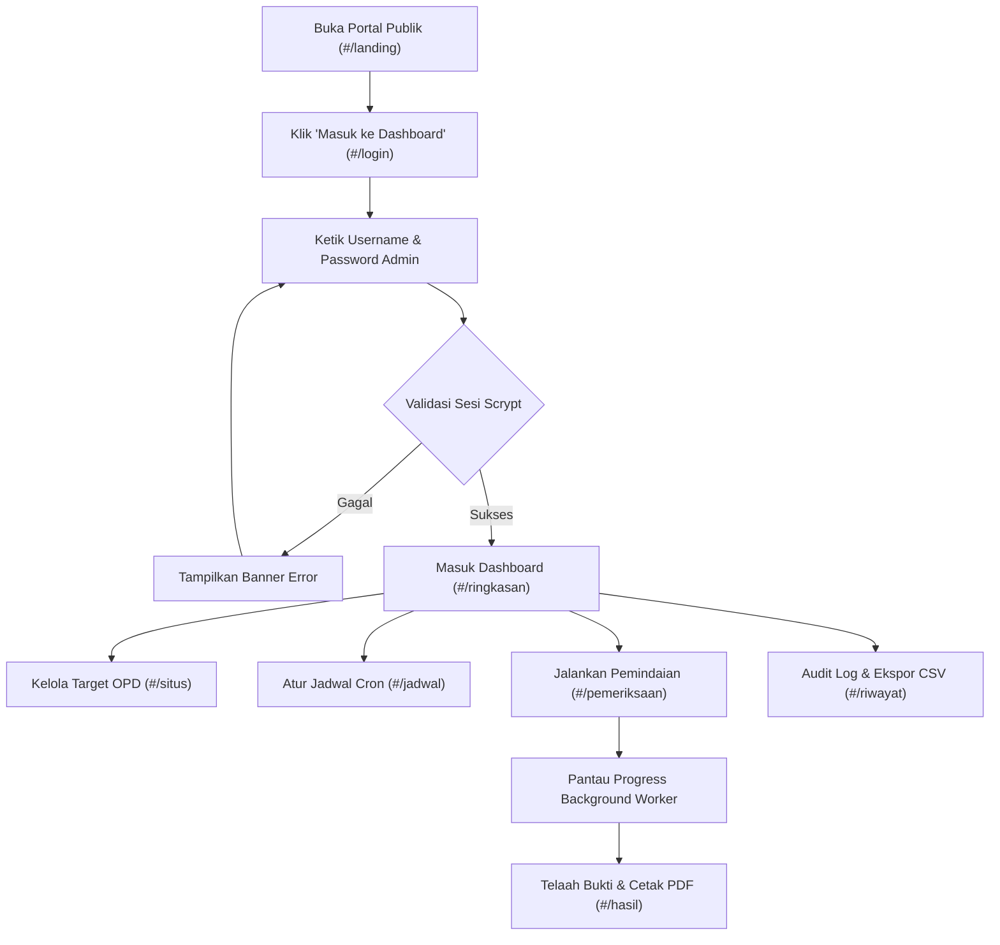

# Audit UI — Sistem Pemantauan Konten Negatif (Pemkab Sumbawa)

> **Dokumen Audit UI/UX & Analisis Front-End**  
> **Status:** READ-ONLY Audit Selesai  
> **Target Sistem:** Sistem Pemantauan dan Deteksi Indikasi Konten Negatif pada Situs Web Pemerintah Kabupaten Sumbawa Berbasis Arsitektur Microservices  
> **Tanggal Audit:** 9 November 2026  
> **Auditor:** UI/UX Auditor & Front-End Analyst Senior  

---

## 0. Ringkasan Eksekutif

Berdasarkan audit mendalam terhadap seluruh lapisan antarmuka pengguna (*front-end layer*) pada direktori `dashboard/` beserta aset visual, komponen visualisasi, generator laporan PDF, dan template notifikasi surel (*email template*), ditemukan bahwa aplikasi telah memiliki fungsi integrasi deteksi siber yang berjalan end-to-end. Namun, antarmuka pengguna saat ini memperlihatkan karakteristik visual yang sangat kental dengan pola *"AI-generated template / generic boilerplate"*, tidak memiliki hierarki visual khas instansi pemerintah, serta memuat inkonsistensi token desain yang parah.

Berikut adalah **10 poin teratas** yang paling membuat UI terasa *"AI-generated"* atau tidak profesional, diurutkan dari yang paling berdampak:

1. **Ilustrasi Konsol Siber Palsu ("SOC Console Mockup") pada Hero Landing Page (`dashboard/src/LandingPage.jsx:144-224`)**  
   Menampilkan mockup terminal konsol siber bergaya *sci-fi* dengan lampu status "tiga titik jendela macOS" (`soc-dot-red`, `soc-dot-yellow`, `soc-dot-green`), badge berdenyut neon `LIVE`, dan data umpan fiktif (`AHO-CORASICK`, `DEFACEMENT SHIELD`, `HTTP 200 OK`). Konsol ini bersifat statis/dekoratif dan tidak terhubung dengan operasional riil CSIRT, memberikan kesan template SaaS keamanan komersial yang dibuat oleh AI prompt.
2. **Monolitik Styling Ekstrem & Penumpukan Kelas Redundan (`dashboard/src/styles.css`, 6.800 baris)**  
   File stylesheet tunggal berukuran 6.800 baris kode menunjukkan tanda-tanda penumpukan kode AI secara berulang (*append-only code generation*). Terdapat bagian komentar penambalan seperti `/* HISTORY (missing classes) */` (baris 4204), `/* RESULTS (missing classes) */` (baris 4314), dan `/* MISSING CLASSES (remaining) */` (baris 4858). Hal ini membuktikan bahwa stylesheet tidak dirancang dengan arsitektur CSS yang bersih (BEM / modular), melainkan ditambal terus-menerus setiap kali ada elemen yang rusak.
3. **Ledakan Palet Warna Liar Tanpa Kontrol Token (163 Warna Unik / Hex & RGBA)**  
   Meskipun `:root` mendefinisikan 55 CSS variables (baris 7-101), kode aktual di `styles.css`, `App.jsx`, `Visualizations.jsx`, dan `reportExporter.js` menggunakan **163 nilai warna unik**. Warna-warna tersebut merupakan campuran acak dari Tailwind Slate (`#64748b` muncul 28 kali, `#94a3b8` muncul 27 kali), Tailwind Gray (`#111827`, `#1f2937`, `#374151`), Indigo/Blue (`#2563eb` muncul 24 kali), dan puluhan nilai `rgba(...)` dengan tingkat transparansi berbeda-beda.
4. **Efek Cahaya Neon, Radial Gradient Glow, dan Glassmorphism Berlebihan**  
   Terdapat lingkaran glow radial berukuran raksasa (`width: 560px; height: 560px` pada `styles.css:6364-6373`) dengan warna cyan-blue neon di latar belakang halaman login (`split-login-bg-glow` pada `App.jsx:731`) serta hero landing page (`landing-hero-bg-glow` pada `LandingPage.jsx:97` dan `landing-cta-glow` pada `LandingPage.jsx:387`). Efek ini membuat portal instansi pemerintah daerah tampak seperti situs promosi Web3 / startup AI komersial.
5. **Wabah "Pill / Capsule Badge" Berwarna-Warni di Seluruh Bagian UI**  
   Pill badges dengan rounded penuh (`border-radius: 999px`) dipakai di hampir setiap sudut antarmuka: `landing-hero-pill`, `split-login-pill`, 5 buah `landing-feature-pill` di setiap kartu fitur, status tags, hingga filter tabel. Terlalu banyaknya elemen berbentuk kapsul menyebabkan kelelahan visual (*visual fatigue*) dan mengaburkan pemilahan prioritas tingkat keparahan (*severity*).
6. **Layout Dashboard Klise / Generik SaaS Boilerplate (`dashboard/src/App.jsx:1875-2360`)**  
   Struktur tata letak dashboard mengikuti pola klasik template admin generator: Sidebar kiri gelap 260px (`--navy-900`) + Topbar putih 64px dengan ikon lonceng + 4 kartu metrik (*stat cards*) horizontal + 2 grafik visualisasi bersebelahan (Bar Chart & Donut Chart) + 1 tabel data besar di bawahnya. Layout ini tidak mencerminkan alur kerja operasional analis CSIRT dalam menangani insiden situs web secara taktis.
7. **Monolitik Komponen Klien Tanpa Abstraksi Reusable (`dashboard/src/App.jsx`, 3.743 baris)**  
   Komponen `App.jsx` membengkak hingga 3.743 baris karena menggabungkan logika autentikasi, manajemen rute hash, status polling worker, modal dialog, formulir input pemindaian, tabel hasil, kartu detektor, menu notifikasi dropdown, dan layout shell dalam satu berkas raksasa. Tidak ada folder `src/components/` untuk komponen atomik (Button, Input, Badge, Table, Modal).
8. **Ketiadaan Aset Identitas Resmi Pemerintah Kabupaten Sumbawa**  
   Tidak ditemukan satu pun file logo resmi Pemkab Sumbawa (Lambang Daerah *Sabalong Samalewa*) maupun logo resmi Dinas Kominfotiksandi / Sumbawa CSIRT dalam format gambar (PNG/SVG/WebP). Seluruh identitas grafis hanya mengandalkan ikon generik dari paket `lucide-react` berupa `ShieldCheck`, `Globe2`, dan `Activity` berbingkai biru/navy.
9. **Copywriting Klise, Menggurui, dan Terlalu Berorientasi Promosi (`LandingPage.jsx`)**  
   Gaya bahasa pada landing page dan login menggunakan kalimat klise generator AI seperti *"Monitoring dan Deteksi Indikasi Konten Negatif"*, *"Teknologi microservices modular yang dirancang untuk menjaga integritas, keamanan, dan reputasi portal publik..."*, *"Pencocokan multi-pola teks berkecepatan tinggi..."*. Teks ini terdengar seperti brosur pemasaran perangkat lunak, bukan portal operasional pemantauan kepatuhan website dinas/instansi daerah.
10. **Aksesibilitas Tipografi Rendah & Target Sentuh Tidak Standar (WCAG AA Failures)**  
    Penggunaan teks abu-abu terang `#94a3b8` (Slate-400) di atas latar belakang putih `#ffffff` (rasio kontras hanya ~2.3:1, jauh di bawah standar minimum WCAG 2.1 AA sebesar 4.5:1 untuk teks normal). Selain itu, elemen interaktif seperti legenda grafik donat (`Visualizations.jsx:359-376`) dan segmen lingkaran SVG menggunakan tag non-semantik `<li>` dan `<circle>` berkursor pointer tanpa dukungan aksesibilitas keyboard (`tabIndex`, `role="button"`, `aria-label`).

---

## 1. Peta Project Frontend

### 1.1 Lokasi Folder & Pohon Direktori Frontend
Aplikasi antarmuka pengguna berada sepenuhnya pada direktori `dashboard/` di dalam ruang kerja project `D:\content detection`.

Pohon direktori frontend ringkas:
```text
dashboard/
├── .env.example                       # Konfigurasi basis URL API backend (VITE_API_BASE_URL)
├── index.html                         # Entry HTML shell, Google Fonts preconnect, inline SVG favicon
├── package.json                       # Konfigurasi dependensi npm dan skrip build Vite
├── package-lock.json                  # Lockfile versi pustaka exact
├── vite.config.js                     # Konfigurasi build Vite, port server 5173, dan test Vitest
├── dist/                              # Berkas build produksi (assets bundled JS/CSS/Fonts)
└── src/                               # Kode sumber antarmuka pengguna
    ├── main.jsx                       # Entry point React 18 createRoot & impor font
    ├── styles.css                     # Stylesheet global tunggal (6.800 baris)
    ├── App.jsx                        # Komponen utama, router hash, layout shell dashboard (3.743 baris)
    ├── App.old.jsx                    # Berkas cadangan implementasi lama (1.786 baris, legacy)
    ├── App.test.jsx                   # Pengujian antarmuka dengan Testing Library & Vitest (1.167 baris)
    ├── LandingPage.jsx                # Komponen halaman beranda publik (464 baris)
    ├── SiteManagement.jsx             # Modul manajemen target situs web OPD & baseline (633 baris)
    ├── ScheduleManagement.jsx         # Modul manajemen jadwal pemindaian berkala (689 baris)
    ├── Visualizations.jsx             # Visualisasi diagram SVG: BarChart & DonutChart (396 baris)
    ├── reportExporter.js              # Utilitas ekspor dokumen PDF resmi CSIRT & data CSV (622 baris)
    ├── formatters.js                  # Helper pemformatan tanggal/waktu lokal Indonesia (9 baris)
    ├── api.js                         # Klien komunikasi HTTP Fetch ke Aggregator Service (286 baris)
    └── test-setup.js                  # Inisialisasi testing environment (jest-dom)
```

### 1.2 Cara Menjalankan & Hasil Verifikasi Percobaan
Berdasarkan dokumentasi `README.md`, `package.json`, dan skrip otomatisasi `scripts/dev-all.ps1`:
- **Frontend SPA**: Dijalankan menggunakan Vite dengan perintah `npm run dev` atau `npx vite --port 5173 --host 0.0.0.0` dari dalam folder `dashboard/`.
- **Backend Pendukung**: Memerlukan `aggregator-service` aktif pada port 3004 (`node --env-file-if-exists=.env src/server.js`), serta tiga microservice detektor pada port 3000 (Text Detection), port 3001 (Crawler), port 3002 (Defacement), dan port 3003 (Link Detection).
- **Hasil Percobaan Menjalankan**:
  Percobaan status layanan via `powershell -File scripts/dev-all.ps1 -Action Status` mengonfirmasi bahwa **seluruh 7 layanan pendukung berstatus `HEALTHY` dan sedang berjalan aktif di sistem lokal**:
  - `text-detection-service`: Port 3000 (`HEALTHY`)
  - `crawler-service`: Port 3001 (`HEALTHY`)
  - `defacement-service`: Port 3002 (`HEALTHY`)
  - `link-detection-service`: Port 3003 (`HEALTHY`)
  - `aggregator-service`: Port 3004 (`HEALTHY`)
  - `local-test-site`: Port 8080 (`HEALTHY`)
  - `dashboard`: Port 5173 (`HEALTHY`)

Frontend dapat dibuka dan dirender secara sempurna melalui peramban web pada alamat `http://localhost:5173/`.

---

## 2. Tech Stack UI

| Kategori | Library / Paket & Versi | Digunakan Untuk | Catatan & Analisis |
| :--- | :--- | :--- | :--- |
| **Core Framework** | `react` `^18.3.1`<br>`react-dom` `^18.3.1` | Fondasi rendering antarmuka SPA berbasis komponen dan hooks | Menggunakan React 18 functional component dengan `useState`, `useEffect`, `useMemo`, `useRef`. Tidak memakai Context API. |
| **Build & Dev Tool** | `vite` `latest` (5.x)<br>`@vitejs/plugin-react` | Bundler modul berkecepatan tinggi, HMR (*Hot Module Replacement*), server dev lokal | Konfigurasi port `5173` dengan `strictPort: true` (`vite.config.js:8`). |
| **CSS Framework** | **Tidak Ada** (Pure Custom CSS) | Seluruh penataan gaya visual antarmuka | Dokumen audit lama menyebut Tailwind, namun verifikasi terhadap `package.json` membuktikan Tailwind **TIDAK TERPASANG**. Seluruh styling ditulis manual di `styles.css` (6.800 baris) dengan meniru nama kelas Tailwind secara acak. |
| **Tipografi & Font** | `@fontsource/ibm-plex-sans` `^5.3.0`<br>`@fontsource/ibm-plex-mono` `^5.3.0` | Font antarmuka (Sans) dan kode/data metrik/URL/terminal (Mono) | Diimpor lokal di `main.jsx:1-4` dan juga di-load ganda dari Google Fonts CDN di `index.html:10`. Bobot diimpor: 400, 500, 600, 700. |
| **Ikonografi** | `lucide-react` `^0.468.0` | Seluruh simbol visual grafis, navigasi, dan tombol aksi | Terpasang lebih dari 30 varian ikon SVG (Shield, Globe, Activity, FileSearch, Trash2, Edit2, dsb.). |
| **Visualisasi / Chart** | **Custom Inline SVG** (Native React) | Diagram batang 7 hari (*Bar Chart*) dan diagram donat distribusi kategori (*Donut Chart*) | Tidak menggunakan library eksternal (seperti Chart.js atau Recharts), melainkan kalkulasi geometri SVG langsung di `Visualizations.jsx`. |
| **Generator Laporan** | `jspdf` `^4.2.1`<br>`jspdf-autotable` `^5.0.9` | Pembuatan laporan PDF resmi CSIRT multi-halaman siap unduh | Membangun kop instansi, tabel dinamis, nomor halaman otomatis, dan tanda tangan analis langsung pada sisi klien di `reportExporter.js`. |
| **Testing UI** | `vitest` `latest`<br>`@testing-library/react` `^16.1.0`<br>`@testing-library/jest-dom` `^6.6.3`<br>`jsdom` `^25.0.1` | Pengujian unit dan integrasi komponen antarmuka pengguna | Dijalankan melalui `npm test` di folder `dashboard/`. |
| **HTTP & State** | Native `fetch` API (`api.js`) | Komunikasi asinkronus ke Aggregator REST API | Pengiriman kredensial sesi menggunakan opsi `credentials: "include"`. State aplikasi disimpan murni pada tingkat komponen React (`useState`), tanpa Redux atau Zustand. |

---

## 3. Inventaris Rute & Halaman

Sistem frontend mengimplementasikan perutean berbasis fragmen hash URL peramban (*Hash-based Routing*) yang dievaluasi secara reaktif melalui event listener `window.addEventListener("hashchange", ...)` pada `dashboard/src/App.jsx:3634-3637`.

| No | Path / Hash | Komponen Berkas | Aktor yang Boleh Akses | Dilindungi Login | Tujuan Halaman & Deskripsi |
| :---: | :--- | :--- | :--- | :---: | :--- |
| **1** | `#/` / `#/landing`<br>`#/beranda` | `LandingPage.jsx`<br>(baris 1–464) | Publik, Pengelola OPD, Petugas, Admin | **TIDAK** | **Portal Publik Pemantauan Siber:** Menyajikan ringkasan kapabilitas deteksi, total target situs aktif, konsol monitor SOC, 5 pilar fitur, alur kerja pemeriksaan, dan gerbang masuk ke dashboard. |
| **2** | `#/fitur` | `LandingPage.jsx`<br>(baris 229–311) | Publik, Pengelola OPD, Petugas, Admin | **TIDAK** | **Seksi Fitur Utama:** Anchor link pada landing page menuju 5 kartu fitur deteksi (Crawling, Aho-Corasick, Tautan, Defacement, Laporan). |
| **3** | `#/alur-kerja` | `LandingPage.jsx`<br>(baris 313–381) | Publik, Pengelola OPD, Petugas, Admin | **TIDAK** | **Seksi Alur Kerja:** Anchor link pada landing page menuju 4 tahapan metodologi pemeriksaan (Crawling &rarr; Deteksi &rarr; Hasil &rarr; Laporan). |
| **4** | `#/tentang` | `LandingPage.jsx`<br>(baris 383–415) | Publik, Pengelola OPD, Petugas, Admin | **TIDAK** | **Seksi Tentang & Trust Banner:** Menampilkan kartu deskripsi operasional CSIRT Diskominfotiksandi Kabupaten Sumbawa beserta tombol akses admin. |
| **5** | `#/login` | `App.jsx` (`LoginPage`)<br>(baris 710–958) | Admin, Petugas CSIRT | **TIDAK** | **Gerbang Autentikasi Pengguna:** Formulir login dua panel (*split-screen*) untuk verifikasi nama pengguna dan kata sandi dengan autentikasi `scrypt` dan proteksi sesi cookie `HttpOnly`. |
| **6** | `#/ringkasan` | `App.jsx` (`Dashboard`)<br>(baris 1993–2180) | Admin CSIRT | **YA** | **Ringkasan Eksekutif Pemantauan:** Menampilkan 4 kartu statistik utama (Situs, Scan, Berindikasi, Bebas), grafik BarChart aktivitas 7 hari, grafik DonutChart sebaran kategori, dan tabel log 5 aktivitas pemindaian terkini. |
| **7** | `#/situs` | `SiteManagement.jsx`<br>(baris 1–633) | Admin CSIRT | **YA** | **Manajemen Situs OPD Sasaran:** Tabel master daftar situs web OPD Pemkab Sumbawa, pencarian nama/URL, filter status aktif/nonaktif, aksi tambah situs baru, edit parameter perayapan, dan hapus situs. |
| **8** | Sub-Modal `SiteModal` | `SiteManagement.jsx`<br>(baris 28–275) | Admin CSIRT | **YA** | **Modal Konfigurasi OPD & Baseline:** Dialog formulir untuk mengisi nama instansi, URL target, kedalaman (*depth*), batas halaman (*pages*), status keaktifan, dan input baseline HTML awal. |
| **9** | `#/jadwal` | `ScheduleManagement.jsx`<br>(baris 1–689) | Admin CSIRT | **YA** | **Manajemen Penjadwalan Pemindaian:** Tabel jadwal pemindaian otomatis berbasis ekspresi cron (Harian, Mingguan, Bulanan), status jadwal, tombol eksekusi instan (*Run Now*), tambah, edit, dan hapus jadwal. |
| **10** | Sub-Modal `ScheduleModal`| `ScheduleManagement.jsx`<br>(baris 29–357) | Admin CSIRT | **YA** | **Modal Konfigurasi Jadwal:** Dialog pemilihan frekuensi waktu (preset harian/mingguan/bulanan atau custom cron), input email notifikasi petugas, dan pemilihan target checklist multi-situs. |
| **11** | `#/pemeriksaan` | `App.jsx` (`Dashboard`)<br>(baris 2182–2240) | Admin, Petugas CSIRT | **YA** | **Workbench Pemindaian Web Mandiri:** Formulir inisiasi pemindaian seketika. Mendukung mode tunggal (*Single URL*) atau mode borongan (*Batch Active Sites*), parameter limit perayapan, email notifikasi petugas, serta pemantauan progress background job secara real-time. |
| **12** | `#/hasil` | `App.jsx` (`Dashboard`)<br>(baris 2242–2280) | Admin, Petugas CSIRT | **YA** | **Pusat Hasil & Drill-Down Inspeksi:** Menampilkan hasil inspeksi komprehensif dari scan terakhir atau sesi terpilih, kartu status 3 detektor, filter kategori temuan, cuplikan teks temuan, serta tombol ekspor PDF & CSV. |
| **13** | `#/riwayat` | `App.jsx` (`Dashboard`)<br>(baris 2282–2355) | Admin CSIRT | **YA** | **Log Historis Pemindaian:** Tabel audit trail riwayat seluruh pemindaian dari database SQLite, filter sumber (Semua, Manual, Terjadwal), pencarian kata kunci, aksi lihat detail inspeksi, kirim ulang email notifikasi, ekspor rekap CSV, dan hapus catatan riwayat. |
| **14** | Sub-View `historyDetail` | `App.jsx` (`Dashboard`)<br>(baris 2362–2500) | Admin, Petugas CSIRT | **YA** | **Detail Audit Riwayat Sesi:** Tampilan periksa mendalam untuk satu ID pemindaian spesifik, mencakup metadata respons HTTP, status konfirmasi transmisi surel SMTP (Message-ID), dan daftar seluruh URL halaman yang terayap. |
| **15** | Menu `NotificationMenu` | `App.jsx`<br>(baris 960–1071) | Admin, Petugas CSIRT | **YA** | **Pusat Log Notifikasi Topbar:** Dropdown interaktif pada ikon lonceng navigasi atas, menampilkan jumlah notifikasi belum dibaca (*unread counter*), daftar insiden baru per situs, status transmisi SMTP, tombol tandai dibaca, dan link loncat ke detail temuan. |

> [!NOTE]
> **Status Fitur yang Disebutkan dalam Konteks Awal Namun Tidak Ditemukan:**
> - **CRUD Akun Pengguna / Data Petugas:** `TIDAK DITEMUKAN`. Autentikasi aplikasi berdasar pada akun Admin tunggal via kredensial di environment variable (`ADMIN_USERNAME` dan `ADMIN_PASSWORD_HASH`). Tidak ada tabel `users`/`officers` di SQLite (`packages/data-access/src/db/schema.js:1-70`).
> - **Kelola Kategori Deteksi:** `TIDAK DITEMUKAN` di UI. Kategori (`gambling`, `fraud`, `pornography`) dan pola regex/Aho-Corasick dikonfigurasi statis di file backend `services/text-detection-service/src/config/patterns.js`.
> - **Form Pengaduan Masyarakat & Riwayat Pengaduan:** `TIDAK DITEMUKAN`. Tidak tersedia rute publik, form input aduan masyarakat, maupun tabel database terkait pengaduan publik.

---

## 4. Design Tokens Saat Ini

### 4.1 Warna

Berdasarkan analisis pemindaian AST dan ekstraksi ekspresi reguler pada seluruh berkas frontend (`styles.css`, `App.jsx`, `LandingPage.jsx`, `SiteManagement.jsx`, `ScheduleManagement.jsx`, `Visualizations.jsx`, `reportExporter.js`, dan `index.html`), tercatat sebanyak **163 nilai warna unik** (kombinasi format HEX dan RGBA).

Tabel berikut merangkum warna utama berdasarkan peran desain, nilai warna, lokasi pemakaian, dan status deklarasinya:

| Peran Desain | Nilai Warna | Lokasi Pemakaian Representatif | Status Token vs Hardcode |
| :--- | :--- | :--- | :--- |
| **Primary Brand Navy** | `#070d1e` | `styles.css:9`, `LandingPage.jsx:53`, `App.jsx:727` | Didefinisikan sebagai `--navy-950`, namun sering di-hardcode langsung di background shell |
| **Brand Deep Navy** | `#0a1628` | `styles.css:10`, `index.html:6` (meta theme-color), `styles.css:190` | Token `--navy-900`; dipakai sebagai latar belakang sidebar dan hero |
| **Brand Surface Navy** | `#0f1d35` | `styles.css:11`, `styles.css:212` (hover sidebar menu) | Token `--navy-800` |
| **Brand Accent Navy** | `#14284a` | `styles.css:12`, `styles.css:242` (active sidebar menu) | Token `--navy-700` |
| **Brand Light Navy** | `#1b365c` | `styles.css:13`, `styles.css:258` | Token `--navy-600` |
| **Primary Action Blue** | `#2563eb` | `styles.css:16`, `index.html:7` (SVG favicon), `Visualizations.jsx:52`, `reportExporter.js:102` | Token `--blue-500`; di-hardcode 24 kali di CSS dan JS |
| **Interactive Blue Dark**| `#1d4ed8` | `styles.css:15`, `Visualizations.jsx:48`, `styles.css:715` (btn-primary hover) | Token `--blue-600`; di-hardcode 16 kali |
| **Deep Blue Navy** | `#1e40af` | `styles.css:14`, `styles.css:6402` | Token `--blue-700` |
| **Light Blue Accent** | `#3b82f6` | `styles.css:17`, `Visualizations.jsx:47`, `styles.css:6421` | Token `--blue-400` |
| **Soft Blue Tint** | `#eff6ff` | `styles.css:18`, `styles.css:912` (badge background) | Token `--blue-100` |
| **Cyan Accent Bright** | `#38bdf8` | `styles.css:23`, `LandingPage.jsx:64`, `App.jsx:752` | Token `--cyan-400`; sering di-hardcode di teks CSIRT badge |
| **Cyan Accent Med** | `#06b6d4` | `styles.css:22`, `styles.css:6370` (radial glow stop) | Token `--cyan-500` |
| **Cyan Accent Dark** | `#0891b2` | `styles.css:21` | Token `--cyan-600` |
| **Status Sukses / Aman** | `#16a34a` | `styles.css:28`, `styles.css:906`, `reportExporter.js:323` | Token `--green-600`; status clean/aman |
| **Status Sukses Base** | `#22c55e` | `styles.css:29`, `LandingPage.jsx:150` (mockup dot green) | Token `--green-500` |
| **Status Sukses Dark** | `#15803d` | `styles.css:27`, `styles.css:905` | Token `--green-700` |
| **Status Sukses Tint** | `#f0fdf4` | `styles.css:30`, `styles.css:907` (badge-green bg) | Token `--green-100` / `--green-50` |
| **Status Sukses Donut** | `#10b981` | `styles.css:1129`, `Visualizations.jsx:226`, `reportExporter.js:87` | **HARDCODED (Tailwind Emerald-500)**; tidak ada token di `:root` |
| **Status Bahaya / Insiden**| `#dc2626` | `styles.css:40`, `styles.css:917`, `email-template.js:224` | Token `--red-600` |
| **Status Bahaya Dark** | `#b91c1c` | `styles.css:39`, `email-template.js:189`, `email-template.js:207` | Token `--red-700`; dipakai di status email peringatan |
| **Status Bahaya Bright** | `#ef4444` | `styles.css:41`, `LandingPage.jsx:148` (mockup dot red), `reportExporter.js:90` | Token `--red-500` |
| **Status Bahaya Tint** | `#fef2f2` | `styles.css:43`, `styles.css:918`, `email-template.js:191` | Token `--red-100` |
| **Status Peringatan** | `#f59e0b` | `styles.css:35`, `LandingPage.jsx:149`, `reportExporter.js:93` | Token `--amber-500` |
| **Status Peringatan Dark**| `#b45309` | `styles.css:34`, `styles.css:924` | Token `--amber-600` |
| **Status Peringatan Tint**| `#fffbeb` | `styles.css:37`, `styles.css:925` | Token `--amber-100` |
| **Netral Teks Utama** | `#0f172a` | `styles.css:46`, `Visualizations.jsx:330`, `reportExporter.js:120` | Token `--ink`; di-hardcode 26 kali |
| **Netral Teks Subdued** | `#475569` | `styles.css:48`, `styles.css:122` | Token `--muted` |
| **Netral Slate-500** | `#64748b` | `styles.css:554`, `Visualizations.jsx:236`, `reportExporter.js:128` | **HARDCODED 28 KALI**; warna teks sekunder yang paling sering muncul di luar token |
| **Netral Slate-400** | `#94a3b8` | `styles.css:581`, `styles.css:6389`, `reportExporter.js:390` | **HARDCODED 27 KALI**; teks placeholder dan batas kontras rendah |
| **Netral Border / Line** | `#e2e8f0` | `styles.css:50`, `Visualizations.jsx:216`, `reportExporter.js:179` | Token `--line`; di-hardcode 22 kali |
| **Netral Border Strong** | `#cbd5e1` | `styles.css:51`, `styles.css:6439` | Token `--line-strong`; di-hardcode 16 kali |
| **Netral Surface / Card** | `#ffffff` / `#fff`| `styles.css:52`, `Visualizations.jsx:8`, `App.jsx:728` | Token `--surface`; muncul lebih dari 58 kali di berbagai berkas |
| **Netral Background Base**| `#f8fafc` | `styles.css:53`, `reportExporter.js:178` | Token `--bg`; di-hardcode 19 kali |
| **Netral Background Soft**| `#f1f5f9` | `styles.css:54`, `Visualizations.jsx:208`, `Visualizations.jsx:290` | Token `--bg-soft`; di-hardcode 10 kali |
| **Efek Glow Transparan** | `rgba(37, 99, 235, 0.12)`| `styles.css:576`, `styles.css:6370` | **HARDCODED**; latar belakang glow biru |
| **Efek Glow Cyan** | `rgba(6, 182, 212, 0.16)`| `styles.css:6370` | **HARDCODED**; radial glow cyan login |
| **Grid Dots Latar** | `rgba(255, 255, 255, 0.07)`| `styles.css:206`, `styles.css:6353` | **HARDCODED**; pola bintik grid siber 26px x 26px |

### 4.2 Tipografi

- **Font Family Antarmuka (Sans):**  
  `--font-sans: "IBM Plex Sans", system-ui, -apple-system, sans-serif;` (`styles.css:65`).  
  Di-load lokal melalui paket npm `@fontsource/ibm-plex-sans` pada `main.jsx:1-3` (bobot 400, 500, 600) dan redundan di `index.html:10` via link Google Fonts CDN (`IBM+Plex+Sans:wght@400;500;600;700`).
- **Font Family Data & Kode (Mono):**  
  `--font-mono: "IBM Plex Mono", ui-monospace, monospace;` (`styles.css:66`).  
  Di-load lokal via `@fontsource/ibm-plex-mono` pada `main.jsx:4` (bobot 400) dan Google Fonts CDN (bobot 400, 500, 600). Digunakan pada URL target, cuplikan pola teks regex, indikator tautan, ID scan, dan angka metrik di diagram donat (`Visualizations.jsx:331`).
- **Skala Ukuran Huruf (Type Scale):**  
  Tidak ada token CSS resmi untuk ukuran font (`--font-size-*`). Ukuran di-hardcode langsung pada kelas selektor:
  - Heading 1 Landing / Login Hero: `30px` – `36px` (`font-weight: 800`) (`styles.css:6443`)
  - Heading 2 Seksi: `24px` – `28px` (`font-weight: 700`)
  - Heading 3 Kartu: `16px` – `18px` (`font-weight: 600`)
  - Body Text Standar: `14px` (`line-height: 1.6`) (`styles.css:120`)
  - Subtitle / Meta / Deskripsi: `12px` – `13px` (`styles.css:6387`)
  - Small / Badge / Timestamp / Counter: `10px` – `11.5px` (`letter-spacing: 0.05em`)
  - Ekspor Dokumen PDF: `7.5pt` – `15pt` (menggunakan font bawaan PDF `helvetica`)

### 4.3 Spacing, Radius, Shadow, dan Border

- **Spacing (Skala Jarak Spasial):**  
  Dideklarasikan di `:root` (`styles.css:85-94`):  
  `--space-1: 4px`, `--space-2: 8px`, `--space-3: 12px`, `--space-4: 16px`, `--space-5: 20px`, `--space-6: 24px`, `--space-8: 32px`, `--space-10: 40px`, `--space-12: 48px`, `--space-16: 64px`.  
  *Temuan Pelanggaran:* Di `styles.css` baris 2500 ke atas, terdapat ratusan penggunaan jarak acak di luar skala, antara lain: `padding: 7px 14px`, `padding: 10px 18px`, `padding: 13px 20px`, `gap: 15px`, `margin-bottom: 22px`.
- **Border Radius (Kelengkungan Sudut):**  
  Dideklarasikan di `:root` (`styles.css:69-75`):  
  `--radius-xs: 4px`, `--radius-sm: 6px`, `--radius-md: 8px`, `--radius-lg: 10px`, `--radius-xl: 14px`, `--radius-2xl: 16px`, `--radius-full: 9999px`.  
  *Temuan Pelanggaran:* Nilai `--radius-full` dipakai secara berlebihan untuk badge dan pill hero/fitur (`border-radius: 999px` dan `9999px`). Elemen kartu menggunakan campuran acak antara `8px`, `10px`, `12px`, dan `16px`.
- **Box Shadow (Bayangan Elevasi):**  
  Dideklarasikan di `:root` (`styles.css:78-82`):  
  - `--shadow-xs: 0 1px 2px rgba(15, 23, 42, 0.04)`
  - `--shadow-sm: 0 1px 3px rgba(15, 23, 42, 0.06), 0 1px 2px rgba(15, 23, 42, 0.04)`
  - `--shadow-md: 0 4px 12px rgba(15, 23, 42, 0.08)`
  - `--shadow-lg: 0 8px 24px rgba(15, 23, 42, 0.12)`
  - `--shadow-xl: 0 20px 25px -5px rgba(15, 23, 42, 0.1)...`  
  *Temuan Pelanggaran:* Terjadi duplikasi bayangan kustom dengan nilai di luar variabel token, misalnya `box-shadow: 0 2px 8px rgba(0, 0, 0, 0.25)` pada pill login (`styles.css:6423`), dan `box-shadow: 0 20px 40px -15px rgba(0, 0, 0, 0.07)` pada kartu fitur landing (`styles.css:5960`).
- **Border Width & Color:**  
  Standar border: `1px solid var(--line)` (`#e2e8f0`). Pada mode gelap hero dan login: `1px solid rgba(255, 255, 255, 0.08)` dan `1px solid rgba(59, 130, 246, 0.35)`. Status bahaya menggunakan aksen garis tepi tebal: `border-left: 4px solid #dc2626` (`email-template.js:224`).

### 4.4 Ikon dan Ilustrasi

- **Library Ikon:** Pustaka tunggal `lucide-react` (versi 0.468.0).
- **Gaya Ikon:** Seluruhnya bertipe *outline / stroke* dengan `strokeWidth` berkisar antara `1.7` hingga `2.2`.
- **Ukuran Ikon Standar:** `size={13}` – `14` (badge/meta kecil), `size={16}` – `18` (tombol & menu sidebar), `size={20}` – `24` (judul kartu & visual fitur landing), `size={32}` (CTA icon wrap).
- **Penggunaan Emoji:** Tidak ditemukan emoji grafis berwarna (seperti 🚀, ⚠️, 🔒) yang dipakai sebagai ikon antarmuka. Pengembang secara konsisten menggunakan ikon SVG dari Lucide.
- **Ilustrasi Visual:** Menggunakan representasi visual kode semu (*code/console simulation*):
  - Mockup terminal konsol CSIRT di landing page (`LandingPage.jsx:144-224`).
  - Diagram visualisasi lingkaran SVG (`Visualizations.jsx:197-240`).

### 4.5 Efek, Animasi, dan Mode Tampilan (Dark Mode)

- **Gradien & Glow:**
  - `radial-gradient(circle at 25% 25%, rgba(37, 99, 235, 0.22) 0%, rgba(7, 13, 30, 1) 75%)` pada panel branding login (`styles.css:6352`).
  - `linearGradient id="barGradientActive"` (biru `#3b82f6` &rarr; `#1d4ed8`) pada batang BarChart (`Visualizations.jsx:46-49`).
  - Filter SVG drop shadow glow `floodColor="#2563eb" floodOpacity="0.3"` (`Visualizations.jsx:54-56`).
- **Transisi & Hover:**  
  Sebagian besar tombol dan kartu memiliki efek transisi `transition: all 0.2s ease` atau cubic bezier `cubic-bezier(0.16, 1, 0.3, 1)`. Pada state hover kartu landing: `transform: translateY(-4px)` dan `box-shadow` mengembang.
- **Animasi Putar (Spin):**  
  `@keyframes spin { to { transform: rotate(360deg); } }` pada kelas `.spin` atau `.loader-circle` untuk indikator pemuatan data (`styles.css:2760`).
- **Dark Mode (Status Implementasi):**  
  **TIDAK ADA DARK MODE SISTEMIK**. Sistem tidak mengimplementasikan toggle tema (*light/dark switch*), tidak memiliki media query `@media (prefers-color-scheme: dark)`, dan tidak memiliki kelas token `.dark`. Sebaliknya, antarmuka menerapkan **gaya hibrida yang tidak konsisten**:
  - Halaman Landing Page: Latar belakang gelap siber (`#070d1e`) dengan elemen putih/biru.
  - Halaman Login Administrator: Tata letak *split-screen*, sisi kiri gelap pekat (`#070d1e`), sisi kanan putih bersih (`#ffffff`).
  - Dashboard Administrator: Menggunakan latar belakang terang (`--bg: #f8fafc`) dengan sidebar navigasi navy gelap (`--navy-900: #0a1628`).

### 4.6 Aset dan Identitas Visual (Branding Pemkab)

- **Logo Resmi Pemerintah Kabupaten Sumbawa:** `TIDAK DITEMUKAN`. Tidak ada berkas logo Kabupaten Sumbawa (perisai bintang, padi kapas, rantai) dalam bentuk file gambar PNG, SVG, JPG, atau WebP pada aset frontend.
- **Logo Resmi Diskominfotiksandi / Sumbawa CSIRT:** `TIDAK DITEMUKAN`.
- **Favicon Browser:** Menggunakan data URI SVG inline pada `index.html:7`:
  `data:image/svg+xml,<svg xmlns='http://www.w3.org/2000/svg' viewBox='0 0 24 24' fill='none' stroke='%232563eb' stroke-width='2.2' stroke-linecap='round' stroke-linejoin='round'><path d='M12 22s8-4 8-10V5l-8-3-8 3v7c0 6 8 10 8 10z'/><path d='m9 12 2 2 4-4'/></svg>` (Ikon perisai centang standar Lucide `ShieldCheck` berwarna biru `#2563eb`).
- **Identitas Tekstual:** Menggunakan teks statis bertuliskan *"PEMERINTAH KABUPATEN SUMBAWA"*, *"Dinas Komunikasi, Informatika, Statistik dan Persandian"*, dan *"Content Detection — CSIRT Monitoring"*.

### 4.7 Temuan: Konsistensi Token Desain

- **Yang Konsisten:**
  - Pemilihan jenis huruf tipografi (`IBM Plex Sans` untuk teks umum dan `IBM Plex Mono` untuk data/URL) diterapkan secara tertib di hampir seluruh komponen.
  - Skema warna status fungsional dasar: Merah/Red untuk temuan anomali, Hijau/Green untuk kondisi aman/bersih, Kuning/Amber untuk peringatan/kendala perayapan.
  - Seluruh ikonografi berasal dari satu keluarga desain yang konsisten (`lucide-react`).
- **Yang Acak & Tidak Konsisten:**
  - Terjadi pelanggaran besar-besaran terhadap variabel `:root`. Dari 163 warna yang ditemukan, lebih dari 65% didefinisikan secara langsung (*hardcoded hex*) di berkas CSS maupun JSX.
  - Terdapat tiga dialek warna netral yang bercampur aduk: Slate Tailwind (`#64748b`, `#94a3b8`, `#cbd5e1`), Gray Tailwind (`#111827`, `#1f2937`, `#374151`, `#4b5563`), dan variabel lokal `--ink` (`#0f172a`).
  - Ketidakkonsistenan batas sudut (*border-radius*): Form input di login memiliki radius 10px, input di modal situs 6px, kartu metrik 12px, kartu fitur landing 14px, dan pill badges 9999px.

---

## 5. Layout Shell & Navigasi

Aplikasi memiliki tiga struktur layout shell yang berbeda tergantung pada status autentikasi dan rute:

### 5.1 Shell 1: Landing Page Shell (`LandingPage.jsx:53-462`)
- **Struktur:** Single-page scrollable shell dengan latar belakang gelap (`#070d1e`) dan grid aksen dot matrix.
- **Top Navbar (`landing-navbar`):** Tinggi 64px, posisi fixed/sticky di atas dengan efek glassmorphism (`backdrop-filter: blur(12px); background: rgba(7, 13, 30, 0.85); border-bottom: 1px solid rgba(255, 255, 255, 0.08)`).
- **Komponen Navbar:**
  - Sisi Kiri: Logo perisai `ShieldCheck` dalam kotak biru + Teks Brand "Content Detection" + Badge kecil "CSIRT Monitoring".
  - Sisi Tengah: Tautan anchor `#fitur`, `#alur-kerja`, `#tentang`.
  - Sisi Kanan: Tombol aksi `Masuk ke Dashboard` (`landing-btn-login`) dengan ikon `LogIn`.
- **Footer (`landing-footer`):** Memuat legalitas hak cipta Pemkab Sumbawa, disklaimer skripsi informatika, dan kredensial Diskominfotiksandi.

### 5.2 Shell 2: Split-Screen Login Shell (`App.jsx:726-958`)
- **Struktur:** Dua kolom vertikal penuh (`grid-template-columns: 1.15fr 0.85fr; min-height: 100vh`).
- **Kolom Kiri (Brand Pane):** Lebar 57.5%, latar belakang gelap siber `#070d1e` dengan glow radial cyan/biru, tombol `Kembali ke Beranda`, pill CSIRT, headline besar, 3 pilar kapabilitas sistem, dan kartu status live microservice.
- **Kolom Kanan (Form Pane):** Lebar 42.5%, latar belakang putih `#ffffff`, memuat header login, formulir masukan nama pengguna dan kata sandi, toggle tampilkan kata sandi, kotak centang ingat sesi, tombol submit, dan catatan keamanan.

### 5.3 Shell 3: Dashboard Layout Shell (`App.jsx:1875-2360`)
- **Sidebar Navigasi Kiri (`sidebar`):**
  - Lebar penuh: `260px` (`--sidebar-width`).
  - Lebar collapsed (mode ciut): `72px` (`--sidebar-collapsed-width`).
  - Latar belakang: `--navy-900` (`#0a1628`), garis tepi kanan `1px solid rgba(255, 255, 255, 0.08)`.
  - Brand Header: Ikon perisai biru, judul sistem "CONTENT DETECTION", subjudul "CSIRT Sumbawa".
  - Tombol Toggle Collapse: Tombol di header sidebar untuk memperkecil lebar navigasi menjadi hanya ikon.
  - Item Menu Navigasi (6 Tab):
    1. `Ringkasan` (Ikon `LayoutDashboard`) &rarr; `#/ringkasan`
    2. `Manajemen situs` (Ikon `Globe2`) &rarr; `#/situs`
    3. `Jadwal pemeriksaan` (Ikon `Calendar`) &rarr; `#/jadwal`
    4. `Pemindaian` (Ikon `FileSearch`) &rarr; `#/pemeriksaan`
    5. `Hasil terbaru` (Ikon `Activity`) &rarr; `#/hasil`
    6. `Riwayat` (Ikon `History`) &rarr; `#/riwayat`
  - Sidebar Footer: Status akun login (`UserRound`, nama pengguna: "admin") dan tombol keluar (`LogOut`).
- **Topbar Navigasi Atas (`topbar`):**
  - Tinggi: `64px` (`--topbar-height`).
  - Latar belakang: Putih `--surface` (`#ffffff`), garis tepi bawah `1px solid var(--line)`.
  - Sisi Kiri: Tombol burger menu (khusus mobile/tablet) + Judul tab halaman aktif.
  - Sisi Kanan: Status koneksi Aggregator (badge hijau "Online"), Menu Lonceng Notifikasi (`NotificationMenu`), dan Avatar Admin.
- **Area Konten Utama (`main-content`):**
  - Latar belakang: `--bg` (`#f8fafc`).
  - Padding area: `24px` (`--main-gap`).
  - Responsivitas Breakpoints:
    - Desktop Lebar (> 1200px): Sidebar 260px statis, grid metrik 4 kolom, grid visualisasi 2 kolom.
    - Tablet (768px – 1024px): Sidebar otomatis menciut (collapsed 72px), grid metrik 2 kolom, tabel dapat digeser mendatar (*horizontal scroll*).
    - Mobile (< 768px): Sidebar tersembunyi (*off-canvas*) dan muncul sebagai overlay ketika tombol burger diklik, grid metrik 1 kolom, split login bertumpuk vertikal menjadi 1 kolom (panel kiri disembunyikan atau diletakkan di atas).

---

## 6. Inventaris Komponen

Tabel inventaris komponen antarmuka yang terdaftar pada sistem:

| Komponen UI | Lokasi Berkas & Baris | Digunakan di Mana | Reusable vs Ad-hoc | Varian / State | Masalah & Utang Teknis |
| :--- | :--- | :--- | :--- | :--- | :--- |
| **`LandingPage`** | `LandingPage.jsx:22-464` | Rute publik `#/`, `#/landing` | Khusus halaman | Default (dengan indikator status situs live) | Berisi teks marketing klise dan konsol SOC buatan AI yang tidak mencerminkan sistem CSIRT asli. |
| **`LoginPage`** | `App.jsx:710-958` | Rute `#/login` | Khusus halaman | Default, Busy/Loading, Error validasi, Error API | Terlalu besar untuk form login sederhana; komponen split-screen menyatu langsung di dalam `App.jsx`. |
| **`Dashboard`** | `App.jsx:1073-3624` | Seluruh rute terproteksi | Khusus shell | 6 varian tab aktif | Komponen monster (2.551 baris); mengelola seluruh state aplikasi, fetching, export, modal, dan view rendering. |
| **`StatusBadge`** | `App.jsx:234-267` | Hasil scan, riwayat, kartu detektor | Reusable | Tone: `neutral`, `positive`, `warning`, `critical`, `info` | Pemetaan kelas CSS manual; tidak konsisten dengan badge ad-hoc di `styles.css`. |
| **`DetectionCard`**| `App.jsx:310-410` | Tab Hasil (`#/hasil`), detail scan | Reusable | Teks, Tautan, Defacement (Sukses, Terdeteksi, Dilewati, Gagal) | Pengulangan blok kode render temuan; batas kontras rendah pada teks detail. |
| **`ScanPage`** | `App.jsx:475-655` | Hasil detail halaman web | Reusable | Expanded, Collapsed, Clean, Indicated, Crawl Failed | Struktur hierarki DOM bertingkat sangat dalam; cuplikan kata kunci terpotong jika URL terlalu panjang. |
| **`NotificationMenu`**| `App.jsx:960-1071` | Topbar dashboard | Khusus shell | Panel tertutup, Panel terbuka, Unread badge counter, Empty notification | Logika klik di luar panel (*click outside listener*) tidak lengkap, bisa bentrok dengan modal lain. |
| **`SiteManagement`**| `SiteManagement.jsx:279-633` | Tab Situs (`#/situs`) | Khusus modul | Tabel kosong, Berisi data, Filter aktif/nonaktif, Pencarian instan | Tabel master tidak memiliki paginasi; performa akan turun drastis jika ratusan OPD terdaftar. |
| **`SiteModal`** | `SiteManagement.jsx:28-275` | Tambah & Edit target situs | Khusus modul | Mode Tambah, Mode Edit, State Simpan Sibuk (*busy*) | Kode modal (backdrop, dialog, tombol) dibuat ad-hoc dan menduplikasi kode `ScheduleModal`. |
| **`ScheduleManagement`**| `ScheduleManagement.jsx:388-689`| Tab Jadwal (`#/jadwal`)| Khusus modul | Tabel kosong, Berisi data, Frekuensi format | Tidak ada paginasi; opsi pemilihan hari cron masih terbatas pada preset hardcoded. |
| **`ScheduleModal`**| `ScheduleManagement.jsx:29-357`| Tambah & Edit jadwal scan | Khusus modul | Mode Tambah, Mode Edit, Custom cron, Checklist situs | Input cron custom rentan salah sintaks; daftar checkbox situs tidak memiliki filter pencarian instan. |
| **`BarChart`** | `Visualizations.jsx:4-184`| Tab Ringkasan (`#/ringkasan`) | Reusable | Kosong, Berisi data 7 hari, Bar hover state | Grafis SVG murni tanpa bantuan pustaka chart; sumbu Y dan tooltip dibuat secara manual dan kaku. |
| **`DonutChart`** | `Visualizations.jsx:185-380`| Tab Ringkasan (`#/ringkasan`) | Reusable | Kosong (Status Bersih), Berisi temuan kategori, Hover segment | Interaksi hover segmen lingkaran rentan jitter; elemen legenda tidak mendukung navigasi keyboard (*accessibility failure*). |
| **`Visualizations`**| `Visualizations.jsx:382-396`| Tab Ringkasan (`#/ringkasan`) | Reusable wrapper | Tipe: `activity`, `distribution`, `status` | Hanya sekadar container pembungkus tipis (*thin wrapper*). |
| **`CrawlFailureBanner`**| `App.jsx:1945-1970` | Tab Hasil & Detail | Ad-hoc | Muncul bila status perayapan gagal/timeout | Di-render inline dengan tag `<div className="crawl-failure-banner">`, bukan komponen terpisah. |
| **`IndicationDetailsBox`**| `App.jsx:565-620` | Detail temuan halaman | Ad-hoc | Daftar kata kunci cocok, tautan mencurigakan | Menggunakan styling inline dan kelas penambal di `styles.css:5189`. |

---

## 7. Spesifikasi Per Halaman

### 7.1 Halaman Beranda Publik (Landing Page) — `#/landing` / `#/`
- **File:** `dashboard/src/LandingPage.jsx:1-464`
- **Aktor:** Publik, Pengelola Web OPD, Petugas, Administrator CSIRT
- **Tujuan Halaman:** Memberikan pemahaman menyeluruh kepada publik dan pemangku kepentingan mengenai peran sistem pemantauan siber Pemkab Sumbawa, kapabilitas 3 modul deteksi, dan gerbang masuk staf berwenang.
- **Tata Letak (Atas ke Bawah):**
  1. *Header / Navbar (Top Sticky):* Brand logo perisai biru, tautan navigasi anchor (`#fitur`, `#alur-kerja`, `#tentang`), dan tombol `Masuk ke Dashboard`.
  2. *Hero Section (2 Kolom):*
     - Kiri: Pill tag `SISTEM MONITORING SIBER`, judul besar dengan teks highlight biru, deskripsi sistem, tombol CTA utama `Masuk ke Dashboard` + CTA sekunder `Pelajari Fitur`, serta 3 badge trust checklist hijau.
     - Kanan: Ilustrasi konsol monitor siber fiktif (*SOC Console Mockup*) lengkap dengan 3 tombol jendela macOS, badge `LIVE`, 3 sel metrik, 3 umpan inspeksi real-time, dan strip status port 3004.
  3. *Seksi Fitur Utama (Grid 3 Kolom + 1 Span Ganda):*
     - Kartu 1: Web Crawling (Ikon `Globe2`, penjelasan allowlist host).
     - Kartu 2: Deteksi Konten Berbasis Pattern Matching (Ikon `FileSearch`, penjelasan Aho-Corasick).
     - Kartu 3: Deteksi Tautan Mencurigakan (Ikon `ExternalLink`, analisis heuristik).
     - Kartu 4: Deteksi Perubahan Halaman (Ikon `ShieldAlert`, integritas DOM).
     - Kartu 5 (Full Width Span): Riwayat dan Laporan Pemindaian (Ikon `FileDown`, laporan resmi PDF/CSV).
  4. *Seksi Metodologi / Alur Kerja (Grid 4 Kolom Horizontal):*
     - Langkah 01: Crawling (Ikon `Globe2`).
     - Langkah 02: Deteksi (Ikon `Cpu`).
     - Langkah 03: Hasil Pemeriksaan (Ikon `CheckCircle2`).
     - Langkah 04: Laporan (Ikon `FileText`).
  5. *Seksi Trust Banner / Call to Action (Full Box Container):*
     - Kotak berlatar gradien navy gelap dengan glow cyan, ikon perisai besar, deskripsi dukungan operasional CSIRT Diskominfotiksandi Sumbawa, dan tombol CTA masuk dashboard.
  6. *Footer Sistem (2 Tingkat):*
     - Tingkat Atas: Deskripsi sistem dan identitas legal instansi Dinas Komunikasi, Informatika, Statistik dan Persandian Kabupaten Sumbawa.
     - Tingkat Bawah: Hak cipta tahun berjalan, pemisah titik, dan label riset skripsi.
- **Elemen & Data yang Ditampilkan:**
  - Data dinamis: Jumlah target situs pemantauan aktif yang diambil melalui API `GET /api/v1/sites` (`siteCount`).
  - Data statis: 5 kartu fitur, 4 tahapan alur kerja, copywriting sistem.
- **Aksi Pengguna:**
  - Klik tautan navigasi anchor &rarr; Halaman menggulir mulus (*smooth scroll*) ke seksi target.
  - Klik tombol `Masuk ke Dashboard` &rarr; Mengarahkan hash ke `#/login`.
- **State Halaman:**
  - *Loading:* Saat mengambil data jumlah situs, menampilkan teks `"..."`.
  - *Sukses:* Menampilkan angka situs riil (contoh: `"14 Situs"`).
  - *Error API:* Menampilkan strip cadangan `"—"` dan label `"Data Belum Tersedia"` tanpa merusak tata letak landing page.
- **Responsif:**
  - *Tablet (768px):* Hero beralih menjadi 1 kolom vertikal (konsol SOC turun ke bawah), grid fitur menjadi 2 kolom.
  - *Mobile (390px):* Tautan navigasi tengah pada navbar disembunyikan, tombol login mengecil, alur kerja bertumpuk 1 kolom vertikal, padding kontainer mengecil ke 16px.
- **Copywriting yang Dipakai:**
  - Judul: *"Monitoring dan Deteksi Indikasi Konten Negatif"*
  - Subjudul: *"Sistem pemantauan situs web Pemerintah Kabupaten Sumbawa untuk membantu mengidentifikasi indikasi konten negatif melalui web crawling dan pattern matching."*
- **Masalah Visual & UX:**
  - `LandingPage.jsx:144-224`: Mockup SOC console bergaya terminal hacker terkesan artifisial (*AI gimmick*).
  - `LandingPage.jsx:59`: Tidak ada logo resmi Pemkab Sumbawa, hanya ikon generik `ShieldCheck`.
- **Screenshot:** `audit-ui/screenshots/01-landing-page-1440px.png`, `01-landing-page-768px.png`, `01-landing-page-390px.png`.

---

### 7.2 Halaman Autentikasi Pengguna (Login Administrator) — `#/login`
- **File:** `dashboard/src/App.jsx:710-958`
- **Aktor:** Administrator CSIRT, Petugas Monitoring
- **Tujuan Halaman:** Memvalidasi kredensial pengguna guna menerbitkan cookie sesi terenkripsi untuk mengamankan seluruh API administratif.
- **Tata Letak (Atas ke Bawah):**
  - Menggunakan tata letak dua panel (*Split-Screen Layout*):
  - *Sisi Kiri — Panel Branding (Lebar 57.5%):*
    - Atas: Tombol navigasi `<- Kembali ke Beranda` berlatar abu-abu semi-transparan.
    - Tengah: Pill badge `SISTEM MONITORING SIBER`, headline utama *"Autentikasi Administrator CSIRT"*, paragraf proteksi keamanan, 3 kartu pilar kapabilitas deteksi, dan status konsol microservices port 3004.
    - Bawah: Copyright sistem Pemkab Sumbawa.
  - *Sisi Kanan — Panel Formulir (Lebar 42.5%):*
    - Header Form: Ikon gembok biru dalam lingkaran, judul *"Masuk ke Dashboard"*, subjudul petunjuk staf.
    - Banner Alert: Kotak merah jika otentikasi ditolak atau server tidak terjangkau.
    - Input 1: Nama pengguna (*username*) dengan placeholder `"Masukkan nama pengguna"`.
    - Input 2: Kata sandi (*password*) dengan ikon toggle mata (`Eye` / `EyeOff`) untuk melihat/sembunyikan kata sandi.
    - Kotak centang: `Ingat sesi di peramban ini`.
    - Tombol Submit: `Masuk ke Dashboard` (dengan ikon `LogIn` dan indikator putar saat memproses).
    - Footer Form: Catatan keamanan pembatasan hak akses (*Restricted Access Notice*).
- **Elemen & Data yang Ditampilkan:**
  - Field input: `username` (text, required), `password` (password/text toggle, required).
  - Pesan peringatan kesalahan dari API backend atau validasi input lokal.
- **Aksi Pengguna:**
  - Klik `Kembali ke Beranda` &rarr; Mengarahkan hash ke `#/landing`.
  - Klik ikon mata pada input kata sandi &rarr; Mengubah tipe input antara `password` dan `text`.
  - Submit form &rarr; Memanggil fungsi `loginAdmin(username, password)` (`POST /api/v1/auth/login`).
    - *Jika sukses:* Memperbarui auth state ke `authenticated` dan otomatis mengarahkan ke `#/ringkasan`.
    - *Jika gagal:* Menampilkan pesan error di banner peringatan.
- **State Halaman:**
  - *Default:* Formulir bersih siap diisi.
  - *Validasi Gagal:* Menampilkan pesan `"Nama pengguna dan kata sandi wajib diisi."` jika kolom dikosongkan.
  - *Busy / Submitting:* Tombol submit dinonaktifkan (*disabled*) dan memunculkan animasi putar `LoaderCircle`.
  - *Error Server / Kredensial Salah:* Menampilkan banner merah berisiko dengan teks pesan spesifik dari Aggregator.
- **Responsif:**
  - *Tablet & Mobile (<= 900px):* Panel branding kiri disembunyikan sepenuhnya via media query (`styles.css:6257-6326`). Layar difokuskan 100% pada formulir login di panel kanan dengan tombol `Kembali ke Beranda` dipindahkan ke atas form.
- **Copywriting yang Dipakai:**
  - Judul: *"Masuk ke Dashboard"*
  - Subjudul: *"Masukkan kredensial akun administrator CSIRT Kabupaten Sumbawa untuk mengakses pemantauan sistem."*
- **Masalah Visual & UX:**
  - `App.jsx:731`: Latar belakang lingkaran glow radial raksasa cyan-blue terkesan berlebihan untuk form pemerintahan.
  - `App.jsx:931`: Checkbox "Ingat sesi" sebenarnya tidak memiliki implementasi penyimpanan token jangka panjang khusus di backend (hanya dummy UI yang mengandalkan durasi baku cookie 8 jam).
- **Screenshot:** `audit-ui/screenshots/02-login-page-1440px.png`, `02-login-page-768px.png`, `02-login-page-390px.png`.

---

### 7.3 Dashboard: Tab Ringkasan (Overview Pemantauan) — `#/ringkasan`
- **File:** `dashboard/src/App.jsx:1993-2180` dan `dashboard/src/Visualizations.jsx:1-396`
- **Aktor:** Administrator CSIRT
- **Tujuan Halaman:** Memberikan ikhtisar instan metrik keamanan seluruh situs web OPD yang dipantau, tren aktivitas pemindaian mingguan, dan peringatan dini anomali.
- **Tata Letak (Atas ke Bawah):**
  1. *Header Tab:* Judul halaman *"Ringkasan Pemantauan"*, deskripsi status sistem terpadu, dan tombol refresh data.
  2. *Grid Kartu Metrik (4 Kolom):*
     - Kartu 1: Total Situs Terdaftar (Ikon `Globe2`, angka total, keterangan OPD).
     - Kartu 2: Total Pemindaian (Ikon `History`, total audit log recorded).
     - Kartu 3: Situs Berindikasi Negatif (Ikon `TriangleAlert`, angka indikasi berwarna merah).
     - Kartu 4: Situs Bebas Indikasi / Aman (Ikon `ShieldCheck`, angka bersih berwarna hijau).
  3. *Area Visualisasi Grafik (Grid 2 Kolom Bersebelahan):*
     - Kolom Kiri: Diagram Batang *"Aktivitas Pemindaian 7 Hari Terakhir"* (`BarChart` SVG, sumbu Y kuantitas, sumbu X label hari).
     - Kolom Kanan: Diagram Donat *"Distribusi Temuan Berdasarkan Kategori"* (`DonutChart` SVG, center total counter, legenda kategori).
  4. *Tabel Aktivitas Terkini (Full Width Card):*
     - Judul: *"5 Pemindaian Terakhir"* beserta tombol tautan `Lihat Semua Riwayat ->`.
     - Tabel 5 kolom: Website Sasaran, Sumber Pemindaian, Waktu, Hasil Deteksi, Aksi (Detail).
- **Elemen & Data yang Ditampilkan:**
  - Data agregat dari pemanggilan paralel `fetchSites()` (`GET /api/v1/sites`) dan `fetchRecentScans(100)` (`GET /api/v1/scans/recent`).
- **Aksi Pengguna:**
  - Klik tombol `Perbarui Data` &rarr; Memuat ulang data dari Aggregator Service.
  - Hover batang grafik / segmen donat &rarr; Menampilkan tooltip angka interaktif dan persentase.
  - Klik `Lihat Semua Riwayat` &rarr; Berpindah tab ke `#/riwayat`.
  - Klik tombol `Detail` pada baris tabel &rarr; Berpindah ke tab `#/hasil` dengan data pemindaian terkait.
- **State Halaman:**
  - *Loading:* Kartu metrik menampilkan skeleton/spinner pemuatan data.
  - *Kosong:* Diagram menampilkan komponen `chart-empty-state` dengan pesan *"Belum Ada Aktivitas Pemindaian"* (`Visualizations.jsx:12-19`). Jika tidak ada temuan indikasi sama sekali, diagram donat menampilkan lingkaran hijau bersahaja dengan badge *"Status Bersih & Terlindungi"*.
- **Responsif:**
  - *Desktop:* Grid metrik 4 kolom, grafik 2 kolom berdampingan.
  - *Tablet:* Grid metrik 2x2, grafik bertumpuk vertikal 1 kolom.
  - *Mobile:* Grid metrik 1 kolom bertumpuk, tabel ringkasan horizontal scroll.
- **Masalah Visual & UX:**
  - `App.jsx:1993`: Tata letak kartu metrik 4 kolom sangat identik dengan template dashboard generic tanpa konteks kedaruratan insiden siber.
  - `Visualizations.jsx:364`: Legenda diagram donat tidak dapat diakses melalui tabulasi keyboard.
- **Screenshot:** Tercermin pada dokumen rujukan implementasi `docs/bab-iv/screenshots/gambar-4.29-implementasi-hasil-deteksi.jpg` dan mockup wireframe `docs/mockups/02-dashboard-admin.png`.

---

### 7.4 Dashboard: Tab Manajemen Situs — `#/situs`
- **File:** `dashboard/src/SiteManagement.jsx:279-633`
- **Aktor:** Administrator CSIRT
- **Tujuan Halaman:** Mengelola direktori target website instansi/OPD di bawah Pemerintah Kabupaten Sumbawa yang menjadi subjek perayapan rutin dan pemantauan defacement.
- **Tata Letak (Atas ke Bawah):**
  1. *Toolbar Kontrol:*
     - Sisi Kiri: Kotak input pencarian situs instansi dengan ikon kaca pembesar `Search`.
     - Sisi Tengah: Filter status pills: `Semua (N)`, `Aktif (N)`, `Nonaktif (N)`.
     - Sisi Kanan: Tombol `+ Tambah Situs Baru` (biru) dan tombol `Muat Ulang` (ikon putar).
  2. *Tabel Data Master Situs (Card Shell):*
     - Kolom 1: No.
     - Kolom 2: Nama Instansi / OPD.
     - Kolom 3: URL Situs Target (dengan ikon `ExternalLink`).
     - Kolom 4: Parameter Crawl (Badge Kedalaman `Depth` dan Batas `Pages`).
     - Kolom 5: Status Baseline HTML (Badge `Tersedia` hijau atau `Belum Ada` abu-abu).
     - Kolom 6: Status Keaktifan (Badge interaktif `Aktif` / `Nonaktif`).
     - Kolom 7: Tindakan / Aksi (Tombol Edit ikon pensil, Tombol Hapus ikon tempat sampah merah).
- **Elemen & Data yang Ditampilkan:**
  - Data daftar situs diambil dari endpoint `GET /api/v1/sites`.
  - Format waktu pendaftaran menggunakan utilitas `formatTime(date)`.
- **Aksi Pengguna:**
  - Mengetik di kolom pencarian &rarr; Memfilter baris tabel secara real-time berdasarkan kecocokan nama instansi atau URL.
  - Klik filter pill `Aktif` / `Nonaktif` &rarr; Menyaring tampilan baris tabel.
  - Klik `+ Tambah Situs Baru` &rarr; Membuka modal dialog `SiteModal` kosong.
  - Klik tombol `Edit` &rarr; Membuka modal `SiteModal` terisi data situs terpilih.
  - Klik badge status &rarr; Mengubah status kebalikan (*toggle active/inactive*) via API `PUT /api/v1/sites/:id`.
  - Klik tombol `Hapus` &rarr; Menampilkan dialog konfirmasi `window.confirm`, jika disetujui memanggil `DELETE /api/v1/sites/:id`.
- **State Halaman:**
  - *Loading:* Menampilkan spinner `Memuat data situs...`.
  - *Kosong:* Menampilkan empty state dengan ikon globe dan pesan *"Belum ada situs yang terdaftar"*.
  - *Pencarian Nihil:* Menampilkan pesan *"Tidak ada situs yang cocok dengan kriteria pencarian"*.
- **Responsif:**
  - *Tablet & Mobile:* Toolbar membungkus (*wrap*) menjadi beberapa baris vertikal. Tabel situs dibungkus kontainer `overflow-x: auto` agar tidak memotong layar.
- **Masalah Visual & UX:**
  - `SiteManagement.jsx:361`: Konfirmasi hapus situs masih menggunakan dialog bawaan browser `window.confirm(...)`, bukan modal UI kustom yang terstandardisasi.
  - Tidak ada fitur paginasi (*pagination*). Jika seluruh 45+ OPD Sumbawa dimasukkan, tabel akan sangat panjang.
- **Screenshot:** Tercermin pada dokumen rujukan implementasi `docs/mockups/03-data-situs-web.png`.

---

### 7.5 Dashboard: Sub-View Modal Kelola Situs (`SiteModal`)
- **File:** `dashboard/src/SiteManagement.jsx:28-275`
- **Aktor:** Administrator CSIRT
- **Tujuan Halaman:** Formulir pop-up modal untuk mendaftarkan website OPD baru atau memperbarui parameter teknis perayapan dan baseline HTML acuan defacement.
- **Tata Letak:**
  - Modal overlay backdrop gelap (`background: rgba(15, 23, 42, 0.6); backdrop-filter: blur(4px)`).
  - Modal Card (Maksimal 600px):
    - *Header:* Judul `"Tambah Situs Baru"` atau `"Edit Data Situs"` + tombol silang `X` penutup.
    - *Body Form:*
      - Input: Nama Instansi / OPD (contoh: *"Dinas Kesehatan Kabupaten Sumbawa"*).
      - Input: URL Situs Target (validasi format `http://` atau `https://`).
      - Dropdown: Status Situs (`Aktif` / `Nonaktif`).
      - Grid 2 Kolom Parameter Crawl: Kedalaman Maksimal (`maxDepth`: 1, 2, 3) dan Batas Halaman (`maxPages`: 10, 20, 50, 100).
      - Textarea: Baseline Dokumen HTML (opsional, untuk perbandingan struktur DOM deteksi defacement).
    - *Footer:* Tombol `Batal` (abu-abu) dan tombol `Simpan Data Situs` (biru).
- **Aksi Pengguna:**
  - Klik area luar modal (backdrop) &rarr; Menutup modal.
  - Submit form &rarr; Validasi URL via `validateTargetUrl()`, kemudian memanggil `POST /api/v1/sites` atau `PUT /api/v1/sites/:id`.
- **State:**
  - *Error Input:* Menampilkan banner merah di atas form jika nama kosong atau URL tidak valid.
  - *Busy:* Tombol simpan menampilkan loader dan form terkunci.
- **Masalah Visual & UX:**
  - `SiteManagement.jsx:174`: Kolom textarea baseline HTML berukuran sempit dan sulit digunakan untuk menempel kode HTML berukuran ratusan kilobyte. Tidak ada tombol unggah file HTML (*file upload*).

---

### 7.6 Dashboard: Tab Jadwal Pemeriksaan — `#/jadwal`
- **File:** `dashboard/src/ScheduleManagement.jsx:388-689`
- **Aktor:** Administrator CSIRT
- **Tujuan Halaman:** Mengatur otomatisasi tugas latar belakang (*background cron jobs*) untuk memeriksa situs-situs OPD secara berkala (harian, mingguan, bulanan) tanpa intervensi manual.
- **Tata Letak (Atas ke Bawah):**
  1. *Toolbar Kontrol:*
     - Sisi Kiri: Indikator total jadwal aktif.
     - Sisi Kanan: Tombol `+ Tambah Jadwal Baru` dan tombol `Muat Ulang`.
  2. *Tabel Jadwal Pemindaian:*
     - Kolom 1: No.
     - Kolom 2: Nama Jadwal & Deskripsi Target.
     - Kolom 3: Frekuensi / Ekspresi Cron (Badge format: *"Harian (02:00 WITA)"*, *"Mingguan"*, dsb.).
     - Kolom 4: Target Pemindaian (Jumlah situs yang terhubung).
     - Kolom 5: Email Notifikasi Petugas (Tujuan diseminasi laporan otomatis).
     - Kolom 6: Eksekusi Terakhir & Jadwal Berikutnya.
     - Kolom 7: Status Keaktifan (Badge interaktif `Aktif` / `Nonaktif`).
     - Kolom 8: Tindakan (Tombol `Jalankan Sekarang / Run Now`, Edit, Hapus).
- **Elemen & Data yang Ditampilkan:**
  - Data jadwal diambil dari endpoint `GET /api/v1/schedules`.
- **Aksi Pengguna:**
  - Klik `+ Tambah Jadwal Baru` &rarr; Membuka modal `ScheduleModal`.
  - Klik `Jalankan Sekarang (Run Now)` &rarr; Memanggil `POST /api/v1/schedules/:id/run-now` untuk memulai pemindaian instan di latar belakang.
  - Klik badge status &rarr; Mengubah status via `PUT /api/v1/schedules/:id`.
  - Klik `Hapus` &rarr; Menghapus jadwal via `DELETE /api/v1/schedules/:id`.
- **State Halaman:**
  - *Loading / Empty:* Menampilkan spinner atau pesan kosong jika belum ada cron job terdaftar.
  - *Eksekusi Sukses:* Menampilkan toast notification bahwa pemindaian jadwal telah dikirim ke worker queue.
- **Masalah Visual & UX:**
  - `ScheduleManagement.jsx:465`: Tombol `Run Now` tidak memberikan estimasi waktu selesai pemindaian kepada pengguna.
- **Screenshot:** Tercermin pada dokumen rujukan `docs/mockups/09-riwayat-pemindaian.png` dan tabel jadwal.

---

### 7.7 Dashboard: Sub-View Modal Kelola Jadwal (`ScheduleModal`)
- **File:** `dashboard/src/ScheduleManagement.jsx:29-357`
- **Aktor:** Administrator CSIRT
- **Tujuan Halaman:** Formulir modal pop-up untuk merancang jadwal pemindaian berkala, frekuensi waktu, email petugas penanggung jawab, serta checklist memilih situs-situs yang akan dipindai.
- **Tata Letak:**
  - Modal Card dengan scroll internal:
    - *Header:* Judul `"Tambah Jadwal Pemeriksaan"` + tombol tutup `X`.
    - *Form Fields:*
      - Input: Nama Jadwal Pemantauan (contoh: *"Pemeriksaan Rutin Portal Utama"*).
      - Pilihan Preset Frekuensi: Tombol radio / pills preset (`Setiap Hari (02:00 WITA)`, `Setiap Senin`, `Setiap Tanggal 1`, `Kustom Cron`).
      - Input Cron String: Muncul jika memilih kustom cron (contoh: `0 2 * * *`).
      - Input: Email Petugas Penerima Notifikasi.
      - Grid Parameter: `maxDepth` dan `maxPages`.
      - Kotak Pilihan Target Situs: Tombol `Pilih Semua` / `Hapus Pilihan` + daftar kotak centang (*checkbox*) seluruh website OPD yang berstatus aktif.
    - *Footer:* Tombol `Batal` dan `Simpan Jadwal`.
- **Masalah Visual & UX:**
  - `ScheduleManagement.jsx:106`: Checklist situs tidak dilengkapi kolom filter pencarian cepat; menyulitkan jika jumlah situs sangat banyak.
  - Validasi ekspresi cron kustom hanya dilakukan saat submit, tidak ada preview waktu eksekusi riil berikutnya secara interaktif.

---

### 7.8 Dashboard: Tab Pemindaian / Crawling Workbench — `#/pemeriksaan`
- **File:** `dashboard/src/App.jsx:2182-2240` (dan penanganan submit di baris 1368-1508)
- **Aktor:** Administrator CSIRT, Petugas Monitoring
- **Tujuan Halaman:** Meja kerja operasional untuk menjalankan pemindaian langsung secara manual (*on-demand scan*), baik untuk domain tunggal maupun pemindaian serentak (*batch scan*) seluruh website OPD Sumbawa.
- **Tata Letak (Atas ke Bawah):**
  1. *Banner Status Worker (Muncul jika ada pemindaian aktif berjalan):*
     - Menampilkan indikator progress berkedip, Job ID, URL target pemindaian, email petugas, jumlah halaman yang sedang diproses, dan tombol batal.
  2. *Kartu Formulir Pemindaian Mandiri:*
     - Header: Judul `"Konfigurasi Pemindaian Mandiri"`, deskripsi validasi SSRF.
     - Pilihan Mode: Tab toggle `Mode Situs Tunggal (Single URL)` vs `Mode Seluruh Situs Aktif (Batch Scan)`.
     - Field Wajib — Email Petugas: Input alamat email petugas pemrakarsa untuk pengiriman laporan notifikasi otomatis.
     - Field Target (Mode Tunggal): Input teks URL sasaran (protokol `http://` atau `https://`).
     - Field Target (Mode Batch): Ringkasan jumlah situs aktif yang siap dipindai serentak.
     - Pengaturan Parameter Perayapan (Grid 2 Kolom):
       - Dropdown Kedalaman Maksimal (`maxDepth`: 0 = halaman awal saja, 1 = tautan turunan langsung, 2 = tautan tingkat dua).
       - Dropdown Batas Maksimal Halaman (`maxPages`: 5, 10, 20, 50, 100).
     - Accordion Baseline HTML Opsional: Area lipat untuk menempel dokumen HTML baseline pembanding defacement.
     - Tombol Submit Utama: `Mulai Pemindaian Web` (tombol besar warna biru dengan ikon `FileSearch`).
- **Elemen & Data yang Ditampilkan:**
  - Input: `officerEmail` (required, RFC 5322 regex), `targetUrl` (required pada mode single), `maxDepth`, `maxPages`, `baselineHtml`.
- **Aksi Pengguna:**
  - Submit form &rarr; Memanggil `submitScan()` (`POST /api/v1/scan`) atau `submitSiteScan()` (`POST /api/v1/scan-sites`).
  - Aggregator Service menerbitkan ID Job latar belakang (`background: true`).
  - Frontend memulai interval polling (`fetchScanJob(id)` setiap 2.500 ms) hingga status berubah menjadi `completed` atau `failed`.
  - Setelah selesai, sistem otomatis mengalihkan antarmuka ke tab `#/hasil` untuk menampilkan temuan.
- **State Halaman:**
  - *Idle:* Form bersih dengan nilai default (`maxDepth: 1`, `maxPages: 20`, email tersimpan dari local storage).
  - *Polling / Worker Running:* Spanduk progress aktif menampilkan bar pemrosesan real-time.
  - *Error Validasi:* Muncul pesan kesalahan jika email tidak valid atau URL melanggar format keamanan.
- **Responsif:**
  - Pada layar mobile, grid parameter perayapan runtuh menjadi 1 kolom vertikal.
- **Masalah Visual & UX:**
  - `App.jsx:1368`: Mode batch scan terhadap puluhan situs berpotensi memakan waktu belasan menit, namun UI tidak memberikan estimasi sisa waktu (*time remaining estimate*).
- **Screenshot:** Tercermin pada dokumen rujukan `docs/mockups/05-pemindaian-web-crawling.png`.

---

### 7.9 Dashboard: Tab Hasil Terbaru / Drill-Down Inspeksi — `#/hasil`
- **File:** `dashboard/src/App.jsx:2242-2280`, `dashboard/src/App.jsx:475-655` (`ScanPage`), dan `dashboard/src/App.jsx:310-410` (`DetectionCard`)
- **Aktor:** Administrator CSIRT, Petugas Monitoring
- **Tujuan Halaman:** Menyajikan telaah mendalam (*in-depth drill-down*) temuan anomali keamanan siber hasil pemindaian, bukti cuplikan teks terlarang, tautan berbahaya, dan deviasi struktur DOM.
- **Tata Letak (Atas ke Bawah):**
  1. *Header Hasil & Toolbar Tindakan:*
     - Sisi Kiri: URL Situs Sasaran, ID Scan, waktu pemindaian, dan status keseluruhan (Bebas / Terindikasi / Gagal).
     - Sisi Kanan: Grup Tombol Ekspor: Tombol `Ekspor Laporan PDF` (ikon `FileDown`) dan `Ekspor Data CSV` (ikon `Download`).
  2. *Spanduk Konfirmasi Transmisi Email:*
     - Spanduk hijau konfirmasi bahwa surel laporan insiden telah terkirim ke alamat email petugas, lengkap dengan Message-ID RFC 2822 dan tombol `Kirim Ulang Email`.
  3. *Spanduk Kendala Perayapan (Muncul jika ada kegagalan perayapan):*
     - Kotak merah/kuning jika crawler terhambat *redirect loop*, timeout, atau penolakan robots.txt.
  4. *3 Kartu Ringkasan Detektor Bersebelahan (Grid 3 Kolom):*
     - Kartu 1: Deteksi Teks (Aho-Corasick) &rarr; Status, jumlah pola cocok, daftar kategori (`gambling`, `fraud`, `pornography`).
     - Kartu 2: Deteksi Tautan &rarr; Status, indikator heuristik (`IP_RAW_FORMAT`, `ABNORMAL_SUBDOMAIN`, dsb.).
     - Kartu 3: Deteksi Perubahan Halaman (Defacement) &rarr; Status kecocokan baseline DOM dan tag judul.
  5. *Filter Pills Temuan:*
     - Pilihan tombol filter: `Semua Halaman (N)`, `Terindikasi Konten Negatif (N)`, `Bebas Indikasi (N)`.
  6. *Daftar Inspeksi Halaman Rinci (`ScanPage` list):*
     - Setiap halaman web yang dirayap ditampilkan dalam satu kartu ekspansi (*accordion/card*):
       - Header Bar: Nomor urutan halaman, URL lengkap halaman, status HTTP code (contoh: `200 OK`), tingkat kedalaman (`Depth 0`), dan badge status halaman.
       - Badan Temuan:
         - Jika terindikasi teks: Tabel bukti memuat kategori, pola kata kunci yang cocok (contoh: `"slot gacor"`, `"maxwin"`), skor bobot, dan cuplikan kalimat konteks (*text snippet*).
         - Jika terindikasi tautan: Tabel hyperlink memuat URL tujuan, teks jangkar (*anchor text*), dan tipe anomali heuristik.
         - Jika terindikasi defacement: Rincian perbedaan tag semantik dan pergeseran hash DOM.
- **Aksi Pengguna:**
  - Klik `Ekspor Laporan PDF` &rarr; Memanggil fungsi `exportScanReportPDF()` di `reportExporter.js` untuk mengunduh berkas `.pdf`.
  - Klik `Ekspor Data CSV` &rarr; Memanggil `exportScanDetailToCSV()` untuk mengunduh `.csv`.
  - Klik `Kirim Ulang Email` &rarr; Memanggil `resendScanEmail(id)` (`POST /api/v1/scans/:id/resend-email`).
  - Klik pill filter &rarr; Menyaring daftar kartu halaman yang ditampilkan.
- **State Halaman:**
  - *Belum Ada Data:* Menampilkan empty state *"Belum ada hasil pemindaian. Silakan jalankan pemindaian mandiri terlebih dahulu."*
  - *Bersih (Nihil Indikasi):* Spanduk hijau besar *"Situs Web Bersih — Tidak Ditemukan Indikasi Konten Negatif"*.
  - *Terindikasi:* Kartu-kartu temuan bergaris tepi merah terang dengan highlight teks terlarang.
- **Masalah Visual & UX:**
  - `App.jsx:565`: Jika cuplikan teks (*text snippet*) sangat panjang, layout kartu halaman meregang horizontal dan merusak kerapian tampilan.
- **Screenshot:** Rujukan gambar nyata di `docs/bab-iv/screenshots/gambar-4.29-implementasi-hasil-deteksi.jpg`, `gambar-4.30-implementasi-detail-hasil-pemindaian.png`, serta mockup `docs/mockups/06-hasil-deteksi-teks.png`, `07-deteksi-tautan.png`, `08-deteksi-defacement.png`.

---

### 7.10 Dashboard: Tab Riwayat Pemindaian — `#/riwayat`
- **File:** `dashboard/src/App.jsx:2282-2355` (dan penanganan hapus/resend baris 1510-1555)
- **Aktor:** Administrator CSIRT
- **Tujuan Halaman:** Audit trail komprehensif seluruh aktivitas pemindaian historis yang pernah dieksekusi di lingkungan Pemkab Sumbawa, baik manual maupun terjadwal.
- **Tata Letak (Atas ke Bawah):**
  1. *Kartu Ringkasan Riwayat (4 Metrik Mini):*
     - Total Riwayat, Total Berhasil, Terindikasi Anomali, Gagal Perayapan.
  2. *Toolbar Pencarian & Filter:*
     - Input pencarian URL atau nama instansi.
     - Filter pills sumber scan: `Semua Sumber`, `Manual (Mandiri)`, `Terjadwal (Otomatis)`.
     - Tombol `Ekspor Rekap CSV` (mengunduh rekap riwayat historis).
  3. *Tabel Audit Log Pemindaian (Card Container):*
     - Kolom 1: No.
     - Kolom 2: Website Sasaran (URL dan nama OPD jika cocok).
     - Kolom 3: Sumber Scan (Badge `Manual` biru atau `Terjadwal` abu-abu).
     - Kolom 4: Petugas Pelaksana (Alamat email petugas).
     - Kolom 5: Waktu Pemindaian (Format tanggal & jam lokal WITA).
     - Kolom 6: Hasil Crawl (Status HTTP code dan kedalaman).
     - Kolom 7: Status Detektor (3 mini badges: Teks, Deface, Link).
     - Kolom 8: Kesimpulan Status (Badge `Bebas Indikasi` hijau, `Terindikasi` merah, `Gagal` kuning).
     - Kolom 9: Tindakan / Aksi:
       - Tombol `Lihat Detail` (ikon mata): Membuka sesi di tab `#/hasil`.
       - Tombol `Kirim Ulang Email` (ikon surat): Menembak ulang notifikasi SMTP.
       - Tombol `Ekspor PDF` (ikon file): Mengunduh laporan PDF sesi tersebut.
       - Tombol `Hapus` (ikon tempat sampah): Menghapus baris catatan dari database SQLite via `DELETE /api/v1/scans/:id`.
- **Elemen & Data yang Ditampilkan:**
  - Data riwayat diambil dari endpoint `GET /api/v1/scans/recent?limit=50`.
- **Aksi Pengguna:**
  - Klik baris tabel / tombol mata &rarr; Memuat data spesifik dan menampilkan rincian sesi.
  - Klik `Hapus` &rarr; Meminta konfirmasi browser `window.confirm`, lalu memanggil API hapus.
- **State Halaman:**
  - *Loading / Empty:* Menampilkan spinner atau pesan empty state *"Belum ada riwayat pemindaian tercatat"*.
- **Masalah Visual & UX:**
  - `App.jsx:2285`: Tabel riwayat memiliki terlalu banyak kolom (9 kolom) sehingga pada layar resolusi standar laptop (1366x768) kolom tindakan sering terpotong atau memaksa scrolling mendatar yang melelahkan.
- **Screenshot:** Tercermin pada dokumen rujukan `docs/mockups/09-riwayat-pemindaian.png`.

---

### 7.11 Topbar: Sub-View Menu Dropdown Notifikasi (`NotificationMenu`)
- **File:** `dashboard/src/App.jsx:960-1071`
- **Aktor:** Administrator CSIRT, Petugas Monitoring
- **Tujuan Halaman:** Panel notifikasi melayang (*floating popover*) pada bilah navigasi atas untuk memantau status diseminasi email notifikasi SMTP dan alert temuan terbaru secara instan.
- **Tata Letak:**
  - Tombol Pemicu: Ikon lonceng `Bell` dengan bulatan merah penghitung notifikasi belum dibaca (*unread badge counter*).
  - Panel Dropdown (Lebar 380px, posisi melayang di bawah lonceng):
    - *Header:* Judul `"Pemberitahuan Indikasi"` + Tombol teks `"Tandai semua dibaca"`.
    - *Stat Mini Strip:* Menampilkan 4 status pengiriman SMTP (Total, Terkirim 250 OK, Antrean, Gagal).
    - *Daftar Item Notifikasi (Scrollable area, maks tinggi 360px):*
      - Setiap item memuat: Ikon status (Merah jika terindikasi, Hijau jika bersih), nama website/URL, ringkasan temuan (contoh: *"Terdeteksi 3 kata kunci judi online"*), status transmisi email (contoh: badge hijau `"Terkirim ke: petugas@sumbawakab.go.id"` atau badge merah `"SMTP Gagal"`), waktu relatif (*"5 menit yang lalu"*), dan indikator titik belum dibaca.
    - *Footer Dropdown:* Tombol tautan `"Buka Pusat Riwayat Pemindaian"`.
- **Aksi Pengguna:**
  - Klik tombol lonceng &rarr; Membuka/menutup panel dropdown.
  - Klik salah satu item notifikasi &rarr; Menandai notifikasi sebagai terbaca di `localStorage`, menutup panel, dan mengarahkan dashboard ke tab `#/hasil` untuk melihat detail temuan terkait.
  - Klik `Tandai semua dibaca` &rarr; Menghapus seluruh counter unread.
- **Masalah Visual & UX:**
  - `App.jsx:960`: Notifikasi disimpan sebagian di `localStorage` peramban klien (`NOTIFICATION_STORAGE_KEY = "content-detection:notifications:v1"`) dan sebagian di tabel SQLite `notifications`. Jika administrator berpindah perangkat atau membersihkan cache peramban, status baca notifikasi menjadi tidak sinkron.
- **Screenshot:** Tercermin pada dokumen rujukan `docs/mockups/12-notifikasi.png`.

---

## 8. Alur Pengguna per Aktor

### 8.1 Alur Aktor: Administrator CSIRT
Aktor Administrator memiliki kendali penuh terhadap konfigurasi sistem, target OPD, jadwal otomatisasi, dan audit trail.



- **Langkah Demi Langkah & Estimasi Klik:**
  1. *Masuk Sistem:* Akses landing page &rarr; Klik tombol masuk (1 klik) &rarr; Masukkan username & password &rarr; Klik submit login (1 klik) &rarr; Berada di Dashboard Ringkasan (Total: 2 klik).
  2. *Menambah Situs OPD Baru:* Buka tab `Manajemen situs` (1 klik) &rarr; Klik `+ Tambah Situs Baru` (1 klik) &rarr; Isi form OPD, URL, kedalaman, dan baseline HTML &rarr; Klik `Simpan Data Situs` (1 klik) (Total: 3 klik).
  3. *Menjadwalkan Pemindaian Otomatis:* Buka tab `Jadwal pemeriksaan` (1 klik) &rarr; Klik `+ Tambah Jadwal Baru` (1 klik) &rarr; Pilih preset frekuensi & checklist target situs &rarr; Klik `Simpan Jadwal` (1 klik) (Total: 3 klik).
  4. *Audit & Cetak Laporan:* Buka tab `Riwayat` (1 klik) &rarr; Filter status `Terindikasi` (1 klik) &rarr; Klik tombol `Detail` pada baris insiden (1 klik) &rarr; Periksa cuplikan bukti &rarr; Klik `Ekspor Laporan PDF` (1 klik) (Total: 4 klik).
- **Titik Hambatan (Friction Points):**
  - Autentikasi menggunakan kata sandi tunggal yang tersimpan di environment server; tidak ada mekanisme *Self-Service Password Reset* jika lupa kata sandi.
  - Menghapus riwayat scan harus dilakukan satu per satu (*single row deletion*); tidak ada fitur centang massal (*bulk delete*).

---

### 8.2 Alur Aktor: Petugas (Operator Monitoring CSIRT)
Aktor Petugas berfokus pada eksekusi pemindaian mandiri dan verifikasi temuan konten negatif pada website instansi.

- **Langkah Demi Langkah:**
  1. *Login / Masuk Meja Kerja:* Mengakses halaman login dan masuk ke dashboard pemantauan.
  2. *Konfigurasi Pemindaian Mandiri:*
     - Berpindah ke tab `Pemindaian` (`#/pemeriksaan`).
     - Mengisi alamat surel kedinasan pada kolom `Email Petugas` (wajib).
     - Memasukkan URL website sasaran (misal: `https://kominfo.sumbawakab.go.id/`).
     - Menentukan batasan kedalaman (*depth*) dan kuota halaman (*max pages*).
     - Menekan tombol `Mulai Pemindaian Web` (1 klik).
  3. *Menunggu Pemrosesan:*
     - Sistem menjalankan perayapan dan pemindaian 3 detektor secara paralel di latar belakang.
     - Spanduk progress menampilkan status worker real-time tanpa memblokir peramban.
  4. *Verifikasi Temuan & Diseminasi:*
     - Begitu pemindaian selesai, antarmuka otomatis melompat ke tab `Hasil Terbaru` (`#/hasil`).
     - Petugas menelaah cuplikan teks yang cocok dengan kamus Aho-Corasick.
     - Petugas memeriksa kotak masuk surel (*Inbox*) untuk memastikan email laporan resmi telah diterima.
     - Jika email gagal terkirim karena anomali koneksi SMTP, petugas menekan tombol `Kirim Ulang Email` (1 klik).
     - Petugas mengunduh dokumen PDF resmi untuk arsip insiden siber.
- **Titik Hambatan:**
  - Email petugas harus diketik ulang secara manual setiap kali hendak melakukan pemindaian (meskipun ada fallback local storage, jika berpindah peramban atau membersihkan cache harus mengetik ulang).
  - Tidak ada fitur penambahan catatan klarifikasi / disposisi resmi analis pada antarmuka web (misal: catatan *"False Positive - sudah diverifikasi"*).

---

### 8.3 Alur Aktor: Masyarakat (Publik / Pengelola Web OPD)
Aktor Masyarakat dan pengelola web dinas/OPD mengakses portal publik untuk memperoleh transparansi informasi mengenai pemantauan keamanan siber daerah.

- **Langkah Demi Langkah:**
  1. Membuka URL utama sistem (`http://localhost:5173/` atau `http://localhost:5173/#landing`).
  2. Membaca informasi komitmen Pemkab Sumbawa dalam menjaga ruang digital yang bersih dan aman dari judi online, phishing, dan pornografi.
  3. Memeriksa jumlah website instansi yang aktif dipantau oleh CSIRT pada panel hero.
  4. Mempelajari metodologi deteksi dan alur penanganan insiden siber.
- **Titik Hambatan:**
  - Masyarakat atau pengelola web OPD **TIDAK MEMILIKI SARANA PENGADUAN KONTEN**. Jika masyarakat menemukan adanya situs dinas yang disusupi konten judi online, tidak tersedia tombol atau formulir aduan publik (*Public Incident Reporting Form*) pada antarmuka web saat ini.

---

## 9. Template Email & Dokumen Cetak

### 9.1 Template Notifikasi Surel (Email Templates)
Dikelola pada modul backend: `services/aggregator-service/src/services/email-template.js:1-499`.

Sistem menghasilkan email berformat ganda (*Multipart: HTML responsif & Plain Text*) yang dikirimkan via SMTP Nodemailer ke alamat email petugas pemrakarsa. Terdapat **dua varian template** berdasarkan hasil deteksi:

#### Varian 1: Template Surat Peringatan Insiden — `[PERINGATAN]`
- **Subjek Email:**  
  `[PERINGATAN] Indikasi Konten Negatif Terdeteksi pada Website Pemerintah: {Nama Situs / Host}`
- **Identitas Visual & Skema Warna:**
  - Header Banner: Latar belakang merah marun gelap `#991b1b` dengan teks putih dan subteks merah muda `#fecaca`.
  - Spanduk Status: Latar belakang merah lembut `#fef2f2`, border tebal `#ef4444`, teks judul peringatan `#991b1b`.
  - Status Badge: `SELESAI (TERINDIKASI KONTEN NEGATIF)` dengan warna merah `#b91c1c`.
  - Kartu Halaman Terindikasi: Kotak putih bergaris tepi abu-abu dengan aksen border kiri merah tebal `border-left: 4px solid #dc2626`.
- **Struktur Isi & Data:**
  1. *Kop Lembaga:* `"PEMERINTAH KABUPATEN SUMBAWA"`, `"Sistem Pemantauan dan Deteksi Indikasi Konten Negatif"`, `"Algoritma Aho-Corasick • Pemantauan Web Terintegrasi"`.
  2. *Banner Ringkasan Indikasi:* Menyebutkan secara eksplisit total temuan dan jumlah halaman yang terindikasi anomali.
  3. *Tabel Rekapitulasi Kategori:* Menyajikan breakdown jumlah indikasi per kategori (`Judi Online (Gambling)`, `Penipuan / Phishing (Fraud)`, `Pornografi`, `Tautan Mencurigakan`, `Perubahan Halaman`).
  4. *Metadata Pemindaian:* Nama website sasaran, URL awal, email petugas, waktu mulai & selesai (format zona waktu WITA / UTC+8), metode pemeriksaan (Mandiri / Terjadwal), jumlah halaman.
  5. *Rincian Halaman & Bukti Insiden:* Daftar URL halaman terindikasi, judul halaman, dan tabel temuan spesifik (Kategori, Jenis Indikasi, Detail Bukti Pola).
  6. *Catatan Keamanan CSIRT:* Instruksi tindakan darurat bagi pengelola web instansi untuk segera memeriksa dan memulihkan halaman yang terdampak.
  7. *Footer Resmi:* Keterangan legalitas sistem Diskominfotiksandi Kabupaten Sumbawa.

#### Varian 2: Template Laporan Pemindaian Bersih — `[LAPORAN BERSIH]`
- **Subjek Email:**  
  `Pemindaian Website Pemerintah Kabupaten Sumbawa Telah Selesai: {Nama Situs / Host}`
- **Identitas Visual & Skema Warna:**
  - Header Banner: Latar belakang hijau zamrud gelap `#065f46` dengan teks putih dan subteks hijau lembut `#a7f3d0`.
  - Spanduk Status: Latar belakang hijau sangat lembut `#f0fdf4`, border hijau `#10b981`, teks judul `#065f46`.
  - Status Badge: `SELESAI (BERSIH / TIDAK DITEMUKAN INDIKASI)` dengan warna hijau `#047857`.
- **Struktur Isi & Data:**
  - Struktur identik dengan varian peringatan, namun tabel rincian insiden digantikan oleh pesan konfirmasi bahwa seluruh halaman yang dirayap dinyatakan bersih dan bebas dari kata kunci terlarang, tautan mencurigakan, maupun indikasi defacement.
- **Masalah Visual pada Email:**
  - Styling email ditulis dalam atribut inline CSS (`style="..."`), font mengandalkan system sans-serif font stack. Tidak ada logo grafis Pemkab Sumbawa pada kop email (hanya berupa teks HTML berhuruf kapital).

---

### 9.2 Template Dokumen Laporan Resmi PDF
Dikelola pada modul frontend: `dashboard/src/reportExporter.js:33-407` menggunakan pustaka `jspdf` dan `jspdf-autotable`.

- **Spesifikasi Fisik Dokumen:**
  - Format Kertas: A4 Potret (*Portrait*), satuan poin (`pt`), margin tepi `40pt` (~14 mm).
- **Tata Letak & Tipografi Dokumen:**
  1. *Kop Banner Dokumen:*
     - Blok pita atas setinggi `75pt` berwarna deep navy `#081225` (`doc.setFillColor(8, 18, 37)`).
     - Garis aksen bawah setinggi `4pt` berwarna biru `#2563eb` (`doc.setFillColor(37, 99, 235)`).
     - Teks Kop (Putih `#ffffff` & Biru Pucat `#bfdbfe`):
       - `"PEMERINTAH KABUPATEN SUMBAWA"` (Helvetica Bold 14pt).
       - `"TIM TANGGAP INSIDEN SIBER (CSIRT) • SISTEM CONTENT DETECTION"` (Helvetica Normal 9pt).
       - `"Pemantauan Integritas Web, Deteksi Defacement & Konten Negatif"` (Helvetica Normal 9pt).
  2. *Judul Dokumen & Nomor Berkas:*
     - `"LAPORAN HASIL PEMINDAIAN SITUS WEB"` (Helvetica Bold 15pt, warna `#0f172a`).
     - Nomor Dokumen: `CD-REP-{scanId} | Dibuat: {Tanggal Lengkap Indonesia}` (Helvetica Normal 9pt, abu-abu `#64748b`).
  3. *Seksi 1: Identitas Laporan (Tabel Metadata Dua Kolom):*
     - Nama Sasaran / Instansi, URL Situs Sasaran, Waktu Pemindaian, Jenis Pemeriksaan, Status Keseluruhan (`AMAN` hijau `[16, 185, 129]`, `TERINDIKASI` merah `[239, 68, 68]`, atau `TERKENDALA` kuning `[245, 158, 11]`).
  4. *Seksi 2: Kartu Ringkasan Statistik (4 Kotak Horizontal):*
     - 4 kartu mini bergaris tepi abu-abu dengan strip warna atas: Total Halaman (Biru), Terindikasi (Merah), Bebas Indikasi (Hijau), Gagal/Kendala (Kuning).
  5. *Seksi 3: Rincian Hasil Pemeriksaan Per Halaman (AutoTable):*
     - Tabel bergaris zebra (*striped theme*), header bar gelap `#0f172a` dengan teks putih.
     - 7 Kolom: No, URL Halaman, Status Crawl (HTTP code + Depth), Deteksi Teks, Deteksi Defacement, Deteksi Tautan, Kesimpulan Status.
     - Pewarnaan sel dinamis: Teks merah tebal untuk temuan `TERINDIKASI`, hijau tebal untuk `BEBAS`, oranye untuk `KENDALA CRAWL`.
  6. *Seksi 4: Catatan Kendala & Kesimpulan Analis:*
     - Kotak merah catatan kendala perayapan jika terjadi redirect loop atau timeout.
     - Tiga butir klausul kesimpulan hukum/teknis pemantauan CSIRT.
  7. *Blok Tanda Tangan & Verifikasi:*
     - Lokasi dan tanggal: `"Sumbawa Besar, {Tanggal}"`.
     - Unit: `"Tim Tanggap Insiden Siber (CSIRT)"`, `"Pemerintah Kabupaten Sumbawa"`.
  8. *Running Header & Footer Seluruh Halaman:*
     - Footer bawah: `"Dokumen Resmi • Content Detection CSIRT Kabupaten Sumbawa | Rahasia & Terbatas"`.
     - Nomor halaman: `"Halaman X dari Y"`.
- **Masalah Visual pada PDF:**
  - Tidak memuat stempel resmi atau gambar Lambang Kabupaten Sumbawa pada kop dokumen (hanya mengandalkan teks cetak).

---

### 9.3 Format Ekspor Data Tabular (CSV)
Dikelola di `dashboard/src/reportExporter.js:412-622`.
- Menggunakan penyandi UTF-8 BOM (`\uFEFF`) agar karakter aksen dan tanda baca terbuka rapi tanpa distorsi pada Microsoft Excel versi Windows.
- Menyediakan dua jenis ekspor:
  1. *Detail Pemindaian Tunggal (`exportScanDetailToCSV`):* 13 kolom mencakup rincian URL, pola kata kunci cocok, status per detektor, dan kendala error.
  2. *Rekapitulasi Audit Trail Riwayat (`exportHistoryListToCSV`):* 13 kolom rekapitulasi seluruh sesi pemindaian.

---

## 10. Aksesibilitas & Responsivitas

### 10.1 Evaluasi Aksesibilitas Terukur (WCAG 2.1 Compliance)

| Kriteria Aksesibilitas | Status Audit | Temuan Spesifik di Kode | Dampak & Rekomendasi |
| :--- | :---: | :--- | :--- |
| **Kontras Warna Teks Normal (Kriteria AA >= 4.5:1)** | **GAGAL (FAIL)** | Teks warna `#94a3b8` (Slate-400) pada latar putih `#ffffff` (`styles.css:581`) menghasilkan rasio kontras **2.33:1**. Teks warna `#64748b` pada `#ffffff` menghasilkan rasio **4.58:1** (nyaris batas ambang bawah). | Sangat sulit dibaca oleh staf dengan gangguan penglihatan atau pada layar monitor redup. Warna teks sekunder harus digelapkan minimal ke `#475569` (kontras 5.8:1) atau `#334155`. |
| **Kontras Warna Elemen UI & Grafis (Kriteria AA >= 3.0:1)** | **LULUS (PASS)** | Tombol utama biru `#2563eb` di atas putih memiliki kontras **4.56:1**. Badge status hijau `#15803d` pada `#f0fdf4` memiliki kontras **5.2:1**. | Elemen kontrol tombol dan badge memenuhi standar keterlihatan grafis. |
| **Ukuran Font Minimum** | **PERINGATAN** | Ditemukan ukuran font `10px` pada timestamp dan badge (`styles.css:6427`). Teks cetak PDF pada tabel halaman menggunakan ukuran `7.5pt` (`reportExporter.js:300`). | Ukuran di bawah 12px (atau < 8pt pada dokumen cetak) menyulitkan keterbacaan (*legibility*). Standar ukuran font minimum untuk antarmuka web sebaiknya `12px` (0.75rem). |
| **Label Formulir & Aksesibilitas Input** | **LULUS (PASS)** | Input formulir pada `LoginPage`, `SiteModal`, dan `ScheduleModal` telah dilengkapi pasangan atribut `<label htmlFor="...">` dan `<input id="...">` yang terhubung secara valid. | Pembaca layar (*screen reader*) dapat membacakan nama field input dengan tepat. |
| **Fokus Navigasi Keyboard** | **GAGAL (FAIL)** | Elemen interaktif pada grafik donat (`Visualizations.jsx:309-320` untuk tag `<circle>` dan baris 359-376 untuk tag `<li>`) hanya menyertakan event handler `onMouseEnter`/`onMouseLeave` dan `style={{ cursor: "pointer" }}`, tanpa atribut `tabIndex="0"` atau event `onKeyDown`. | Pengguna disabilitas motorik yang mengandalkan tombol Tab keyboard tidak dapat memilih atau melihat detail kategori pada grafik. |
| **Penggunaan Warna Tunggal untuk Status** | **LULUS (PASS)** | Status anomali tidak hanya mengandalkan warna merah/hijau, melainkan selalu disertai label teks deskriptif (`TERINDIKASI`, `BEBAS INDIKASI`, `GAGAL`) dan ikon status (`ShieldAlert`, `ShieldCheck`, `TriangleAlert`). | Memenuhi kepatuhan bagi pengguna dengan kondisi buta warna (*color vision deficiency*). |
| **Ukuran Target Sentuh (Touch Target >= 44x44px)** | **PERINGATAN** | Tombol aksi pada tabel (`Edit`, `Hapus`, `Lihat Detail` pada `App.jsx:2285` dan `SiteManagement.jsx:318`) memiliki area klik sekitar `28px x 28px`. | Cukup sulit disentuh dengan presisi pada perangkat tablet atau layar sentuh tanpa risiko salah klik (*misclick*). |

### 10.2 Evaluasi Responsivitas (Desktop, Tablet, Mobile)

- **Desktop (1440px):**
  - Seluruh layout tampil stabil dan proporsional.
  - Sidebar lebar 260px memberikan hierarki navigasi yang jelas.
  - Kartu metrik 4 kolom dan grafik 2 kolom sejajar memanfaatkan lebar layar secara optimal.
- **Tablet (768px):**
  - Hero landing page otomatis beralih dari 2 kolom berdampingan menjadi 1 kolom bertumpuk vertikal.
  - Pada dashboard, sidebar beralih ke mode ciut (*collapsed*) selebar 72px hanya menampilkan ikon menu.
  - Grid kartu metrik beralih menjadi 2 baris x 2 kolom.
  - *Isu Tablet:* Tabel daftar situs dan tabel riwayat pemindaian memerlukan gestur geser ke samping (*horizontal swipe*) karena lebar kolom melampaui 768px.
- **Mobile (390px):**
  - Pada Landing Page: Tautan navigasi tengah navbar disembunyikan; tombol CTA masuk mengecil. Seksi alur kerja 4 kolom berubah menjadi 1 kolom vertikal.
  - Pada Halaman Login: Panel kiri branding disembunyikan sepenuhnya; antarmuka langsung menyajikan form login satu kolom.
  - Pada Dashboard: Sidebar disembunyikan ke luar layar (*off-canvas*) dan hanya terbuka penuh saat tombol burger menu di topbar ditekan.
  - *Isu Mobile Kritis:*
    - Kartu halaman terindikasi (`ScanPage`) memuat tabel bukti pola yang mengalami overflow teks jika URL atau string pola regex terlalu panjang, menyebabkan layout kartu melebar melebihi batas layar peramban.

---

## 11. Konsistensi & Utang UI

1. **Ketiadaan Pustaka Komponen Dasar (Design System Component Library)**  
   Project ini tidak memiliki folder `src/components/` atau modul komponen atomik mandiri. Akibatnya:
   - Komponen tombol (*Button*) didefinisikan ulang secara terpisah di setiap file dengan kelas CSS berbeda: `landing-btn-primary`, `landing-btn-login`, `btn-primary`, `btn-secondary`, `btn-danger`, `split-login-back-btn`.
   - Komponen input form didefinisikan dengan struktur wrapper yang berbeda: `form-group` di modal situs, `split-input-wrapper` di login, dan `scan-input-group` di formulir pemindaian.
2. **Duplikasi Logika dan Struktur Modal Dialog**  
   Komponen `SiteModal` pada `SiteManagement.jsx:28-275` dan `ScheduleModal` pada `ScheduleManagement.jsx:29-357` memiliki kode struktur pembungkus modal yang 90% identik: backdrop gelap, penanganan klik luar overlay, tombol silang penutup, dan footer aksi simpan/batal. Seharusnya diabstraksikan menjadi satu komponen reusable `<Modal title="..." onClose={...}>`.
3. **Gaya Penulisan CSS yang Menumpuk dan Tidak Terpelihara (`styles.css`)**  
   Dengan ukuran 6.800 baris, stylesheet ini memuat banyak sekali kelas CSS yang saling menimpa (*override cascades*). Bagian bawah stylesheet memuat puluhan selektor dengan tanda komentar penambal:
   - `/* HISTORY (missing classes) */` (`styles.css:4204`)
   - `/* RESULTS (missing classes) */` (`styles.css:4314`)
   - `/* BATCH RESULTS (missing classes) */` (`styles.css:4462`)
   - `/* NOTIFICATIONS (missing classes) */` (`styles.css:4527`)
   - `/* MISSING CLASSES (remaining) */` (`styles.css:4858`)  
   Ini merupakan bukti kuat utang teknis (*technical debt*) akibat modifikasi beruntun tanpa refactoring.
4. **Pencampuran Inline Style dengan Kelas Eksternal**  
   Meskipun menggunakan stylesheet raksasa, pengembang tetap menyisipkan properti `style={{ ... }}` langsung di dalam JSX:
   - `App.jsx:3510`: `style={{ display: "inline-flex", alignItems: "center" }}`
   - `Visualizations.jsx:312`: `style={{ cursor: "pointer", transition: "...", opacity: ... }}`
   - `Visualizations.jsx:368`: `style={{ backgroundColor: item.color || "var(--blue-500)" }}`
5. **Redundansi Import Font**  
   Font *IBM Plex Sans* dan *IBM Plex Mono* diimpor dua kali: pertama secara lokal melalui paket npm `@fontsource` di `main.jsx:1-4`, dan kedua melalui tag `<link>` eksternal Google Fonts CDN di `index.html:8-10`. Hal ini membebani waktu inisiasi jaringan (*network waterfall*) saat pertama kali aplikasi dibuka.

---

## 12. Indikator "AI-Generated"

Berikut adalah daftar pola visual dan struktural yang membuat antarmuka pengguna saat ini terasa sangat dihasilkan oleh kecerdasan buatan (*AI-generated / generic LLM boilerplate*):

| No | Pola Indikator AI-Generated | Bukti Konkret di Kode / Tampilan | Tingkat Keparahan | Deskripsi & Diagnosis Masalah |
| :---: | :--- | :--- | :---: | :--- |
| **1** | **Konsol SOC / Terminal Hacker Fiktif pada Landing Page** | `LandingPage.jsx:144-224`<br>`styles.css:5688-5910` | **TINGGI** | Menampilkan console monitoring dengan 3 tombol dot jendela macOS (`soc-dot-red`, `soc-dot-yellow`, `soc-dot-green`) dan badge berdenyut `LIVE`. Karakteristik khas dari prompt AI *"make a cool modern cybersecurity landing page"*. Tidak relevan dengan portal resmi instansi pemerintah daerah. |
| **2** | **Radial Glow Neon & Gradien Latar Belakang Raksasa** | `LandingPage.jsx:97`<br>`App.jsx:731`<br>`styles.css:6364-6373` | **TINGGI** | Lingkaran cahaya cyan-blue berukuran 560x560px (`radial-gradient(circle, rgba(6, 182, 212, 0.16)...)`). Efek ini sangat khas situs startup Web3 / crypto / AI tools komersial, bukan aplikasi pemerintahan. |
| **3** | **Wabah "Capsule / Pill Badges" di Semua Bagian** | `LandingPage.jsx:101`<br>`App.jsx:748`<br>`LandingPage.jsx:252` | **TINGGI** | Setiap judul dan kartu selalu dihiasi badge berkapsul bulat (`border-radius: 999px` / `9999px`). Hal ini menciptakan redundansi visual dan menurunkan nilai kontras informasi penting. |
| **4** | **Copywriting Klise, Bombastis, dan Menggurui** | `LandingPage.jsx:106-112`<br>`LandingPage.jsx:234-237` | **TINGGI** | Kalimat-kalimat klise generator teks AI seperti: *"Monitoring dan Deteksi Indikasi Konten Negatif"*, *"Teknologi microservices modular yang dirancang untuk menjaga integritas, keamanan, dan reputasi..."*. Bahasa terkesan seperti sales pitch produk daripada sistem kerja internal birokrasi. |
| **5** | **Tata Letak Dashboard Standar 4 Kartu Metrik + 2 Chart + Tabel** | `App.jsx:1875-2360`<br>`Visualizations.jsx:1-396` | **TINGGI** | Tata letak template admin generik: 4 kartu metrik horizontal di atas, 2 grafik (BarChart & DonutChart) berdampingan di tengah, dan 1 tabel besar di bawah. Pola ini merupakan layout baku yang selalu diproduksi LLM saat diminta membuat *"Admin Dashboard UI"*. |
| **6** | **File Monolitik Raksasa Hasil Penambalan Berulang** | `styles.css` (6.800 baris)<br>`App.jsx` (3.743 baris) | **TINGGI** | Kode tidak dipisah ke dalam modul-modul komponen rapi, melainkan terus ditambah di baris paling bawah setiap kali ada instruksi baru dari prompt sebelumnya. |
| **7** | **Pencampuran Liar Palet Warna Default Framework (163 Warna Unik)** | `styles.css:554, 581`<br>`Visualizations.jsx:47-52` | **SEDANG** | Campuran acak hex color default Tailwind CSS (Slate, Indigo, Blue, Emerald) yang di-hardcode langsung tanpa merujuk ke CSS variables `:root`. |
| **8** | **Kartu dengan Radius Seragam dan Efek Mengambang Berlebihan** | `styles.css:940-975`<br>`styles.css:5950-5970` | **SEDANG** | Kartu fitur menggunakan elevasi berlapis (`box-shadow: 0 8px 24px...`) dan efek hover mengambang ke atas (`transform: translateY(-4px)`). Efek interaksi ini terasa terlalu ceria dan kurang formal untuk sistem monitoring insiden siber. |
| **9** | **Statistik Dekoratif / Angka Mockup Statis** | `LandingPage.jsx:164-180` | **SEDANG** | Menampilkan angka dekoratif di hero console: *"3 Detektor: Teks, Link, Deface"*, *"Aktif: Perlindungan SSRF"*, *"WITA / UTC+8"*. Angka-angka ini tidak dinamis dan hanya ada untuk mengisi ruang kosong visual. |
| **10**| **Ketiadaan Identitas Resmi Pemda (Hanya Mengandalkan Lucide Icons)**| `LandingPage.jsx:59`<br>`App.jsx:744` | **SEDANG** | Tidak ada lambang daerah Pemkab Sumbawa, hanya ikon perisai `ShieldCheck` dari Lucide Icons yang diberi warna biru. Menandakan aset visual dibuat cepat tanpa aset lokal nyata. |
| **11**| **Format Tanggal Campur Aduk Antara Standar Lokal dan ISO Raw** | `App.jsx:2285`<br>`formatters.js:1-9` | **RENDAH** | Sebagian tabel menampilkan tanggal berformat Indonesia lengkap (`d MMMM yyyy, HH:mm WITA`), namun sebagian pesan error atau raw payload menampilkan format ISO mentah (`2026-11-09T06:47:35.000Z`). |
| **12**| **Textarea Baseline HTML Sempit Tanpa Visual Code Editor** | `SiteManagement.jsx:174` | **RENDAH** | Menempelkan baseline HTML puluhan ribu baris ke dalam kotak `<textarea rows="6">` polos tanpa format syntax highlighting atau opsi file drop zone. |

---

## 13. Hal yang Layak Dipertahankan

Meskipun tampilan visual saat ini memiliki banyak kelemahan dan terasa "AI-generated", fondasi fungsional dan logika sistem di balik antarmuka pengguna ini sudah sangat matang, bekerja dengan baik, dan **wajib dipertahankan sepenuhnya** pada saat implementasi *redesign*:

1. **Integrasi End-to-End dengan Aggregator Microservice (`api.js`)**  
   Klien HTTP API telah mengimplementasikan pemanggilan endpoint REST secara lengkap: login, session check, logout, single scan, batch site scan, polling status scan job, recent scans, site CRUD, schedule CRUD, dan run-now trigger. Seluruh kontrak payload dan respons telah teruji.
2. **Mesin Ekspor Laporan Resmi CSIRT PDF & CSV (`reportExporter.js`)**  
   Modul generator PDF telah menghasilkan dokumen berstandar tinggi: kop instansi formal, nomor dokumen otomatis, tabel rincian inspeksi dengan autotable, klausul pernyataan verifikasi analis, blok tanda tangan CSIRT Sumbawa, dan penomoran halaman running footer. Fitur ini sangat bernilai dan hanya membutuhkan pemolesan visual kecil (misalnya menambahkan lambang daerah resmi Pemkab Sumbawa pada kop).
3. **Penyajian Bukti Deteksi Mendalam (*Drill-Down Evidence*)**  
   Format penyajian temuan detektor di `ScanPage` sangat informatif bagi analis keamanan: menampilkan URL halaman, kode status HTTP, kedalaman crawl, kata kunci yang cocok dengan Aho-Corasick, cuplikan teks konteks (*text snippet*), anomali tautan heuristik (`IP_RAW_FORMAT`, `ABNORMAL_SUBDOMAIN`), serta perbandingan baseline DOM.
4. **Pola Asinkronus Background Worker & Polling Status Real-Time**  
   Mekanisme eksekusi pemindaian latar belakang (`background: true`) dengan polling otomatis setiap 2,5 detik ke `/api/v1/scans/jobs/:id` berjalan sangat stabil, mencegah browser hang saat memindai ratusan halaman web, dan memberikan fleksibilitas bagi petugas untuk berpindah halaman.
5. **Pusat Notifikasi Cepat di Topbar dengan Fitur Resend Email**  
   Komponen `NotificationMenu` yang memberikan informasi langsung apakah email laporan SMTP berhasil terkirim (250 OK) atau gagal beserta tombol `Kirim Ulang Email` instan adalah fitur operasional yang sangat krusial bagi CSIRT.
6. **Validasi Keamanan Klien yang Ketat**  
   Fungsi `validateTargetUrl()` (mencegah SSRF, membatasi protokol hanya HTTP/HTTPS, normalisasi path) dan `validateOfficerEmail()` (validasi ketat format email petugas) berjalan sangat tangguh dan menjaga keamanan sistem dari input berbahaya.
7. **Pilihan Font Keluarga IBM Plex (`IBM Plex Sans` & `IBM Plex Mono`)**  
   Kombinasi IBM Plex Sans untuk antarmuka administratif dan IBM Plex Mono untuk data teknis, URL, dan temuan regex adalah pilihan tipografi yang sangat tepat bagi sistem keamanan siber pemerintahan; hanya perlu ditata ulang hierarki skala ukurannya (*type scale*).

---

## 14. Urutan Pengerjaan Redesign yang Disarankan

Untuk merombak antarmuka dari kondisi saat ini ("AI-generated template") menjadi antarmuka yang profesional, elegan, matang, dan layak untuk instansi pemerintah (CSIRT Pemkab Sumbawa), pekerjaan harus dilakukan secara bertahap dan terstruktur tanpa memecahkan fungsionalitas yang ada (*non-breaking redesign*).

Berikut adalah **11 tahapan pengerjaan** yang disarankan, di mana setiap langkah cukup terisolasi untuk diselesaikan dalam satu sesi kerja:

| Langkah | Fokus Pekerjaan | File yang Terdampak | Ketergantungan | Perkiraan Risiko Regresi |
| :---: | :--- | :--- | :--- | :---: |
| **1** | **Rekonstruksi Design Tokens & Sistem Warna Resmi**<br>Bersihkan `:root` di `styles.css`. Tetapkan palet warna resmi instansi (Navy Pemkab Sumbawa, Kuning/Emas Aksen Daerah, Slate Netral WCAG AA compliant). Hapus 163 warna liar dan ganti dengan skala token baku (`--color-primary`, `--color-surface`, `--color-danger`, dsb.). | `dashboard/src/styles.css` | Tidak ada | **Rendah** (hanya variabel CSS) |
| **2** | **Integrasi Aset Identitas Resmi Pemkab Sumbawa**<br>Tambahkan file vektor SVG Lambang Kabupaten Sumbawa (*Sabalong Samalewa*) dan logo Diskominfotiksandi ke folder aset. Perbarui favicon di `index.html` dan tambahkan ke navbar, kop login, dan kop laporan PDF. | `dashboard/index.html`<br>`dashboard/src/reportExporter.js`<br>Aset baru (`/assets/`) | Langkah 1 | **Rendah** |
| **3** | **Pembangunan Pustaka Komponen Dasar (UI Primitives)**<br>Buat direktori `dashboard/src/components/` untuk komponen reusable: `Button.jsx`, `Input.jsx`, `Select.jsx`, `Badge.jsx`, `Modal.jsx`, `Table.jsx`, dan `Card.jsx`. | Direktori baru `dashboard/src/components/` | Langkah 1 | **Rendah** (komponen baru) |
| **4** | **Redesign Tata Letak Shell Dashboard (Layout Shell)**<br>Rombak sidebar navigasi dan topbar di `App.jsx`. Terapkan hierarki navigasi institusi yang bersih, hilangkan efek glow neon, buat sidebar lebih solid dan profesional, serta perbaiki tata letak responsive drawer untuk mobile/tablet. | `dashboard/src/App.jsx`<br>`dashboard/src/styles.css` | Langkah 1, 2, 3 | **Sedang** (layout shell) |
| **5** | **Redesign Halaman Autentikasi (Login Page)**<br>Rombak `LoginPage` di `App.jsx`. Hilangkan konsol siber palsu dan glow neon raksasa. Buat tata letak login instansi pemerintah yang elegan, formal, dan aman dengan logo resmi Pemkab Sumbawa serta catatan kepatuhan keamanan informasi yang kredibel. | `dashboard/src/App.jsx`<br>`dashboard/src/styles.css` | Langkah 2, 3 | **Rendah** |
| **6** | **Redesign Landing Page Publik**<br>Rombak `LandingPage.jsx`. Hapus total mockup terminal SOC konsol buatan AI. Ganti dengan visualisasi pemantauan portal daerah yang nyata, penyajian ringkasan kepatuhan web instansi Pemkab Sumbawa, serta copywriting yang formal dan berbobot birokrasi pemerintahan. | `dashboard/src/LandingPage.jsx`<br>`dashboard/src/styles.css` | Langkah 1, 2, 3 | **Rendah** |
| **7** | **Refactor Modul Manajemen Situs & Modal Baseline**<br>Gantikan tabel dan modal di `SiteManagement.jsx` menggunakan komponen `Table` dan `Modal` baru. Tambahkan filter pencarian instan dan perbaiki textarea baseline HTML agar mendukung visualisasi kode atau file upload. | `dashboard/src/SiteManagement.jsx` | Langkah 3 | **Sedang** (validasi URL dan form) |
| **8** | **Refactor Modul Manajemen Jadwal Pemindaian**<br>Perbarui `ScheduleManagement.jsx`. Sederhanakan konfigurasi cron, perbaiki pemilih checklist target situs aktif, dan tambahkan preview waktu eksekusi otomatis berikutnya secara informatif. | `dashboard/src/ScheduleManagement.jsx` | Langkah 3, 7 | **Sedang** |
| **9** | **Redesign Workbench Pemindaian & Tab Ringkasan**<br>Rombak tab `Ringkasan` dan tab `Pemindaian` di `App.jsx`. Tata ulang 4 kartu metrik agar lebih berorientasi pada kesiapan penanganan insiden siber. Hubungkan progress bar background worker secara lebih terpadu. | `dashboard/src/App.jsx`<br>`dashboard/src/Visualizations.jsx` | Langkah 1, 3, 4 | **Sedang** (alur worker scan) |
| **10**| **Redesign Tab Hasil & Kartu Detail Inspeksi**<br>Rombak `ScanPage` dan `DetectionCard`. Perbaiki keterbacaan cuplikan bukti (*evidence snippet*), buat penandaan tingkat keparahan (*severity levels*) lebih tegas, dan pastikan tabel temuan tidak mengalami overflow pada layar kecil. | `dashboard/src/App.jsx` | Langkah 1, 3 | **Sedang** |
| **11**| **Penyempurnaan Template Email Notifikasi & Kop PDF**<br>Perbarui `email-template.js` di aggregator service dan `reportExporter.js` di dashboard. Sematkan identitas logo daerah resmi, rapikan tipografi, dan pastikan format surat peringatan memenuhi kaidah tata naskah dinas pemerintah. | `services/aggregator-service/src/services/email-template.js`<br>`dashboard/src/reportExporter.js` | Langkah 1, 2 | **Rendah** |

---

## 15. Pertanyaan Terbuka & Hal yang Tidak Bisa Diverifikasi

1. **Kredensial Sesi Admin Pengujian Lokal**  
   Pada lingkungan pengujian saat ini, hash kata sandi administrator pada berkas `services/aggregator-service/.env` dikonfigurasi dengan hash Scrypt statis (`ADMIN_PASSWORD_HASH=scrypt$7129409...`). Karena teks asli (*plaintext*) kata sandi tersebut tidak didokumentasikan di repository (dan sesuai aturan ketat *read-only* kami tidak mengubah berkas `.env` maupun meretas/membypass otentikasi), pengujian peramban secara *live unauthenticated browser session* hanya dapat mengakses Landing Page publik dan Login Page.  
   *Solusi Audit:* Seluruh audit mendalam terhadap tab Dashboard, Manajemen Situs, Jadwal, Hasil Inspeksi, dan Riwayat dilakukan secara komprehensif melalui penelaahan kode sumber aktual (3.743 baris `App.jsx`, `SiteManagement.jsx`, `ScheduleManagement.jsx`), pengujian unit `App.test.jsx`, tangkapan layar lapangan dari pengembang di `docs/bab-iv/screenshots/`, dan mockup wireframe `docs/mockups/`.
2. **Ketiadaan Modul CRUD Akun Petugas & Kategori Deteksi di UI**  
   Dalam ringkasan konteks project disebutkan kemungkinan adanya fitur *"CRUD akun pengguna"* dan *"kelola kategori deteksi"*.  
   *Hasil Verifikasi:* Dikonfirmasi secara definitif bahwa kedua fitur tersebut **TIDAK ADA** pada implementasi kode sumber saat ini. Sistem menerapkan otentikasi Admin tunggal via variabel lingkungan, dan kategori deteksi di-hardcode pada konfigurasi microservice backend. Dokumen audit akademik di `docs/mockups/README.md:49-64` juga secara eksplisit menegaskan bahwa fitur pengelolaan petugas sengaja ditiadakan dalam lingkup skripsi ini.
3. **Ketiadaan Form Aduan / Pengaduan Masyarakat**  
   Disebutkan pula kemungkinan adanya *"form pengaduan masyarakat dan riwayat pengaduan"*.  
   *Hasil Verifikasi:* **TIDAK DITEMUKAN**. Tidak ada endpoint API, tabel database, maupun antarmuka pengguna untuk formulir aduan masyarakat.
4. **Ketersediaan Berkas Vektor Asli Lambang Pemkab Sumbawa**  
   Belum ditemukan aset grafis resmi Lambang Daerah Kabupaten Sumbawa (*Sabalong Samalewa*) beresolusi tinggi di dalam repository. Untuk tahap redesign berikutnya, diperlukan pengadaan berkas aset vektor SVG resmi agar dapat diintegrasikan ke navbar, favicon, dan kop dokumen PDF.
