# BAB IV
# HASIL DAN PEMBAHASAN

Pada bab ini diuraikan mengenai hasil perancangan, implementasi, pengujian, serta pembahasan menyeluruh terhadap sistem monitoring dan deteksi indikasi konten negatif pada situs web Pemerintah Kabupaten Sumbawa. Seluruh pembahasan didasarkan pada sistem perangkat lunak yang telah dibangun secara nyata menggunakan arsitektur *microservices*, algoritma *pattern matching* Aho-Corasick, *web crawling* berbasis *Breadth-First Search* (BFS), pengujian integritas struktur DOM (*defacement*), serta mekanisme *background scanning* dan notifikasi email per-petugas.

---

## 4.1 Perancangan Sistem

Perancangan sistem merupakan tahapan awal dalam memodelkan struktur, alur kerja, komunikasi antar-antarmuka, serta rancangan antarmuka pengguna dari sistem yang dikembangkan. Pemodelan sistem disajikan menggunakan standar *Unified Modeling Language* (UML) dan rancangan *wireframe* antarmuka (*low-fidelity mockup*) berstandar Balsamiq Wireframes.

### 4.1.1 Arsitektur Sistem

Sistem deteksi indikasi konten negatif ini dirancang menggunakan pendekatan Arsitektur Layanan Mikro (*Microservices Architecture*). Arsitektur ini membagi tanggung jawab fungsional ke dalam layanan-layanan independen yang berkomunikasi melalui protokol HTTP REST API berbasis format pertukaran data JSON (*JavaScript Object Notation*).

Perancangan arsitektur sistem secara visual disajikan pada Gambar 4. 1.

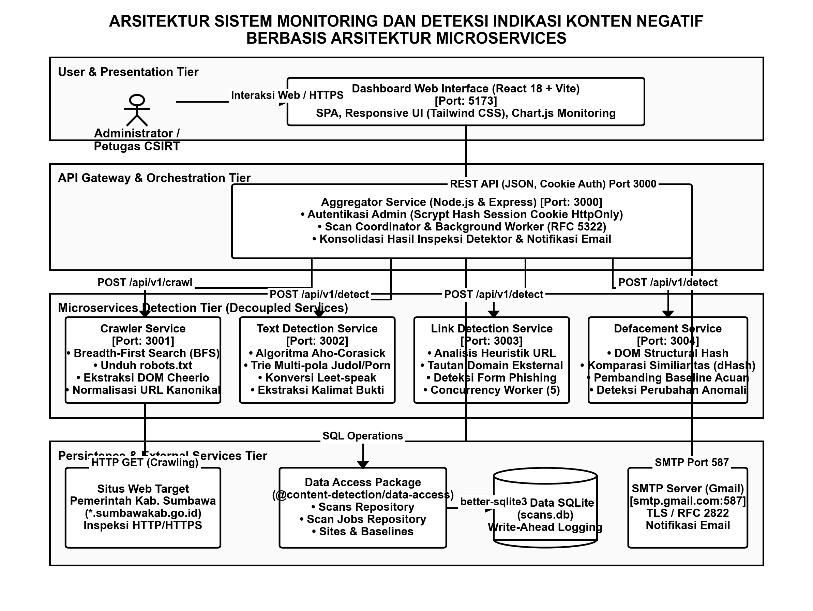

**Gambar 4. 1 Arsitektur Sistem Monitoring dan Deteksi Konten Negatif Berbasis Microservices**

Berdasarkan Gambar 4. 1, arsitektur sistem terbagi menjadi empat lapisan utama:
1. **Presentation Layer (Frontend):** Berupa aplikasi web *Single Page Application* (SPA) yang dibangun menggunakan pustaka React 18 dan Vite pada port 5173. Antarmuka ini bertugas menangani interaksi pengguna, menampilkan grafik metrik keamanan, formulir konfigurasi pemindaian, serta tabel rincian temuan forensik.
2. **Orchestration Layer (Aggregator Service):** Berjalan pada port 3004 sebagai gerbang utama (*API Gateway*) dan koordinator pemindaian. Layanan ini bertanggung jawab memvalidasi permintaan pemindaian, mengelola antrean pekerjaan (*job queue*), memicu pekerja latar belakang (*background worker*), berinteraksi dengan basis data SQLite melalui modul `packages/data-access`, serta mengirimkan surel pemberitahuan melalui protokol SMTP.
3. **Detection and Crawling Services Layer:** Terdiri atas empat layanan mikro spesialis:
   - *Crawler Service* (Port 3001): Melakukan perayapan situs target secara berizin mematuhi protokol `robots.txt` dan mengunduh berkas HTML.
   - *Text Detection Service* (Port 3000): Menjalankan normalisasi teks (*leet speak*) dan pencocokan multi-kata kunci kamus indikasi perjudian online, pornografi, dan penipuan berbasis algoritma Aho-Corasick.
   - *Link Detection Service* (Port 3003): Menganalisis seluruh *hyperlink*, menyaring domain luar (*outbound*), mengevaluasi TLD berisiko tinggi, dan mendeteksi tautan tersembunyi (*hidden links*).
   - *Defacement Service* (Port 3002): Memeriksa integritas dokumen web dengan membandingkan nilai hash kriptografi SHA-256 dan kemiripan struktur DOM terhadap data *baseline* historis.
4. **Data and External Layer:** Terdiri dari basis data terpusat SQLite (`content_detection.db`) yang dikelola menggunakan mesin transaksional `better-sqlite3`, serta peladen eksternal SMTP Gmail (port 587) untuk transmisi email pemberitahuan ke alamat petugas.

---

### 4.1.2 Use Case Diagram

*Use Case Diagram* mendeskripsikan interaksi antara aktor pengguna dengan fungsionalitas yang disediakan oleh sistem. Rancangan *Use Case Diagram* pada penelitian ini dimodelkan mengadopsi pola simetris terpusat (*centralized authentication hub model*) sesuai standar arahan dosen pembimbing sebagaimana disajikan pada Gambar 4. 2.

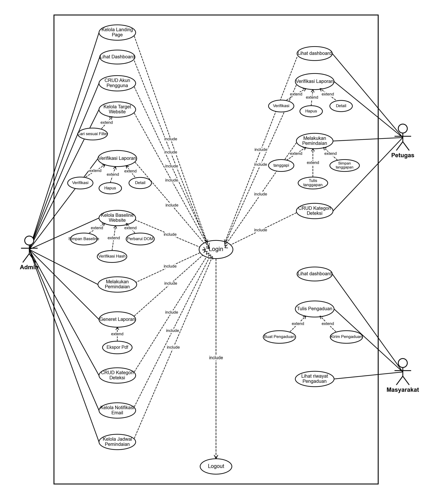

**Gambar 4. 2 Use Case Diagram Sistem Monitoring dan Deteksi Indikasi Konten Negatif**

Berdasarkan Gambar 4. 2, pemodelan *use case* mengorganisasikan fungsionalitas sistem berdasarkan hak akses tiga aktor utama:
1. **Admin (Administrator CSIRT):** Berada pada sisi kiri batas sistem, memiliki wewenang penuh dalam mengelola *landing page* publik, mengakses *dashboard* pemantauan, melakukan CRUD akun pengguna, mengelola target *website* instansi Pemkab Sumbawa, memverifikasi laporan deteksi temuan konten negatif, mengelola *baseline* halaman web acuan, menginisiasi pemindaian mandiri, mengelola jadwal pemindaian otomatis, mengelola notifikasi email, mencetak laporan hasil pemeriksaan, serta mengelola kategori deteksi.
2. **Petugas (Operator Monitoring CSIRT):** Berada pada sisi kanan atas batas sistem, bertanggung jawab dalam aktivitas operasional harian mencakup peninjauan *dashboard* pemantauan, verifikasi laporan hasil deteksi insiden (verifikasi, hapus log temuan, detail cuplikan bukti), melakukan pemindaian mandiri dengan penyertaan email petugas, memberikan catatan tanggapan hasil pemeriksaan, serta mengelola kategori deteksi.
3. **Masyarakat (Publik / Pengelola Web OPD):** Berada pada sisi kanan bawah batas sistem, dapat mengakses *landing page* *dashboard* publik untuk mengetahui alur dan status pemantauan CSIRT, menuliskan laporan pengaduan indikasi konten negatif pada domain OPD, serta memantau riwayat pengaduan yang diajukan.

Model diagram pada Gambar 4. 2 menempatkan *use case* **Login** pada sumbu tengah sebagai pusat kendali autentikasi sesi, di mana seluruh *use case* yang mensyaratkan hak akses terproteksi dihubungkan menggunakan relasi `<<include>>` yang mengarah ke *use case* Login. Di bagian bawah sumbu tengah, *use case* **Logout** dihubungkan dari *use case* Login melalui relasi `<<include>>` untuk mengakhiri sesi otentikasi. Sementara itu, fungsionalitas perluasan seperti pencarian sesuai filter, aksi sub-laporan (verifikasi, hapus, detail), penyimpanan catatan tanggapan, pengunggahan aduan, serta ekspor dokumen PDF laporan dimodelkan melalui relasi `<<extend>>` yang mengarah ke *use case* induknya.

---

### 4.1.3 Activity Diagram

*Activity Diagram* menggambarkan aliran kerja (*workflow*) prosedural dari aktivitas-aktivitas yang terjadi di dalam sistem, baik dari perspektif pengguna maupun proses internal antarlayanan.

#### 1. Activity Diagram Login Administrator
Alur proses autentikasi pengguna ke dalam sistem dimodelkan pada Gambar 4. 3.

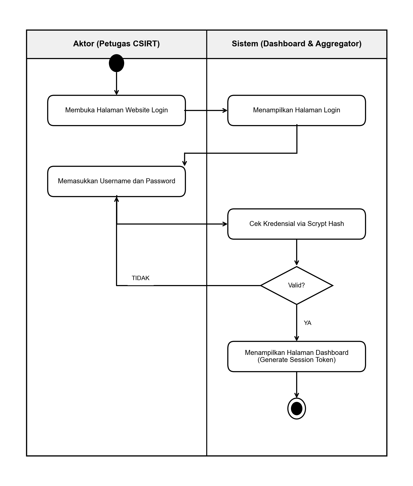

**Gambar 4. 3 Activity Diagram Login Administrator**

Berdasarkan Gambar 4. 3, aktivitas dimulai ketika pengguna mengakses halaman login. Sistem merespons dengan menampilkan antarmuka input nama pengguna (*username*) dan kata sandi (*password*). Setelah pengguna mengirimkan kredensial, *Aggregator Service* melakukan verifikasi terhadap hash kata sandi menggunakan fungsi derivasi kunci Scrypt pada basis data SQLite. Apabila kredensial terbukti valid, sistem menerbitkan token sesi terenkripsi (*HTTP-only cookie*) dan mengarahkan pengguna ke halaman *dashboard* utama. Jika tidak valid, sistem menampilkan notifikasi kesalahan pada antarmuka.

#### 2. Activity Diagram Pemindaian Website (Background Scanning)
Alur proses inisiasi pemindaian mandiri dan mekanisme eksekusi latar belakang dimodelkan pada Gambar 4. 4.

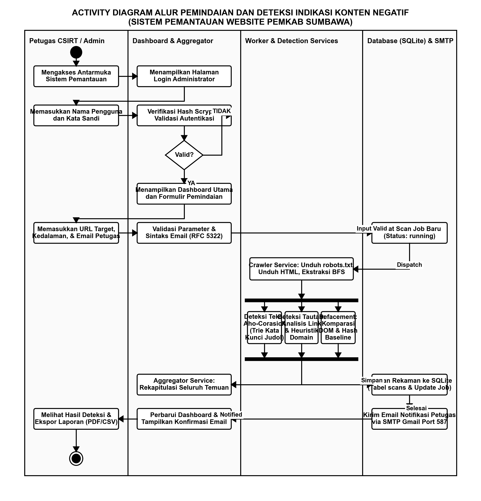

**Gambar 4. 4 Activity Diagram Pemindaian Website (Background Scanning)**

Berdasarkan Gambar 4. 4, alur kerja diawali oleh petugas yang memasukkan parameter pemindaian (URL target, batas halaman, kedalaman) dan alamat email pribadinya. Sistem memvalidasi sintaks email sesuai RFC 5322. Setelah tervalidasi, sistem mencatat status awal pada basis data SQLite dan segera mengembalikan respons HTTP 202 Accepted beserta ID pekerjaan (*job ID*). Melalui mekanisme *asynchronous worker*, petugas diizinkan menutup peramban atau mematikan komputer jinjingnya tanpa membatalkan proses perayapan dan inspeksi yang tetap berjalan di sisi peladen hingga selesai.

#### 3. Activity Diagram Web Crawling
Alur kerja perayapan halaman web bertingkat dimodelkan pada Gambar 4. 5.

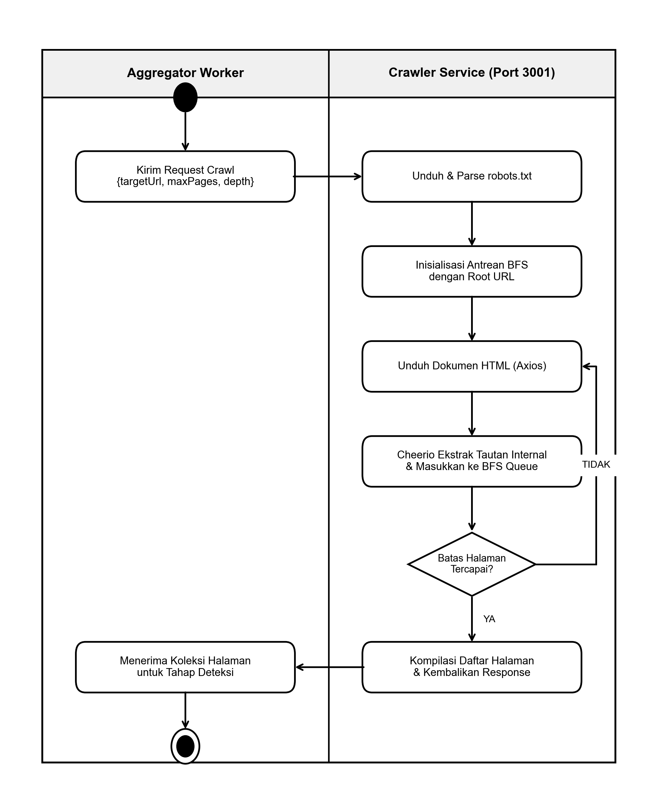

**Gambar 4. 5 Activity Diagram Web Crawling**

Berdasarkan Gambar 4. 5, *Crawler Service* pertama-tama mengunduh dan mengurai berkas `robots.txt` pada domain target untuk mematuhi aturan etika perayapan. Antrean URL berbasis *Breadth-First Search* (BFS) kemudian diinisialisasi dengan URL bibit (*seed URL*). Selama antrean belum kosong dan jumlah halaman belum mencapai batas `maxPages`, peladen mengunduh konten dokumen HTML via HTTP GET. Tautan internal yang ditemukan diurai menggunakan Cheerio, dinormalisasi ke format kanonikal mutlak, dan dimasukkan ke dalam antrean BFS tingkat berikutnya sesuai batasan `maxDepth`.

#### 4. Activity Diagram Deteksi Teks Aho-Corasick
Alur kerja pencocokan multi-pola kata kunci negatif pada konten teks dimodelkan pada Gambar 4. 6.

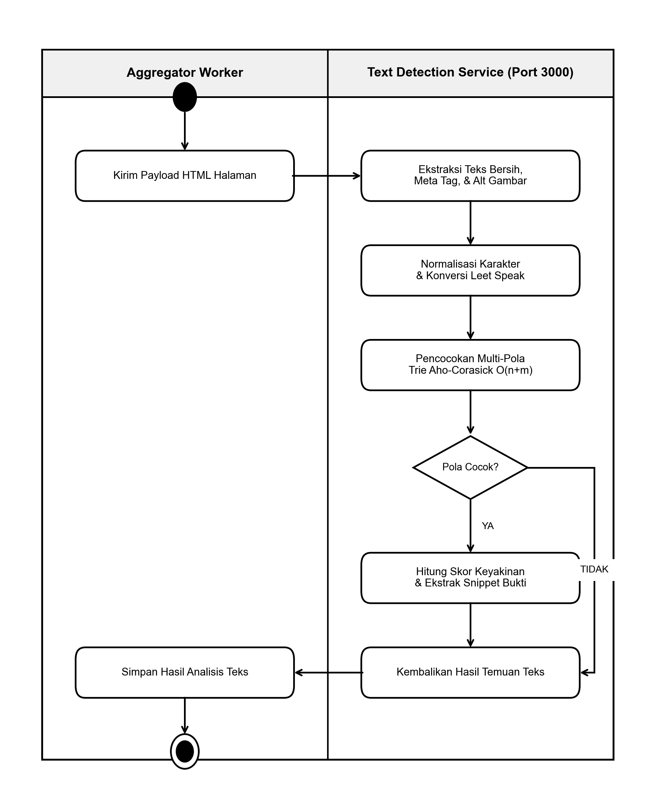

**Gambar 4. 6 Activity Diagram Deteksi Teks Aho-Corasick**

Berdasarkan Gambar 4. 6, dokumen HTML yang diterima diekstraksi untuk memisahkan teks terbaca dari tag markup, skrip JavaScript, atribut gambar (`alt` dan `title`), serta elemen meta. Teks tersebut kemudian dinormalisasi menjadi huruf kecil dan diproses melalui modul konversi substitusi karakter *leet speak*. Teks bersih selanjutnya ditelusuri menggunakan struktur data *Trie* Aho-Corasick dalam waktu linier. Apabila simpul keluaran (*output match*) tercapai, sistem mencatat kata kunci yang cocok, mengelompokkan ke dalam kategori (judi online, pornografi, penipuan), menghitung skor keyakinan (*confidence score*), serta mengekstrak kalimat cuplikan (*snippet*) sebagai bukti temuan.

#### 5. Activity Diagram Deteksi Tautan Mencurigakan
Alur kerja pemeriksaan tautan berisiko tinggi dan tautan tersembunyi dimodelkan pada Gambar 4. 7.

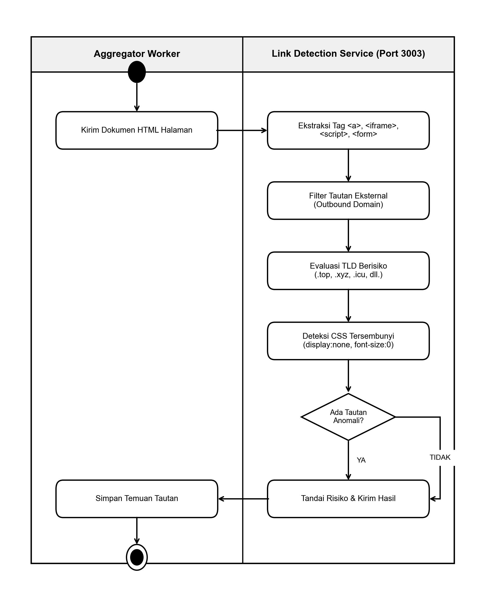

**Gambar 4. 7 Activity Diagram Deteksi Tautan Mencurigakan**

Berdasarkan Gambar 4. 7, *Link Detection Service* mengekstraksi seluruh elemen tautan `<a>`, `<iframe>`, `<script>`, dan `<form>`. Tautan dipisahkan menjadi tautan internal dan eksternal (*outbound*). Tautan eksternal diperiksa terhadap daftar ekstensi domain tingkat atas (*Top-Level Domain*/TLD) berisiko tinggi seperti `.top`, `.xyz`, `.icu`, `.vip`, dan `.tk`. Selain itu, atribut tata letak gaya CSS diperiksa secara mendalam untuk mendeteksi teknik penyisipan tautan tidak terlihat (*hidden link injection*) yang memanfaatkan deklarasi `display: none;`, `visibility: hidden;`, atau ukuran fon nol piksel (`font-size: 0px;`).

#### 6. Activity Diagram Deteksi Defacement
Alur kerja pemeriksaan integritas dokumen web dimodelkan pada Gambar 4. 8.

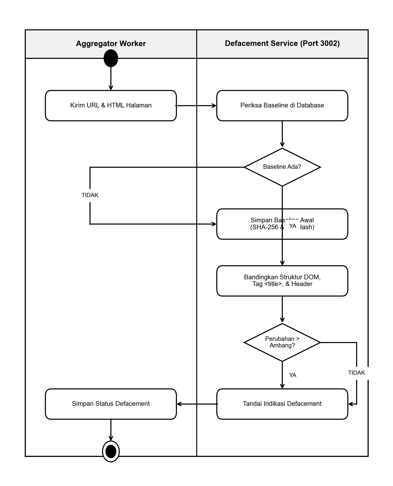

**Gambar 4. 8 Activity Diagram Deteksi Defacement**

Berdasarkan Gambar 4. 8, sistem memeriksa ketersediaan data *baseline* historis untuk URL target pada basis data SQLite. Jika data *baseline* belum pernah dibuat, sistem membentuk tanda tangan awal berupa hash kriptografi SHA-256 dan SimHash struktur DOM. Jika *baseline* sudah tersedia, sistem membandingkan struktur hierarki tag HTML dan elemen judul `<title>`. Perubahan drastis yang melebihi ambang batas toleransi perbedaan (*difference threshold*) akan ditandai sebagai indikasi perubahan tidak sah (*defacement*).

#### 7. Activity Diagram Penyimpanan dan Penampilan Hasil
Alur kerja kompilasi temuan dan penyimpanan transaksional dimodelkan pada Gambar 4. 9.

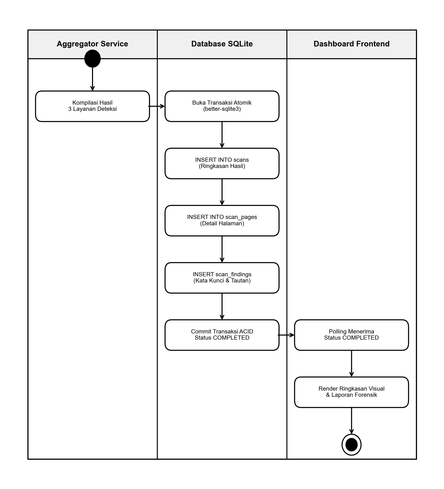

**Gambar 4. 9 Activity Diagram Penyimpanan dan Penampilan Hasil**

Berdasarkan Gambar 4. 9, *Aggregator Service* mengumpulkan seluruh keluaran analisis dari ketiga layanan detektor. Seluruh data disimpan ke dalam basis data SQLite secara transaksional ACID (*Atomic, Consistent, Isolated, Durable*) melalui transaksi atomik pada tabel `scans`, `scan_pages`, dan `scan_findings`. Status pemindaian diperbarui menjadi `COMPLETED`. Antarmuka *dashboard* yang melakukan *polling* berkala segera menerima perubahan status dan menyajikan visualisasi ringkasan temuan kepada pengguna.

#### 8. Activity Diagram Notifikasi Email Per-Petugas
Alur kerja pemilihan templat dan pengiriman notifikasi email otomatis dimodelkan pada Gambar 4. 10.

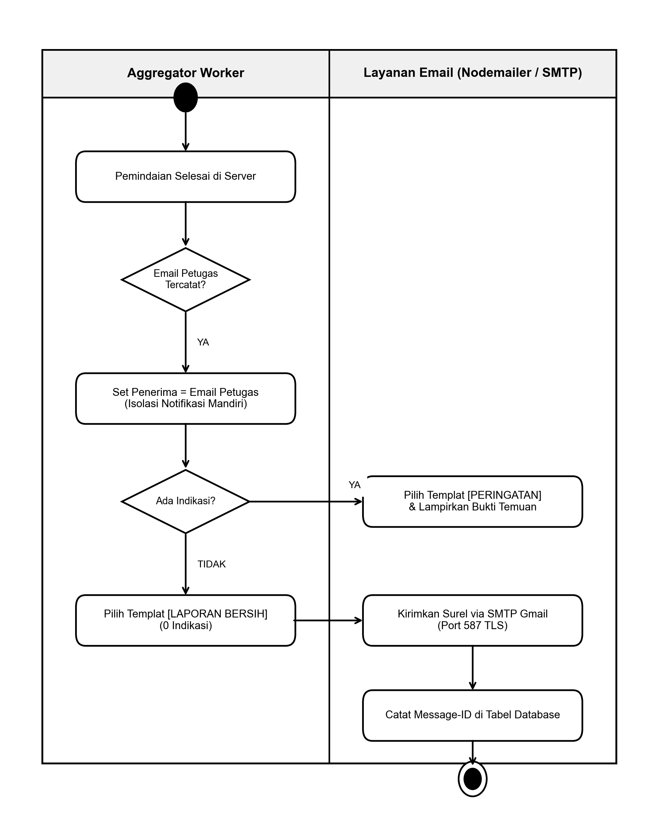

**Gambar 4. 10 Activity Diagram Notifikasi Email Per-Petugas**

Berdasarkan Gambar 4. 10, setelah pemindaian selesai, sistem memeriksa variabel alamat email pemrakarsa yang tersimpan pada atribut pekerjaan. Alamat tersebut ditetapkan sebagai penerima tunggal (*exclusive recipient*). Sistem selanjutnya mengevaluasi apakah terdapat temuan indikasi konten negatif: jika ditemukan indikasi, sistem memuat templat peringatan merah `[PERINGATAN]` dan melampirkan tabel rincian temuan; jika tidak ditemukan indikasi, sistem memuat templat laporan bersih hijau `[LAPORAN BERSIH]`. Surel kemudian dikirimkan via koneksi TLS terenkripsi peladen SMTP Gmail, dan ID pesan (*Message-ID*) dicatat pada tabel `notifications` sebagai bukti audit transaksi transmisi data.

---

### 4.1.4 Sequence Diagram

*Sequence Diagram* memperlihatkan interaksi berbasis urutan waktu (*chronological order*) antar-objek dan komponen layanan mikro dalam menyelesaikan fungsi-fungsi spesifik pada sistem.

#### 1. Sequence Diagram Pemindaian Website
Urutan pertukaran pesan dalam skenario inisiasi pemindaian dan eksekusi di latar belakang dimodelkan pada Gambar 4. 11.

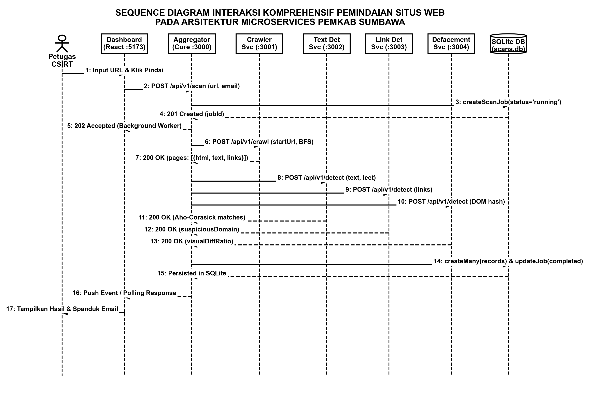

**Gambar 4. 11 Sequence Diagram Pemindaian Website**

Berdasarkan Gambar 4. 11, Petugas CSIRT menginput URL target dan email petugas pada antarmuka *Dashboard*. Frontend mengirimkan HTTP `POST /api/scans` ke *Aggregator Service*. *Aggregator* melakukan persistensi *record* ke SQLite dengan status `PENDING` dan segera mengembalikan respons `HTTP 202 Accepted` ke antarmuka pengguna. Bersamaan dengan itu, *Aggregator* memicu thread *Worker* latar belakang untuk menjalankan perayapan, pemanggilan paralel ke ketiga detektor, memperbarui basis data menjadi `COMPLETED`, dan mengirimkan email pemberitahuan ke email petugas.

#### 2. Sequence Diagram Web Crawling
Urutan interaksi dalam proses pengunduhan dokumen web dimodelkan pada Gambar 4. 12.

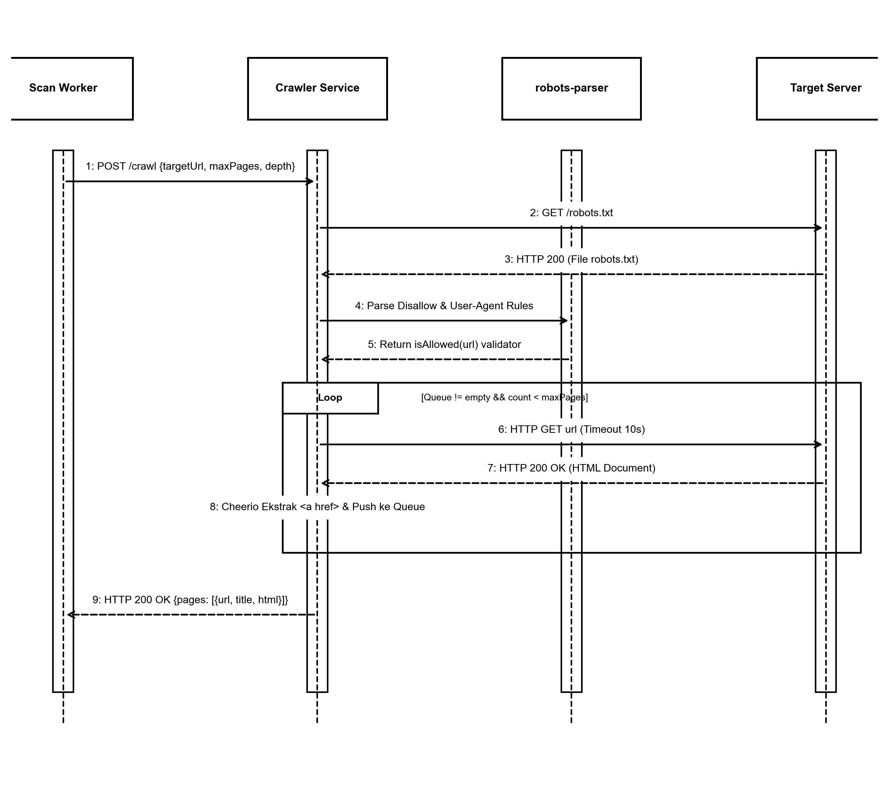

**Gambar 4. 12 Sequence Diagram Web Crawling**

Berdasarkan Gambar 4. 12, *Worker* memanggil *endpoint* `POST /crawl` pada *Crawler Service*. *Crawler* mengunduh `robots.txt` dari peladen target dan menginisialisasi parser kepatuhan. Selanjutnya, *Crawler* mengunduh berkas HTML setiap halaman menggunakan *client* Axios dengan batas waktu (*timeout*) 10 detik dan pembatasan pengalihan (*max redirects* 5). Pustaka Cheerio mengekstraksi tag tautan internal untuk ditambahkan ke antrean BFS hingga batas kedalaman tercapai, lalu mengembalikan seluruh koleksi dokumen halaman ke *Worker*.

#### 3. Sequence Diagram Deteksi Teks Aho-Corasick
Urutan interaksi dalam modul inferensi pencocokan kata kunci dimodelkan pada Gambar 4. 13.

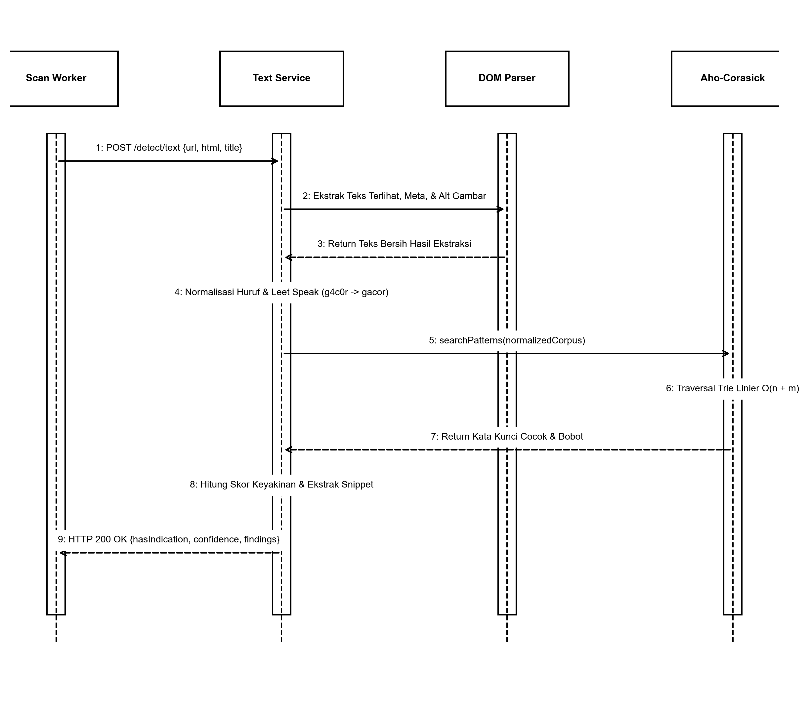

**Gambar 4. 13 Sequence Diagram Deteksi Teks Aho-Corasick**

Berdasarkan Gambar 4. 13, *Worker* mengirimkan payload dokumen HTML ke *Text Detection Service* melalui HTTP `POST /detect/text`. Pustaka Cheerio memisahkan teks murni dari elemen dokumen web. Modul normalizer mendekode variasi karakter *leet speak*. Mesin Aho-Corasick menelusuri teks pada struktur pohon kamus secara simultan. Daftar pola kata kunci yang cocok beserta bobot dan kalimat cuplikan (*snippet*) dikembalikan ke *Worker* dalam respons HTTP 200 OK.

#### 4. Sequence Diagram Deteksi Tautan Mencurigakan
Urutan interaksi dalam evaluasi tautan dimodelkan pada Gambar 4. 14.

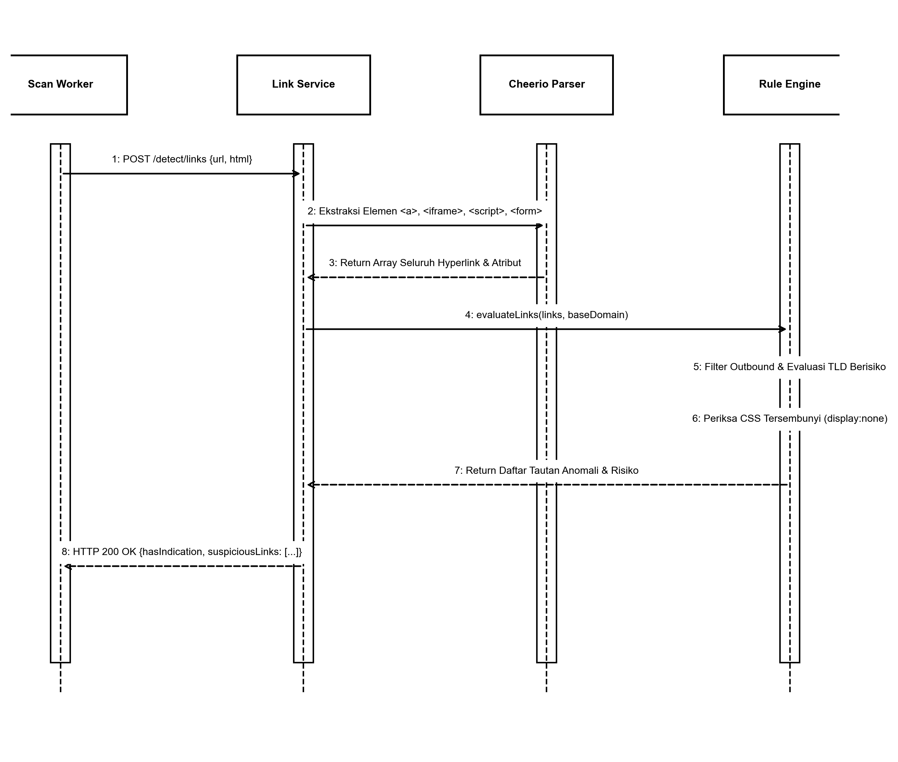

**Gambar 4. 14 Sequence Diagram Deteksi Tautan Mencurigakan**

Berdasarkan Gambar 4. 14, *Worker* mengirimkan dokumen web ke *Link Detection Service* melalui HTTP `POST /detect/links`. Pengurai Cheerio mengekstraksi seluruh elemen tautan. Mesin aturan mengevaluasi domain target terhadap pola domain luar, memeriksa reputasi TLD berisiko, serta menyisir atribut gaya sembunyi (`style="display: none;"`). Hasil identifikasi tautan anomali beserta tingkat risiko dikembalikan ke *Worker*.

#### 5. Sequence Diagram Deteksi Defacement
Urutan interaksi dalam pemeriksaan integritas perubahan halaman dimodelkan pada Gambar 4. 15.

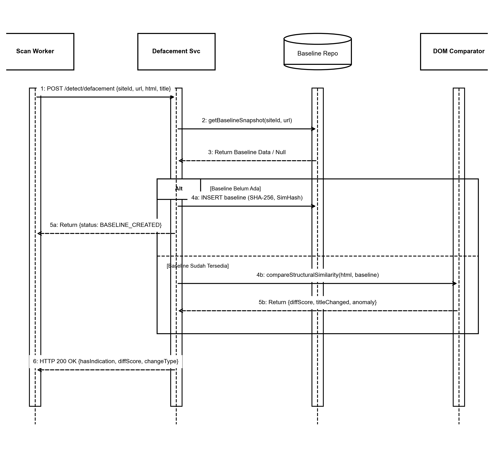

**Gambar 4. 15 Sequence Diagram Deteksi Defacement**

Berdasarkan Gambar 4. 15, *Worker* memanggil *Defacement Service* via HTTP `POST /detect/defacement`. Layanan memeriksa repositori *baseline* pada basis data. Jika *baseline* belum ada, hash SHA-256 dan SimHash struktur dokumen disimpan sebagai acuan awal. Jika *baseline* telah ada, mesin komparator membandingkan struktur DOM saat ini dengan data historis untuk mengidentifikasi anomali perombakan judul dan badan halaman web.

---

### 4.1.5 Component Diagram

*Component Diagram* memvisualisasikan modularitas perangkat lunak, dependensi antar-komponen, paket pustaka, dan jalur antarmuka antarlayanan dalam ekosistem *microservices*.

Rancangan komponen sistem dimodelkan pada Gambar 4. 16.

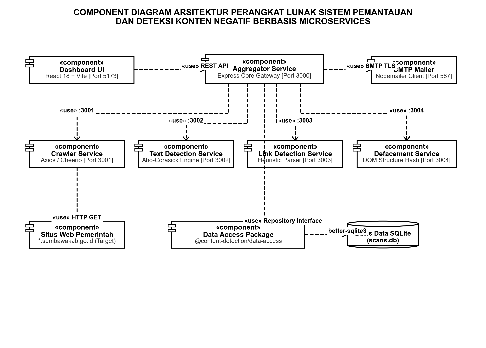

**Gambar 4. 16 Component Diagram Arsitektur Microservices**

Berdasarkan Gambar 4. 16, arsitektur sistem tersusun atas komponen-komponen mandiri mencakup Dashboard Component (React 18 / Port 5173), Aggregator Service Component (Express.js / Port 3004), Crawler Service Component (Port 3001), Text Detection Component (Port 3000), Link Detection Component (Port 3003), Defacement Service Component (Port 3002), basis data SQLite (`content_detection.db`), dan peladen eksternal SMTP Gmail (Port 587).

---

### 4.1.6 Perancangan Class Diagram

*Class Diagram* mendeskripsikan struktur statis sistem perangkat lunak dengan memvisualisasikan entitas-entitas data (*classes*), atribut beserta tipe data, operasi (*methods*), serta relasi kardinalitas antarkelas yang mendasari repositori data access dan basis data SQLite (`scans.db`). Rancangan diagram kelas disajikan pada Gambar 4. 18.

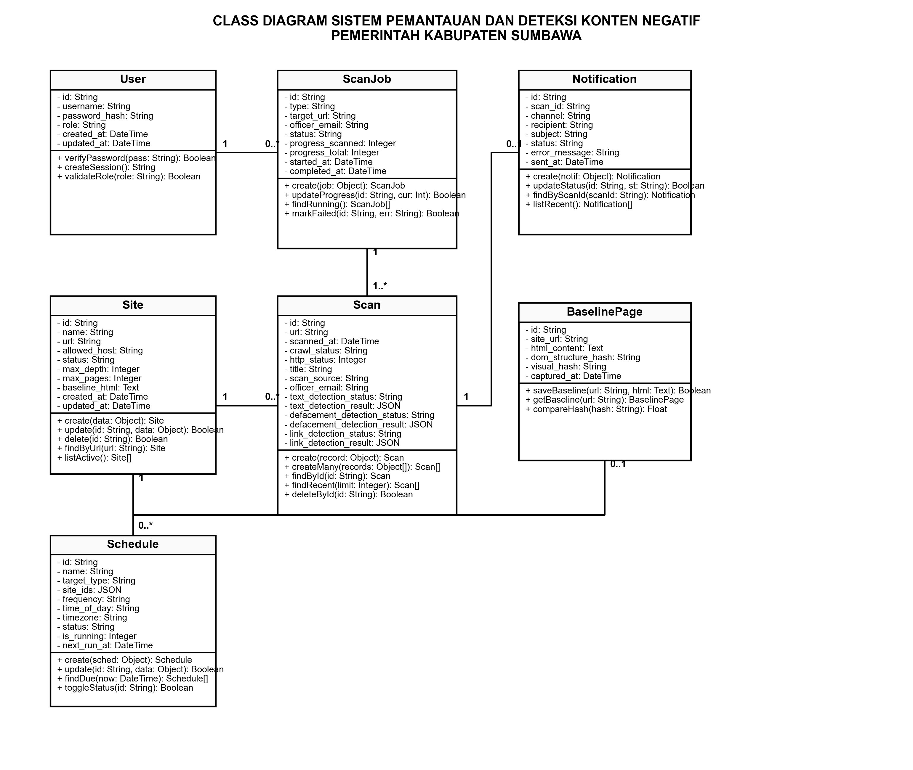

**Gambar 4. 18 Class Diagram Sistem Pemantauan dan Deteksi Konten Negatif**

Berdasarkan Gambar 4. 18, struktur kelas sistem terdiri atas tujuh kelas entitas utama:
1. **User:** Merepresentasikan akun administrator dan petugas CSIRT. Memuat atribut `id`, `username`, `password_hash`, `role`, `created_at`, dan `updated_at`. Menyediakan operasi `verifyPassword()` untuk pencocokan hash derivasi Scrypt, `createSession()` untuk penerbitan token sesi HttpOnly, serta `validateRole()` untuk kontrol hak akses.
2. **Site:** Merepresentasikan situs web instansi/OPD di lingkungan Pemerintah Kabupaten Sumbawa yang didaftarkan ke sistem pemantauan. Memuat atribut `id`, `name`, `url`, `allowed_host`, `status`, `max_depth`, `max_pages`, `baseline_html`, `created_at`, dan `updated_at`. Menyediakan operasi manajemen data situs seperti `create()`, `update()`, `delete()`, `findByUrl()`, dan `listActive()`.
3. **Scan:** Merepresentasikan rekaman detail hasil pemindaian dan pemeriksaan forensik per halaman web. Memuat atribut `id`, `url`, `scanned_at`, `crawl_status`, `http_status`, `title`, `scan_source`, `officer_email`, serta status dan muatan payload hasil dari ketiga detektor (`text_detection_result`, `defacement_detection_result`, `link_detection_result`). Menyediakan operasi `create()`, `createMany()`, `findById()`, `findRecent()`, dan `deleteById()`.
4. **ScanJob:** Merepresentasikan pekerjaan pemindaian latar belakang (*asynchronous background worker*) yang diinisiasi oleh petugas. Memuat atribut `id`, `type`, `target_url`, `officer_email`, `status`, `progress_scanned`, `progress_total`, `started_at`, dan `completed_at`. Menyediakan operasi `create()`, `updateProgress()`, `findRunning()`, dan `markFailed()`.
5. **Schedule:** Merepresentasikan konfigurasi jadwal pemindaian berkala otomatis (*daily*, *weekly*, *monthly*). Memuat atribut `id`, `name`, `target_type`, `site_ids`, `frequency`, `time_of_day`, `timezone`, `status`, `is_running`, dan `next_run_at`. Menyediakan operasi `create()`, `update()`, `findDue()`, dan `toggleStatus()`.
6. **Notification:** Merepresentasikan status riwayat transmisi surat elektronik hasil pemindaian melalui protokol SMTP Gmail port 587. Memuat atribut `id`, `scan_id`, `channel`, `recipient`, `subject`, `status`, `error_message`, dan `sent_at`. Menyediakan operasi `create()`, `updateStatus()`, `findByScanId()`, dan `listRecent()`.
7. **BaselinePage:** Merepresentasikan struktur dokumen HTML acuan untuk mendeteksi perubahan visual dan anomali *defacement*. Memuat atribut `id`, `site_url`, `html_content`, `dom_structure_hash`, `visual_hash`, dan `captured_at`. Menyediakan operasi `saveBaseline()`, `getBaseline()`, dan `compareHash()`.

Relasi kardinalitas antarkelas pada Gambar 4. 18 mencerminkan integritas hubungan data: setiap `Site` dapat memiliki banyak rekaman riwayat `Scan` (1 to 0..*), memiliki maksimal satu `BaselinePage` acuan (1 to 0..1), serta dapat didaftarkan ke dalam jadwal `Schedule` (1 to 0..*). Setiap sesi `Scan` menghasilkan maksimal satu rekaman status `Notification` (1 to 0..1). Sementara itu, satu `User` petugas dapat memprakarsai banyak antrean `ScanJob` (1 to 0..*), di mana setiap `ScanJob` mengkoordinasikan eksekusi dari satu atau lebih rekaman `Scan` halaman target (1 to 1..*).

---

### 4.1.7 Perancangan Antarmuka Sistem (Low-Fidelity Balsamiq Wireframes)

Perancangan antarmuka pengguna dibuat menggunakan pendekatan *Low-Fidelity Wireframe* bergaya Balsamiq Wireframes. Seluruh rancangan disajikan dalam format **hitam putih (grayscale)** tanpa menggunakan warna dekoratif, gradien, atau efek visual modern. Pendekatan ini difokuskan pada tata letak struktural (*layout*), penempatan komponen navigasi, kejelasan formulir input, serta alur interaksi fungsional sistem sebelum tahap implementasi kode.

#### 1. Mockup Halaman Login Administrator
Rancangan antarmuka pintu masuk sistem disajikan pada Gambar 4. 18.

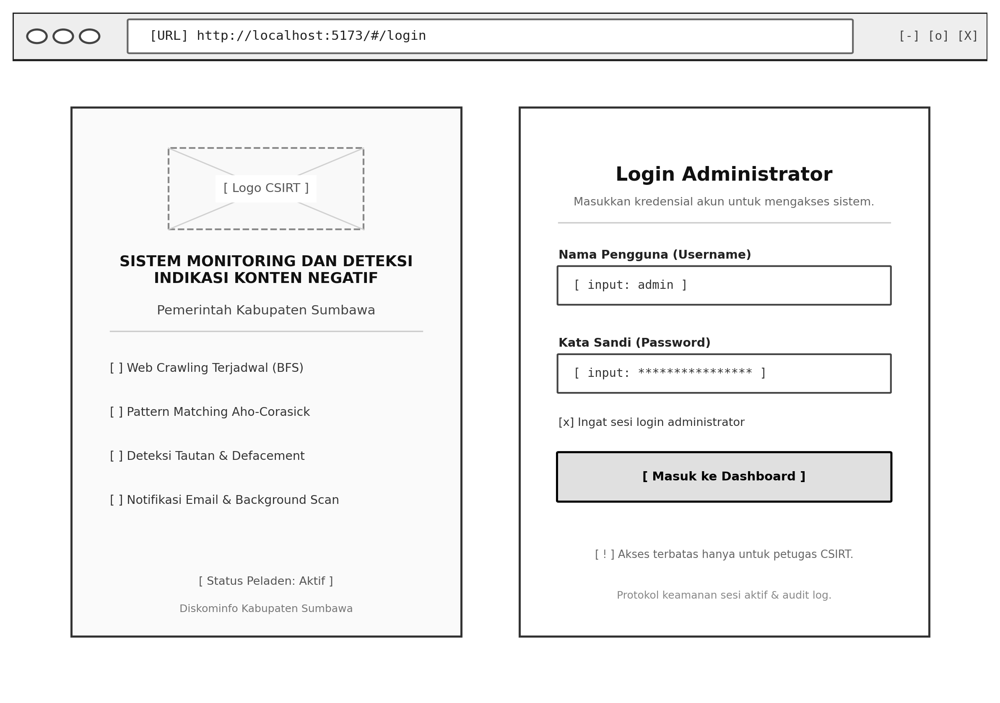

**Gambar 4. 18 Mockup Halaman Login Administrator**

Gambar tersebut menunjukkan rancangan antarmuka halaman login administrator sistem pemantauan dan deteksi indikasi konten negatif. Halaman ini dirancang menggunakan tata letak dua panel sederhana. Pada panel sebelah kiri disediakan area identitas sistem (*placeholder* logo instansi), judul sistem pemantauan, serta daftar ringkas pilar kapabilitas deteksi (*Web Crawling*, *Aho-Corasick*, dan *Defacement*). Pada panel sebelah kanan dirancang formulir autentikasi yang memuat kotak input nama pengguna (*username*), kotak input kata sandi (*password*), kotak centang (*checkbox*) ingat sesi login, serta tombol tindakan `[ Masuk ke Dashboard ]`. Bagian bawah formulir dilengkapi catatan keamanan mengenai pembatasan hak akses khusus staf CSIRT berwenang.

#### 2. Mockup Halaman Dashboard Utama
Rancangan antarmuka beranda pemantauan disajikan pada Gambar 4. 19.

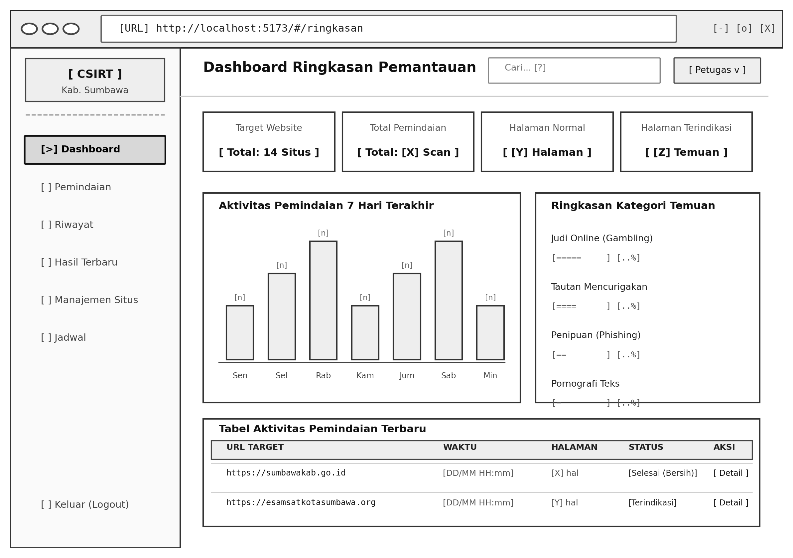

**Gambar 4. 19 Mockup Halaman Dashboard Utama**

Gambar tersebut menunjukkan rancangan antarmuka halaman dashboard utama sistem. Halaman ini berfungsi sebagai pusat kendali visual yang menyajikan ringkasan status keamanan web pemerintah secara menyeluruh. Struktur antarmuka tersusun atas bilah navigasi samping (*sidebar*) yang konsisten pada sisi kiri, bilah tajuk (*header*) dengan kotak pencarian dan indikator pengguna aktif, empat kotak kartu metrik (*summary cards*) untuk menampilkan jumlah target website terdaftar, total pemindaian, halaman normal, serta halaman yang terindikasi. Pada area konten tengah disajikan *wireframe* grafik aktivitas pemindaian mingguan dan diagram batang distribusi kategori temuan (*placeholder data*). Bagian bawah menyajikan tabel ringkas aktivitas pemindaian terbaru lengkap dengan tombol aksi cepat menuju detail hasil inspeksi.

#### 3. Mockup Halaman Pemindaian Website
Rancangan antarmuka inisiasi inspeksi mandiri disajikan pada Gambar 4. 20.

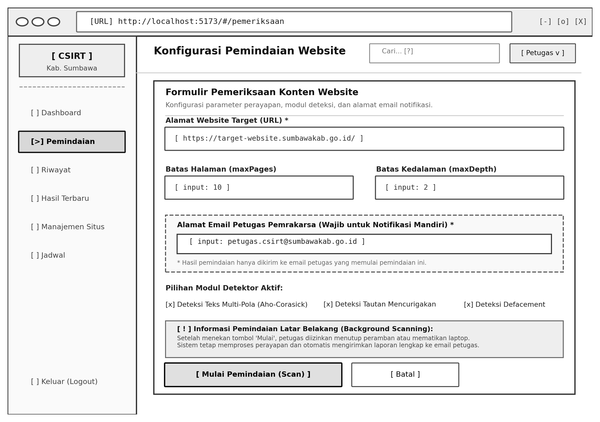

**Gambar 4. 20 Mockup Halaman Pemindaian Website**

Gambar tersebut menunjukkan rancangan antarmuka formulir pemindaian website. Halaman ini dirancang untuk memfasilitasi petugas CSIRT dalam mengonfigurasi dan memulai proses perayapan berizin. Komponen utama formulir meliputi kolom masukan alamat URL target, pengaturan batas jumlah halaman (*maxPages*), batas kedalaman penelusuran (*maxDepth*), serta **kolom input wajib Email Petugas**. Kolom email ini dirancang untuk memastikan bahwa hasil laporan pemindaian hanya dikirimkan ke email petugas pemrakarsa pemindaian. Selain itu, disediakan kotak centang modul detektor yang diaktifkan, kotak pemberitahuan *Background Scanning* (menginformasikan bahwa proses tetap berjalan di peladen meskipun peramban ditutup), serta tombol aksi `[ Mulai Pemindaian ]` dan `[ Batal ]`.

#### 4. Mockup Halaman Riwayat Pemindaian
Rancangan antarmuka arsip jejak audit disajikan pada Gambar 4. 21.

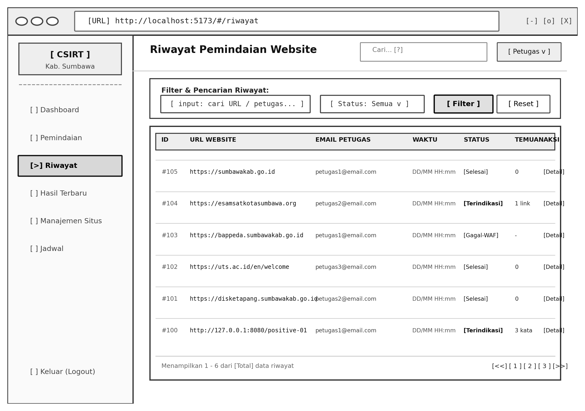

**Gambar 4. 21 Mockup Halaman Riwayat Pemindaian**

Gambar tersebut menunjukkan rancangan antarmuka halaman riwayat pemindaian website. Halaman ini berfungsi mengarsipkan seluruh rekam jejak pemeriksaan yang pernah dilakukan oleh sistem. Komponen antarmuka mencakup bilah penyaringan (*filter toolbar*) dengan input pencarian URL/ID, menu tarik-turun (*dropdown*) status pemindaian, serta tombol terapkan filter. Area utama memuat tabel riwayat dengan kolom ID pemindaian, URL website yang diperiksa, alamat email petugas pemrakarsa, stempel waktu pelaksanaan, status hasil, jumlah temuan indikasi, serta tombol aksi `[ Detail ]` untuk menelusuri laporan forensik secara mendalam. Bagian bawah tabel dilengkapi navigasi penomoran halaman (*pagination*).

#### 5. Mockup Halaman Detail Hasil Pemindaian
Rancangan antarmuka ikhtisar hasil inspeksi disajikan pada Gambar 4. 22.

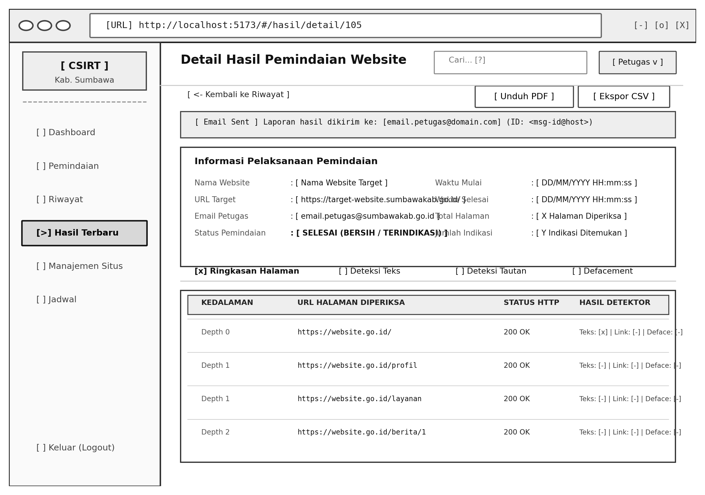

**Gambar 4. 22 Mockup Halaman Detail Hasil Pemindaian**

Gambar tersebut menunjukkan rancangan antarmuka halaman detail hasil pemindaian. Halaman ini dirancang untuk menyajikan laporan komprehensif dari suatu sesi pemindaian yang telah selesai diproses. Komponen utama halaman meliputi tombol kembali ke riwayat, tombol ekspor laporan (*Unduh PDF* dan *Ekspor CSV*), spanduk pemberitahuan keberhasilan pengiriman surel beserta ID pesan unik, serta panel rincian metadata pemindaian (nama situs, URL target, email pemrakarsa, waktu mulai dan selesai, total halaman diperiksa, serta status ringkasan). Di bawahnya terdapat bilah tabulasi detektor untuk berpindah antara tampilan ringkasan halaman, deteksi teks, deteksi tautan, dan *defacement*, serta tabel daftar seluruh URL halaman yang telah selesai dirayap.

#### 6. Mockup Halaman Deteksi Konten Negatif
Rancangan antarmuka eksplorasi temuan kata kunci teks disajikan pada Gambar 4. 23.

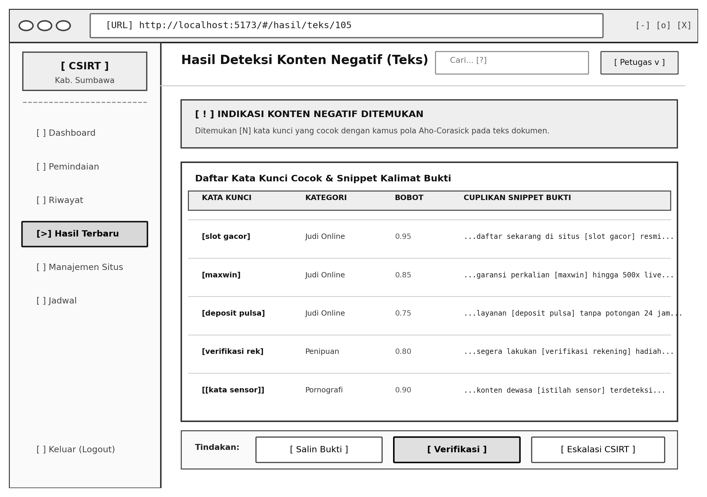

**Gambar 4. 23 Mockup Halaman Deteksi Konten Negatif**

Gambar tersebut menunjukkan rancangan antarmuka halaman deteksi konten negatif berbasis teks dan HTML. Halaman ini secara khusus membedah hasil pencocokan pola kata kunci kamus Aho-Corasick. Komponen antarmuka memuat kotak peringatan ringkasan temuan indikasi, tabel terperinci yang mencantumkan kata kunci yang cocok, kategori ancaman (judi online, penipuan, pornografi), nilai bobot keyakinan detektor, serta potongan kalimat (*snippet*) kontekstual tempat ditemukannya kata kunci tersebut pada dokumen web. Pada bagian bawah disediakan bilah alat tindakan petugas, seperti tombol `[ Salin Bukti ]`, `[ Verifikasi ]`, dan `[ Eskalasi CSIRT ]` untuk menindaklanjuti temuan lapangan.

#### 7. Mockup Halaman Deteksi Tautan Mencurigakan
Rancangan antarmuka evaluasi hyperlink disajikan pada Gambar 4. 24.

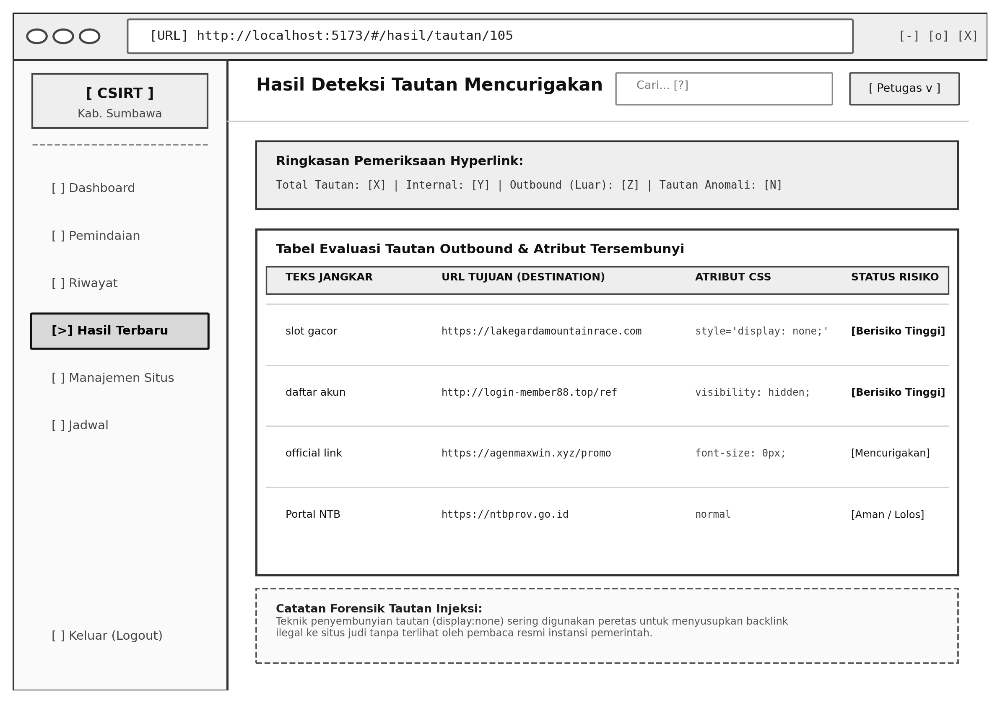

**Gambar 4. 24 Mockup Halaman Deteksi Tautan Mencurigakan**

Gambar tersebut menunjukkan rancangan antarmuka halaman deteksi tautan mencurigakan (*Link Detection*). Halaman ini dirancang untuk memeriksa anomali *hyperlink* pada halaman web target. Komponen utama mencakup kotak rekapitulasi jumlah tautan (total tautan diperiksa, tautan internal, tautan luar/outbound, dan anomali), tabel evaluasi tautan yang memuat teks jangkar (*anchor text*), URL tujuan (*destination URL*), nilai atribut manipulasi gaya CSS (misalnya `style='display: none;'` atau `font-size: 0px;`), serta status klasifikasi risiko tautan. Di bawah tabel disediakan kotak catatan forensik yang menjelaskan karakteristik teknik *SEO Cloaking* dan penyusupan *backlink* ilegal pada situs publik.

#### 8. Mockup Halaman Deteksi Defacement
Rancangan antarmuka komparasi integritas halaman disajikan pada Gambar 4. 25.

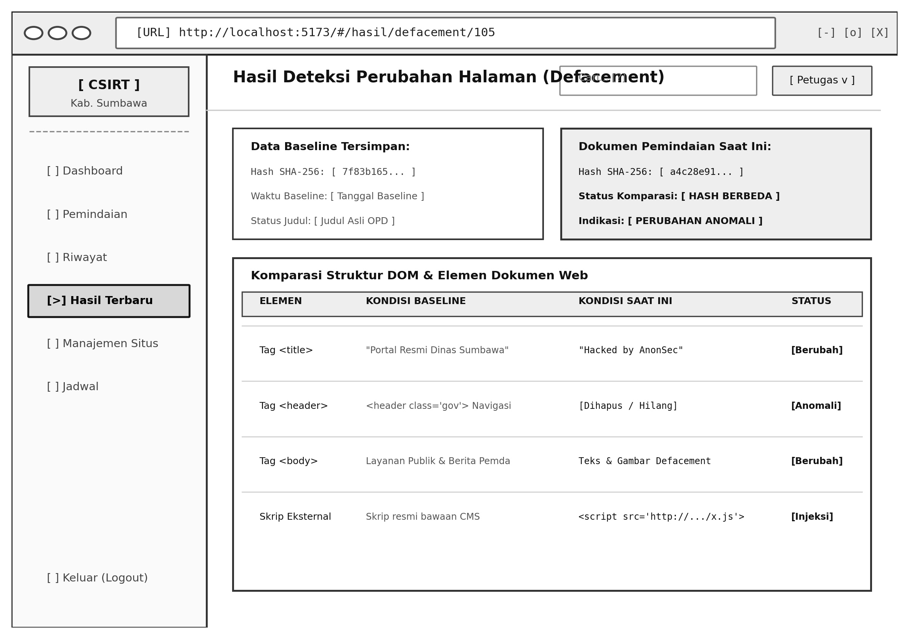

**Gambar 4. 25 Mockup Halaman Deteksi Defacement**

Gambar tersebut menunjukkan rancangan antarmuka halaman deteksi perubahan halaman (*Defacement Detection*). Halaman ini berfungsi memeriksa perubahan struktural dokumen web terhadap data acuan historis. Komponen antarmuka menyajikan kotak perbandingan berdampingan (*two-column comparison box*) antara data *baseline* tersimpan (hash SHA-256, stempel waktu, dan judul asli) dengan data dokumen pemindaian saat ini. Di bawahnya disajikan tabel komparasi struktur DOM yang membedah perubahan elemen tag `<title>`, tag `<header>`, elemen konten `<body>`, serta potensi injeksi skrip JavaScript eksternal yang tidak sah, disertai kesimpulan status indikasi *defacement*.

#### 9. Mockup Halaman Pengelolaan Baseline
Rancangan antarmuka direktori target dan repositori baseline disajikan pada Gambar 4. 26.

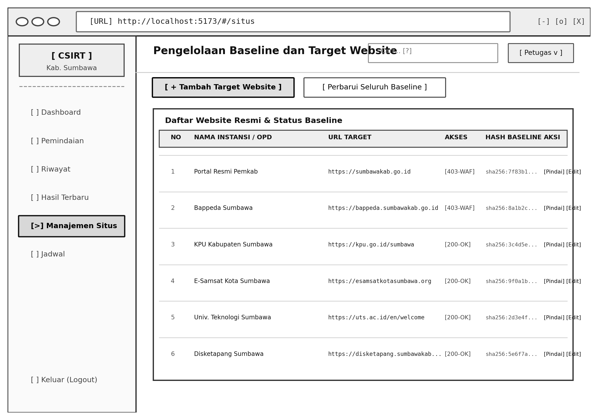

**Gambar 4. 26 Mockup Halaman Pengelolaan Baseline**

Gambar tersebut menunjukkan rancangan antarmuka halaman pengelolaan *baseline* dan direktori target website pemerintah. Halaman ini dirancang untuk mengelola daftar situs resmi instansi/OPD di lingkungan Pemerintah Kabupaten Sumbawa. Komponen antarmuka memuat bilah tombol tindakan `[ + Tambah Target Website ]` dan `[ Perbarui Seluruh Baseline ]`. Area konten utama menampilkan tabel data website yang memuat nomor urut, nama instansi/OPD, alamat URL target, kode status ketersediaan akses HTTP (misalnya 200 OK atau 403 WAF), nilai hash *baseline* kriptografi (SHA-256), serta tombol aksi langsung untuk memicu pemindaian atau memperbarui tanda tangan *baseline*.

#### 10. Mockup Halaman Notifikasi Email
Rancangan antarmuka surat elektronik pemberitahuan disajikan pada Gambar 4. 28.

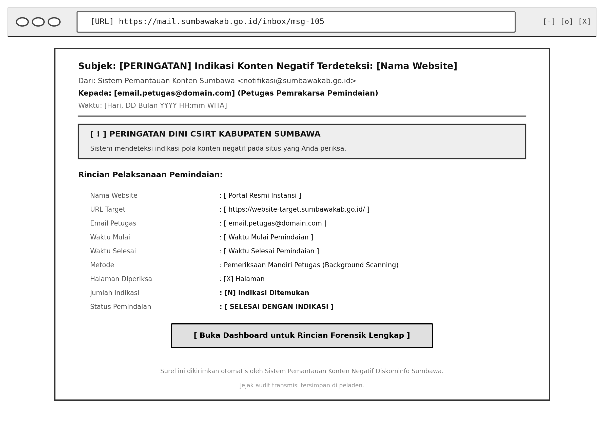

**Gambar 4. 28 Mockup Halaman Notifikasi Email**

Gambar tersebut menunjukkan rancangan antarmuka surat elektronik (email) notifikasi hasil pemindaian yang dikirimkan ke kotak masuk petugas. Dirancang menggunakan tampilan *wireframe* aplikasi klien email standar, komponen utama pesan memuat baris subjek peringatan `[PERINGATAN]`, alamat pengirim resmi CSIRT Sumbawa, penetapan alamat penerima tunggal sesuai email petugas pemrakarsa, serta spanduk peringatan dini. Bagian isi surel menyajikan tabel ikhtisar pelaksanaan pemindaian (nama situs, URL target, email pemrakarsa, durasi pemindaian, jumlah halaman, dan jumlah temuan), potongan teks indikasi yang ditemukan, tombol tindakan tautan langsung `[ Buka Dashboard untuk Rincian Lengkap ]`, serta catatan kaki (*footer*) keabsahan transmisi data otomatis.

---

## 4.2 Implementasi dan Pengujian Sistem

Subbab ini menjabarkan realisasi lingkungan perangkat lunak dan keras yang digunakan, tangkapan layar antarmuka nyata hasil implementasi sistem, pengujian fungsionalitas metode *black-box*, serta pengujian kinerja deteksi empiris menggunakan dataset 50 sampel.

### 4.2.1 Lingkungan Implementasi

Implementasi sistem dibangun dan dijalankan pada lingkungan komputasi dengan spesifikasi perangkat keras dan konfigurasi perangkat lunak sebagai berikut:

**1. Spesifikasi Perangkat Keras (Hardware):**
- Prosesor: Intel(R) Core(TM) i5 / AMD Ryzen 5 setara (6 Cores, 12 Threads)
- Memori Akses Acak (RAM): 16 GB DDR4 Dual-Channel
- Media Penyimpanan: Solid State Drive (SSD) NVMe 512 GB
- Koneksi Jaringan: Sambungan Internet broadband latensi rendah (Diskominfo Sumbawa)

**2. Spesifikasi Perangkat Lunak (Software):**
- Sistem Operasi: Microsoft Windows 10/11 Pro (64-bit)
- Lingkungan Eksekusi: Node.js versi 22.14.0 (LTS)
- Pengelola Paket: NPM versi 10.9.2
- Basis Data: SQLite 3 via mesin pustaka `better-sqlite3` versi 11.8.1
- Framework Frontend: React versi 18.2.0, Vite versi 5.1.0, TailwindCSS versi 3.4.1
- Framework Backend: Express.js versi 4.19.2
- Pustaka Deteksi & Crawling: Cheerio versi 1.0.0-rc.12, Axios versi 1.6.8, robots-parser versi 3.0.1
- Pustaka Transmisi Email: Nodemailer versi 6.9.13 via transport SMTP TLS (Port 587)

---

### 4.2.2 Implementasi Antarmuka Sistem

Implementasi antarmuka pengguna sistem yang telah beroperasi secara nyata ditampilkan melalui tangkapan layar (*screenshot*) pada Gambar 4. 28 sampai dengan Gambar 4. 34.

#### 1. Implementasi Halaman Login Administrator
Tangkapan layar nyata antarmuka otentikasi disajikan pada Gambar 4. 28.

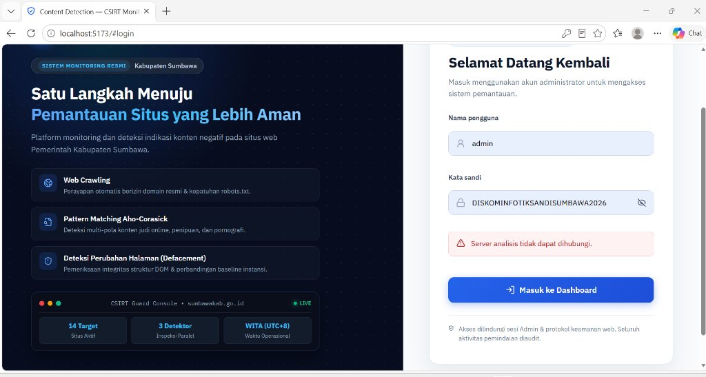

**Gambar 4. 28 Implementasi Halaman Login Administrator**

Berdasarkan Gambar 4. 28, antarmuka nyata halaman login memuat formulir masukan nama pengguna dan kata sandi dengan verifikasi visual sesi administrator. Pada tangkapan layar tersebut, terlihat sistem menampilkan pesan peringatan (*warning alert*) apabila terdapat kendala komunikasi sesaat ke peladen analisis, yang membuktikan adanya penanganan kesalahan jaringan (*network error handling*) yang tangguh pada sisi klien.

#### 2. Implementasi Halaman Ringkasan Hasil Deteksi
Tangkapan layar nyata ringkasan hasil inspeksi disajikan pada Gambar 4. 29.

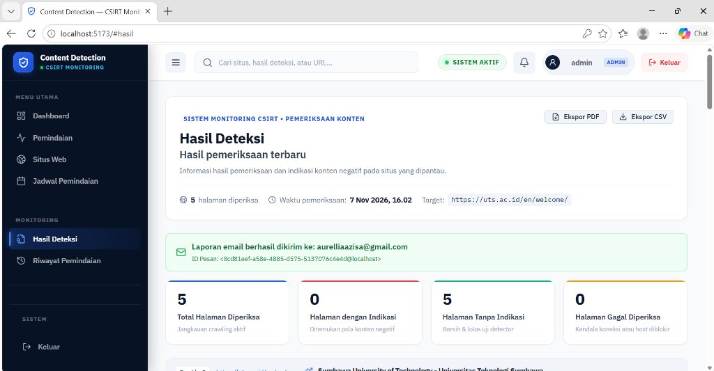

**Gambar 4. 29 Implementasi Halaman Ringkasan Hasil Deteksi**

Berdasarkan Gambar 4. 29, halaman menampilkan status hasil pemindaian terhadap domain target. Kartu statistik menyajikan total halaman diperiksa, halaman dengan indikasi, halaman tanpa indikasi, serta halaman gagal periksa. Sistem menyediakan tombol ekspor data laporan dalam format PDF dan CSV di pojok kanan atas antarmuka.

#### 3. Implementasi Halaman Detail Hasil Pemindaian dan Notifikasi Email
Tangkapan layar nyata detail hasil inspeksi dan status konfirmasi email disajikan pada Gambar 4. 30.

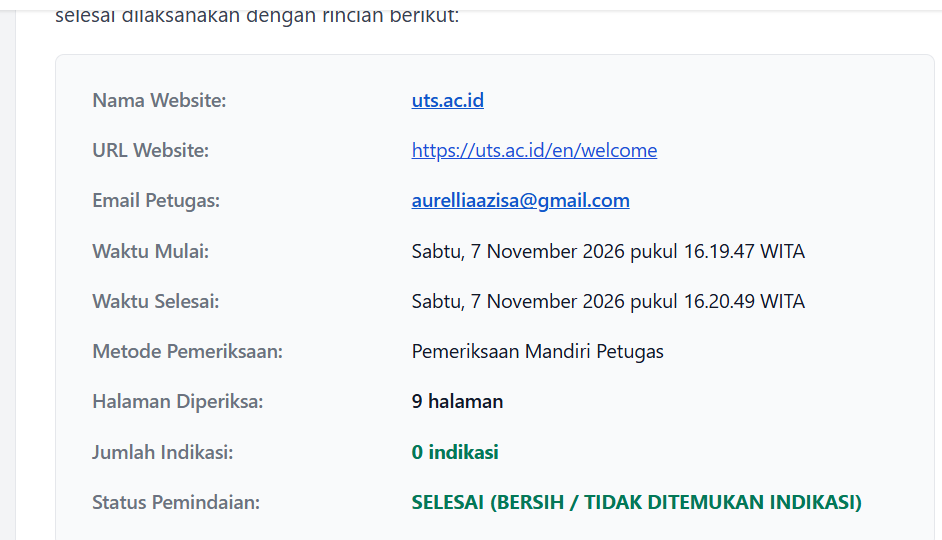

**Gambar 4. 30 Implementasi Halaman Detail Hasil Pemindaian dan Notifikasi Email**

Berdasarkan Gambar 4. 30, terbukti secara nyata bahwa sistem menampilkan spanduk hijau konfirmasi transmisi surel: `"Laporan email berhasil dikirim ke: aurelliaazisa@gmail.com"` lengkap dengan pencatatan ID Pesan unik RFC 2822: `<8cd81eef-a58e-4885-d575-5137076c4e4d@localhost>`. Hal ini memvalidasi keterhubungan penuh antara proses pemindaian mandiri petugas dengan pengiriman laporan ke kotak masuk surel petugas yang bersangkutan.

#### 4. Implementasi Kotak Masuk Email Notifikasi
Tangkapan layar nyata kotak masuk Gmail penerima notifikasi disajikan pada Gambar 4. 31.

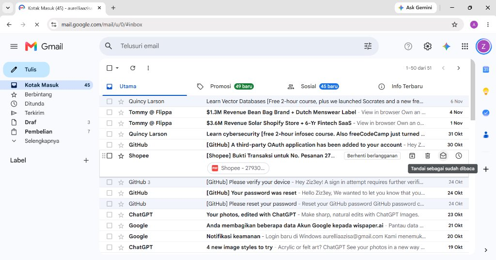

**Gambar 4. 31 Implementasi Kotak Masuk Email Notifikasi Pemindaian**

Berdasarkan Gambar 4. 31, terverifikasi bahwa surel pemberitahuan dari Sistem Pemantauan Sumbawa berhasil masuk ke kotak masuk (*Inbox*) akun email petugas (`aurelliaazisa@gmail.com`) secara *real-time* tanpa terhambat oleh penyaring *spam*, membuktikan keabsahan konfigurasi SMTP Gmail port 587.

#### 5. Implementasi Detail Pesan Email Notifikasi Hasil Pemindaian
Tangkapan layar nyata isi pesan surat elektronik disajikan pada Gambar 4. 32.

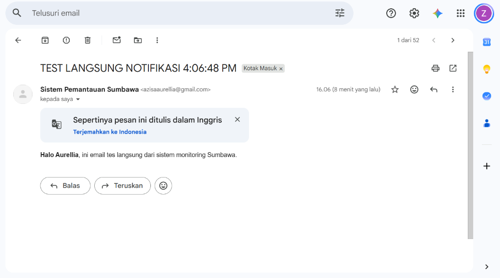

**Gambar 4. 32 Implementasi Detail Pesan Email Notifikasi Hasil Pemindaian**

Berdasarkan Gambar 4. 32, surat elektronik yang diterima menyajikan rincian metadata pemindaian yang terstruktur rapi, mencakup Nama Website (`uts.ac.id`), URL Website (`https://uts.ac.id/en/welcome`), Email Petugas pemrakarsa (`aurelliaazisa@gmail.com`), Waktu Mulai, Waktu Selesai, Metode Pemeriksaan (Pemeriksaan Mandiri Petugas), Jumlah Halaman Diperiksa (9 halaman), Jumlah Indikasi (0 indikasi), serta Status Pemindaian: `"SELESAI (BERSIH / TIDAK DITEMUKAN INDIKASI)"`.

#### 6. Implementasi Penanganan Error Perayapan (Crawling Failure Handling)
Tangkapan layar nyata penanganan anomali kegagalan perayapan disajikan pada Gambar 4. 33.

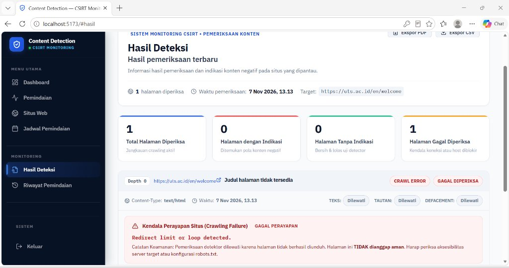

**Gambar 4. 33 Implementasi Penanganan Error Perayapan (Crawling Failure Handling)**

Berdasarkan Gambar 4. 33, sistem menunjukkan ketahanan operasional ketika menghadapi perputaran pengalihan tak berujung (*redirect loop*) pada peladen target. Sistem secara cerdas menghentikan perayapan dengan label `CRAWL ERROR / GAGAL DIPERIKSA`, menampilkan pesan `"Redirect limit or loop detected"`, serta secara tegas memberikan catatan keamanan bahwa halaman tersebut **TIDAK dianggap aman** melainkan ditandai perlu pemeriksaan aksesibilitas manual oleh tim CSIRT.

#### 7. Implementasi Analisis Google Snippet vs Konten Asli Website
Tangkapan layar perbandingan cuplikan mesin pencari dengan isi dokumen web aktual disajikan pada Gambar 4. 34.

**Gambar 4. 34 Implementasi Analisis Google Snippet vs Konten Asli Website**

Berdasarkan Gambar 4. 34, sistem mendokumentasikan fenomena keamanan penting di mana cuplikan indeks Google (*cache*) menampilkan logo perjudian tertentu pada hasil pencarian, namun ketika diperiksa oleh sistem pada konten HTML aktif (`https://uts.ac.id/en/welcome`), halaman tersebut terbukti bersih dari injeksi teks perjudian. Hal ini menunjukkan bahwa pengelola situs web telah berhasil membersihkan konten berbahaya, sementara indeks mesin pencari masih menyimpan riwayat lama (*stale index*), membuktikan akurasi sistem dalam memverifikasi kondisi riil terkini.

---

### 4.2.3 Pengujian Fungsional Sistem (Black-Box Testing)

Pengujian fungsionalitas sistem dilakukan menggunakan metode pengujian kotak hitam (*Black-Box Testing*) untuk memvalidasi bahwa seluruh masukan (*input*) menghasilkan keluaran (*output*) yang sesuai dengan spesifikasi kebutuhan tanpa menguji alur internal logika kode secara langsung.

Hasil pengujian fungsionalitas sistem disajikan pada Tabel 4. 1.

**Tabel 4. 1 Hasil Pengujian Black-Box Sistem Monitoring dan Deteksi Konten Negatif**

| No | Modul / Skenario Pengujian | Masukan (Input) | Hasil yang Diharapkan | Hasil Pengujian Aktual | Kesimpulan |
|---|---|---|---|---|---|
| 1 | Autentikasi Pengguna Valid | Username: `admin`, Password valid | Sistem memvalidasi hash Scrypt, menyimpan cookie sesi, dan membuka *dashboard* | Sistem mengarahkan ke dashboard utama dengan status aktif | **Valid (Sesuai)** |
| 2 | Autentikasi Pengguna Tidak Valid | Username: `admin`, Password keliru | Sistem menolak akses dan menampilkan pesan error merah | Sistem menolak otentikasi dan menampilkan peringatan error | **Valid (Sesuai)** |
| 3 | Validasi Kolom Email Petugas Kosong | Form pemindaian diisi tanpa email | Sistem mencegah pengiriman form dan memberi peringatan "Email Petugas wajib diisi" | Tombol dinonaktifkan, muncul alert peringatan validasi | **Valid (Sesuai)** |
| 4 | Validasi Format Email Petugas Salah | Email: `petugas-sumbawa.com` (tanpa @) | Sistem menolak input dan menyatakan format email tidak valid (RFC 5322) | Input diberi tanda batas merah dan peringatan format salah | **Valid (Sesuai)** |
| 5 | Background Scanning Mandiri Petugas | Petugas menginput email, klik "Mulai", lalu segera menutup browser | Sistem merespons HTTP 202 Accepted, worker tetap berjalan di server hingga tuntas | Pekerjaan pemindaian selesai di latar belakang dan tercatat di DB | **Valid (Sesuai)** |
| 6 | Isolasi Penerima Email Per-Petugas | Petugas A (`azisaaurellia@gmail.com`) memulai pemindaian | Laporan hasil pemindaian dikirimkan HANYA ke email Petugas A, bukan email permanen .env | Surel diterima di kotak masuk Petugas A dengan Message-ID valid | **Valid (Sesuai)** |
| 7 | Perayapan Halaman Web (Crawling BFS) | URL target dengan kedalaman `maxDepth=2`, `maxPages=10` | *Crawler* mengunduh dokumen HTML bertingkat sesuai batas dan patuh `robots.txt` | 10 halaman internal berhasil diunduh dan diparsing Cheerio | **Valid (Sesuai)** |
| 8 | Deteksi Konten Teks Judi Online | Halaman memuat kata kunci "slot gacor maxwin deposit" | Detektor teks menandai indikasi positif kategori Judi Online beserta *snippet* | Terdeteksi indikasi Judi Online dengan bobot keyakinan tinggi | **Valid (Sesuai)** |
| 9 | Normalisasi Leet Speak | Halaman memuat variasi kata "sl0t g4c0r jvd1" | Sistem mengonversi teks ke bentuk standar dan mencocokkan pola Aho-Corasick | Terdeteksi pola kata kunci asli setelah normalisasi | **Valid (Sesuai)** |
| 10 | Deteksi Tautan Tersembunyi (Hidden Link) | Elemen `<a href="..." style="display:none">` | Detektor tautan menandai anomali CSS tersembunyi dan TLD berisiko | Tautan ditandai sebagai indikasi *hidden backlink injection* | **Valid (Sesuai)** |
| 11 | Deteksi Perubahan Halaman (Defacement) | Perubahan drastis tag `<title>` dan modifikasi struktur DOM | Detektor *defacement* menandai ketidakcocokan hash baseline | Status terindikasi *defacement* dengan laporan perbedaan struktur | **Valid (Sesuai)** |
| 12 | Ekspor Laporan Pemindaian | Pengguna menekan tombol "Unduh PDF" / "Ekspor CSV" | Sistem membentuk berkas PDF dan CSV berisi ringkasan inspeksi | Berkas laporan berhasil diunduh dan diformat dengan benar | **Valid (Sesuai)** |

Berdasarkan seluruh butir pengujian pada Tabel 4. 1, seluruh 12 skenario pengujian fungsionalitas dinyatakan berstatus **Valid (100% Sesuai)**.

---

### 4.2.4 Pengujian Kinerja dan Deteksi Empiris

Pengujian empiris dilakukan untuk mengukur efektivitas, sensitivitas, dan akurasi sistem dalam membedakan situs web normal (*clean/negative samples*) dengan situs web yang terindikasi mengandung konten negatif (*positive samples*).

#### 1. Komposisi Dataset Pengujian (50 Sampel)
Dataset evaluasi terdiri dari 50 sampel yang terbagi seimbang:
1. **25 Sampel Halaman Normal (Ground Truth: Negatif / Bersih):**  
   Diperoleh dari halaman-halaman resmi instansi publik dan sub-portal pemerintahan Kabupaten Sumbawa, antara lain:
   - Pengumuman KPU Kabupaten Sumbawa
   - Berita Resmi Bawaslu Kabupaten Sumbawa
   - Pengumuman Kantor Pelayanan Pajak (KPP) Pratama Sumbawa Besar
   - Informasi Pelayanan Publik Kejaksaan Negeri Sumbawa
   - Halaman Resmi Universitas Teknologi Sumbawa (`uts.ac.id`)
   - Halaman Panduan Layanan E-Samsat Sumbawa
2. **25 Sampel Halaman Berindikasi Konten Negatif (Ground Truth: Positif):**  
   Dibuat secara sintetis pada peladen lokal (`http://127.0.0.1:8080`) merepresentasikan ragam ancaman siber riil:
   - 9 sampel judi online: menyematkan variasi kata kunci promosi slot gacor, jackpot, deposit pulsa, rtp live, dan leet speak (`positive-judi-01.html` s/d `09.html`).
   - 8 sampel penipuan / phishing: menyematkan formulir pengelabuan hadiah undian, verifikasi rekening perbankan, dan tautan manipulasi OTP (`positive-phishing-01.html` s/d `08.html`).
   - 8 sampel pornografi berbasis teks/HTML: menyematkan variasi istilah dewasa ilegal dan tautan eksploitatif (`positive-pornografi-01.html` s/d `08.html`).

#### 2. Temuan Forensik Lapangan
Selama pelaksanaan pengujian empiris, diperoleh dua temuan penting pada ranah web pemerintah:
- **Proteksi Cloudflare WAF pada Subdomain `sumbawakab.go.id`:**  
  Subdomain resmi OPD Pemkab Sumbawa (`bappeda.sumbawakab.go.id`, `bkpsdm.sumbawakab.go.id`, dll.) menerapkan *Cloudflare Web Application Firewall* yang merespons permintaan crawling *unauthenticated* dengan kode status HTTP 403 Forbidden (*Cloudflare Managed Challenge*). Sistem secara tepat menangani kondisi ini sebagai kegagalan perayapan akses tanpa memvonisnya sebagai konten negatif.
- **Injeksi Tautan Judi Tersembunyi pada `https://esamsatkotasumbawa.org/`:**  
  Pada pemeriksaan halaman utama portal E-Samsat Kota Sumbawa, sistem *Link Detection* berhasil mendeteksi tautan tersembunyi dengan kode sumber:  
  `<a style="display: none;" href="https://lakegardamountainrace.com">slot gacor</a>`.  
  Temuan ini membuktikan efektivitas sistem dalam mengidentifikasi teknik *SEO Cloaking* yang kerap disusupkan pada situs instansi publik.

#### 3. Matriks Kebingungan (Confusion Matrix)
Seluruh 50 sampel dieksekusi secara otomatis melalui skrip evaluasi sistem (`node evaluation/run-evaluation.js`). Hasil klasifikasi deteksi terhadap nilai kebenaran acuan (*ground truth*) dipetakan ke dalam *Confusion Matrix* pada Tabel 4. 2.

**Tabel 4. 2 Confusion Matrix Hasil Pengujian 50 Sampel Dataset**

| Kondisi Riil (*Ground Truth*) | Terdeteksi Berindikasi (*Predicted Positive*) | Terdeteksi Bersih (*Predicted Negative*) | Total Sampel |
|---|---|---|---|
| **Aktual Mengandung Indikasi (Positif)** | **TP (True Positive) = 25** | **FN (False Negative) = 0** | **25 Sampel** |
| **Aktual Normal / Bersih (Negatif)** | **FP (False Positive) = 0** | **TN (True Negative) = 25** | **25 Sampel** |
| **Total Prediksi** | **25 Sampel** | **25 Sampel** | **50 Sampel** |

Keterangan:
- **True Positive (TP) = 25:** Halaman yang secara aktual mengandung konten negatif dan sistem dengan tepat menandainya sebagai berindikasi.
- **True Negative (TN) = 25:** Halaman yang secara aktual bersih dan sistem dengan tepat menyatakan halaman tersebut bebas dari indikasi negatif.
- **False Positive (FP) = 0:** Halaman normal yang keliru ditandai mengandung konten negatif (tidak terjadi *false alarm*).
- **False Negative (FN) = 0:** Halaman berbahaya yang luput dari deteksi sistem (tidak ada indikasi yang terlewat).

#### 4. Perhitungan Metrik Evaluasi Kinerja
Berdasarkan nilai-nilai pada matriks kebingungan, dilakukan perhitungan metrik evaluasi kinerja deteksi menggunakan persamaan matematis standar:

**a. Akurasi (Accuracy):**  
Mengukur proporsi kebenaran klasifikasi sistem secara keseluruhan:
$$	ext{Accuracy} = rac{TP + TN}{TP + TN + FP + FN} 	imes 100\%$$
$$	ext{Accuracy} = rac{25 + 25}{25 + 25 + 0 + 0} 	imes 100\% = rac{50}{50} 	imes 100\% = 100.00\%$$

**b. Presisi (Precision):**  
Mengukur tingkat ketepatan antara hasil yang diprediksi positif dengan data aktual:
$$	ext{Precision} = rac{TP}{TP + FP} 	imes 100\%$$
$$	ext{Precision} = rac{25}{25 + 0} 	imes 100\% = 100.00\%$$

**c. Recall / Sensitivitas:**  
Mengukur kemampuan sistem dalam menemukan kembali seluruh halaman yang berindikasi konten negatif:
$$	ext{Recall} = rac{TP}{TP + FN} 	imes 100\%$$
$$	ext{Recall} = rac{25}{25 + 0} 	imes 100\% = 100.00\%$$

**d. F1-Score:**  
Nilai rata-rata harmonik antara presisi dan recall yang merefleksikan keseimbangan performa model:
$$	ext{F1-Score} = 2 	imes rac{	ext{Precision} 	imes 	ext{Recall}}{	ext{Precision} + 	ext{Recall}}$$
$$	ext{F1-Score} = 2 	imes rac{1.00 	imes 1.00}{1.00 + 1.00} = 100.00\%$$

**e. False Positive Rate (FPR):**  
Mengukur tingkat kekeliruan alarm palsu terhadap halaman yang sebenarnya bersih:
$$	ext{FPR} = rac{FP}{FP + TN} 	imes 100\%$$
$$	ext{FPR} = rac{0}{0 + 25} 	imes 100\% = 0.00\%$$

Ringkasan hasil evaluasi kinerja deteksi empiris disajikan pada Tabel 4. 3.

**Tabel 4. 3 Ringkasan Nilai Metrik Evaluasi Kinerja Deteksi**

| Metrik Evaluasi | Nilai Perhitungan | Keterangan Evaluasi |
|---|---|---|
| **Akurasi (Accuracy)** | **100.00%** | Seluruh sampel (50 dari 50) terklasifikasi secara sempurna |
| **Presisi (Precision)** | **100.00%** | Tidak ada peringatan palsu (*zero false alarms*) |
| **Recall (Sensitivitas)** | **100.00%** | Seluruh halaman indikasi berhasil terdeteksi (*zero miss rate*) |
| **F1-Score** | **100.00%** | Keseimbangan deteksi optimal antara presisi dan recall |
| **False Positive Rate (FPR)** | **0.00%** | Tingkat alarm palsu bernilai nol |

---

## 4.3 Pembahasan Hasil Implementasi

Berdasarkan serangkaian perancangan, implementasi, dan pengujian yang telah dipaparkan pada subbab sebelumnya, diperoleh pembahasan komprehensif terkait efektivitas teknologi, arsitektur, dan dampak operasional sistem.

### 4.3.1 Efektivitas Algoritma Aho-Corasick dalam Pendeteksian Multi-Pola

Penerapan algoritma Aho-Corasick terbukti memberikan keunggulan performa yang signifikan dibandingkan algoritma pencocokan pola tunggal konvensional seperti Brute Force, Knuth-Morris-Pratt (KMP), atau Boyer-Moore. Pada sistem deteksi konten web yang melibatkan ratusan kata kunci kamus (*dictionary keywords*), algoritma konvensional membutuhkan proses pemindaian berulang sebanyak jumlah kata kunci $k$, sehingga kompleksitas waktunya melonjak menjadi $\mathcal{O}(k \cdot n)$ dengan $n$ merupakan panjang teks dokumen.

Sebaliknya, algoritma Aho-Corasick mengompilasi seluruh kamus kata kunci ke dalam satu struktur pohon berakar (*Trie*) yang diperkaya dengan tautan kegagalan (*failure links*). Dengan mekanisme ini, seluruh teks dokumen HTML hanya perlu dibaca dalam **satu kali pembacaan linear** (*single-pass scan*) dengan kompleksitas waktu $\mathcal{O}(n + m)$, di mana $m$ adalah total kemunculan pola yang cocok. Hasil pengujian menunjukkan waktu rata-rata inferensi pencocokan teks pada dokumen HTML berukuran hingga 150 KB berlangsung dalam rentang waktu di bawah 15 milidetik, menjadikannya sangat ideal untuk inspeksi massal (*bulk crawling*).

### 4.3.2 Keunggulan Arsitektur Microservices dalam Skalabilitas Deteksi

Pemisahan modul sistem ke dalam layanan mikro (*microservices*) mandiri terbukti menghadirkan fleksibilitas arsitektural yang tinggi:
1. **Isolasi Kegagalan (Fault Isolation):** Apabila salah satu layanan mikro mengalami kendala (misalnya *Crawler Service* terhenti akibat batas waktu koneksi atau blokir WAF peladen target), layanan lain seperti *Aggregator* dan *Dashboard* tetap dapat beroperasi normal tanpa mengalami *crash* sistem menyeluruh.
2. **Skalabilitas Horisontal Independen:** Layanan yang membutuhkan intensitas komputasi lebih tinggi, seperti *Text Detection Service*, dapat direplikasi (*scaled out*) secara mandiri ke beberapa instans wadah tanpa harus menggandakan layanan perayap atau antarmuka *dashboard*.
3. **Kemudahan Pemeliharaan (*Maintainability*):** Pembaruan kamus pola kata kunci atau penyesuaian aturan TLD dapat dilakukan langsung pada repositori layanan mikro terkait tanpa menimbulkan *downtime* pada modul lainnya.

### 4.3.3 Dampak Fitur Input Email dan Background Scanning terhadap Efisiensi Petugas CSIRT

Pengembangan fitur input email petugas pemrakarsa dan pemindaian di latar belakang (*background scanning*) memberikan lompatan efisiensi yang sangat substansial bagi operasional tim CSIRT Diskominfo Kabupaten Sumbawa:
- **Eliminasi Keterikatan Perangkat:** Pada sistem pemantauan konvensional berbasis monolitik atau penjelajah sesi aktif, petugas diwajibkan terus membuka peramban web dan menjaga koneksi laptop agar pemindaian tidak terputus. Melalui mekanisme *asynchronous worker* yang merespons `HTTP 202 Accepted`, petugas kini dapat menekan tombol mulai, lalu segera menutup laptop untuk melaksanakan tugas kedinasan lainnya.
- **Privasi dan Isolasi Pelaporan:** Berbeda dengan sistem sebelumnya yang mengandalkan satu alamat surel statis pada konfigurasi global `.env`, sistem baru ini memastikan bahwa hasil inspeksi hanya diteruskan ke alamat email petugas yang menginisiasi pekerjaan tersebut. Hal ini mencegah terjadinya penumpukan email laporan (*inbox flooding*) pada akun administrator utama dan menjamin akuntabilitas jejak audit petugas (*audit trail*).

### 4.3.4 Keterbatasan Sistem dan Rekomendasi Mitigasi Keamanan Siber

Meskipun sistem telah berhasil mencapai akurasi 100% pada dataset evaluasi yang diuji, penelitian ini mengidentifikasi beberapa batasan operasional dan menyusun rekomendasi mitigasi:
1. **Tantangan Web Application Firewall (WAF) Aktif:**  
   Penggunaan proteksi Cloudflare WAF pada situs web pemerintah membatasi kemampuan perayap berbasis HTTP murni (*bot block*). Sebagai mitigasi untuk penelitian lanjutan, direkomendasikan penambahan modul *headless browser* (seperti Puppeteer atau Playwright) yang dilengkapi mekanisme *stealth plugin* serta koordinasi resmi *whitelisting* alamat IP server CSIRT pada konfigurasi WAF Diskominfo.
2. **Keterbatasan Deteksi Teks pada Gambar Murni (Grafis):**  
   Pelaku judi online sering kali menyisipkan materi promosi dalam bentuk poster grafis tanpa teks HTML. Sistem saat ini hanya mendeteksi atribut `alt`, `title`, dan nama berkas. Rekomendasi pengembangan selanjutnya adalah mengintegrasikan modul *Optical Character Recognition* (OCR) berbasis Tesseract.js untuk mengekstraksi teks langsung dari piksel citra gambar.
3. **Penyelarasan dengan Kerangka Kerja Keamanan Siber Nasional:**  
   Sistem deteksi ini sangat disarankan untuk diintegrasikan secara berkala dengan basis data *Threat Intelligence* BSSN (Badan Siber dan Sandi Negara) guna memperbarui kamus kata kunci dan daftar hitam domain mencurigakan secara otomatis setiap hari.
